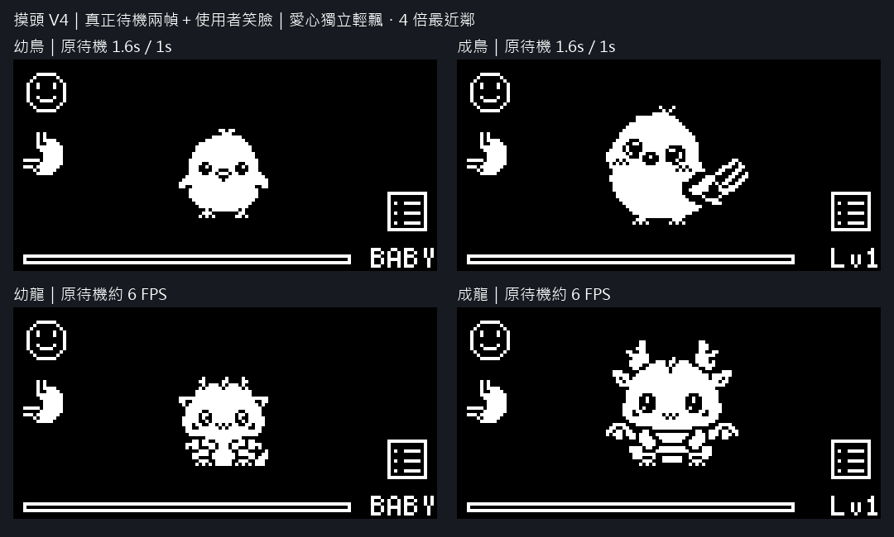
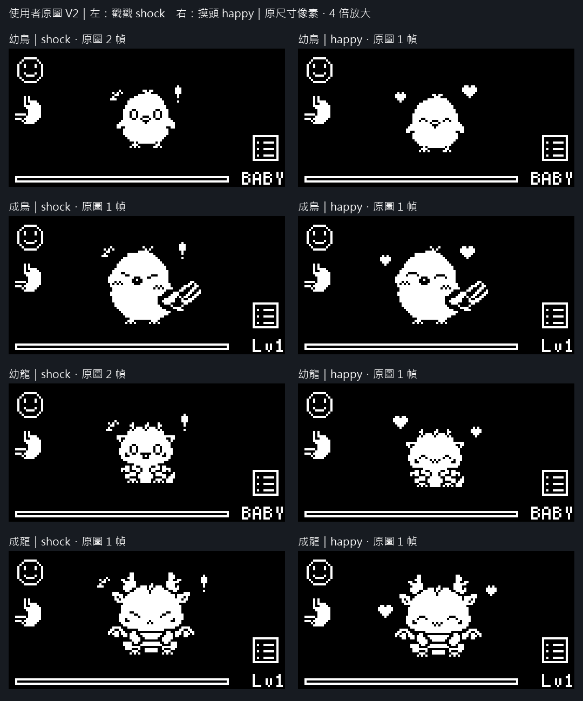
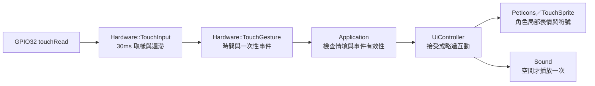
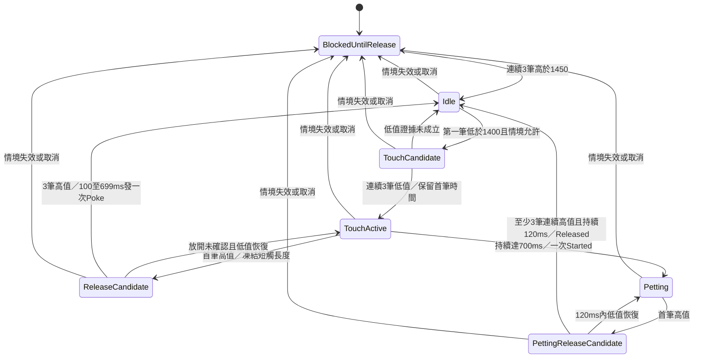
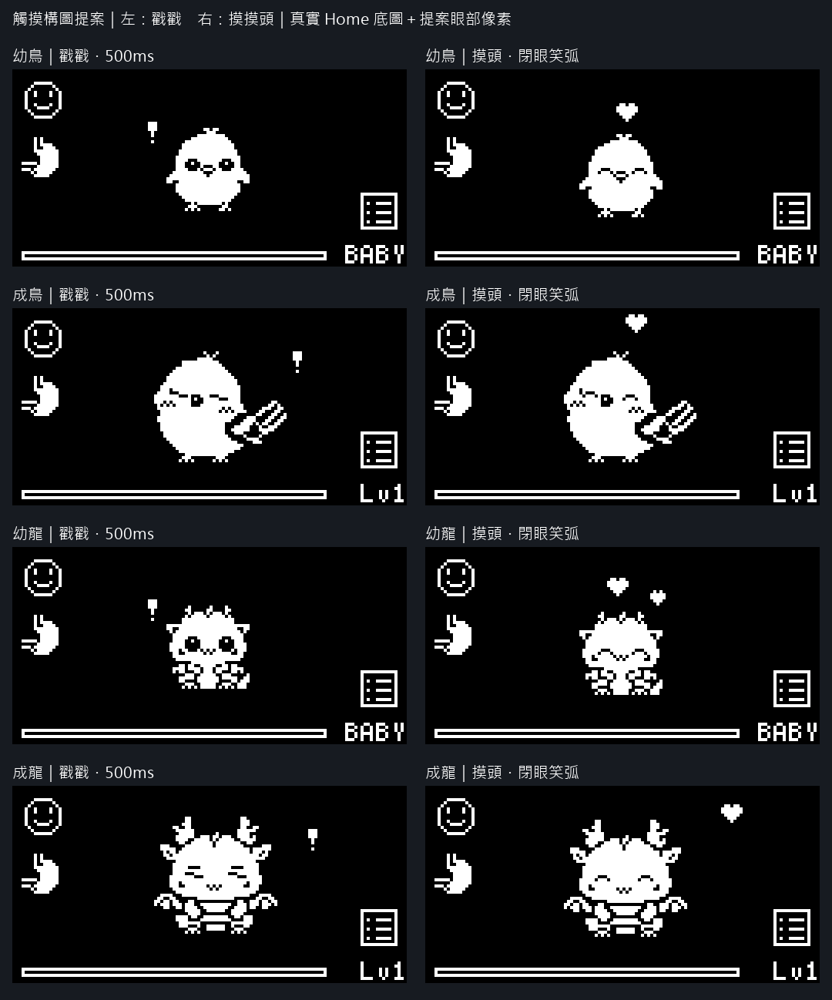

# 電容觸摸互動：第一階段分析與 OLED 提案

> 第一階段歷史快照已於`0a25af4`保存。2026-10-20使用者指示開始第二階段後，已接入工作目錄韌體；目前實作／測試／硬體待驗收狀態請看[觸摸驗收](../testing/touch-test.md)與主台帳TOUCH-P2。以下「未接入／待開始」描述保留第一階段當時的界線，不代表目前程式狀態。

建立日期：2026-10-19；核對更新：2026-10-20。觸摸偵測、互動事件、正式動畫及音效尚未接入韌體。使用者已確認V9摸頭觀感，以下以V9摸頭／V3戳戳為目前美術基準；其餘互動預設與實機效果仍待第二階段確認。本次保存第一階段文件、來源美術、預覽工具與產物；先前的既有測試／正式版建置是未加入觸摸功能的基線。本次提交核對僅重跑最新預覽及工具語法檢查，沒有操作實體裝置、燒錄或清除NVS。使用者已要求先commit；未要求push或開始第二階段。

## 最新摸頭預覽 V9：依使用者重繪圖集播放

2026-10-20 使用者重新繪製角色動作與愛心出現時機，預覽改為直接播放四份 `happy.png` 完整影格，不另加 V8 愛心 overlay 或原待機動作。每格64×44，依左到右、上到下讀取；幼鳥14幀、成鳥13幀皆5 FPS，幼龍／成龍各8幀皆7 FPS。圖集末尾無角色的透明填充格略過（幼鳥1格、成鳥2格）。整幀原像素與原點(32,6)保留，HUD沿用既有真實 C++／U8g2 framebuffer。

GIF：[幼鳥](../previews/touch-proposal/user-art-v9-authored-timing/bird-baby-happy-512x256.gif)、[成鳥](../previews/touch-proposal/user-art-v9-authored-timing/bird-adult-happy-512x256.gif)、[幼龍](../previews/touch-proposal/user-art-v9-authored-timing/wyvern-baby-happy-512x256.gif)、[成龍](../previews/touch-proposal/user-art-v9-authored-timing/wyvern-adult-happy-512x256.gif)。[原尺寸、逐幀PNG與節奏說明](../previews/touch-proposal/user-art-v9-authored-timing/README.md)。GIF以10ms計時，小飛龍用140／150ms累積捨入並保留7輪，56格／8秒平均正好7 FPS，邊界誤差小於5ms。

8份GIF逐格像素／時長回讀、來源影格順序、HUD／放大一致性通過；來源素材、正式韌體與舊預覽雜湊不變。[驗證紀錄](../previews/touch-proposal/user-art-v9-authored-timing/validation.json)。重建：`tools/render_touch_authored_timing_preview.py`。使用者回覆「終於...好多了」，確認V9觀感；這代表預覽美術確認，尚非正式韌體或硬體驗收。未新增Build／完整韌體回歸或實機驗收。V5～V8 已退役，見下節；V2～V4 保留歷史產物，部分舊工具依賴當時單幀 happy.png，不能直接套用目前多幀原圖重建。

## 已退役的 V5～V8 歷史方案

2026-10-20 文件整理：V5 時間錯位、V6 單向上飄、V7 XY 漂移及 V8 無隱藏重生均已由使用者重繪的 V9 圖集取代。依使用者同意，移除這四版的 PNG／GIF／驗證產物、V8 Piskel 匯出與五支專用工具，不再提供工作目錄內的預覽連結或重建命令。

這些版本當時只驗證預覽像素／時長，沒有代表正式韌體或硬體驗收；歷史來源仍可由第一階段 Git 快照 `0a25af4` 查閱。現行基準為上方 V9 摸頭與下方 V3 戳戳。V4 底圖仍由 V9 預覽工具使用，予以保留。

## 角色與笑臉基準 V4：原待機動作搭配 happy 笑臉

2026-10-19 追加。依使用者要求，摸頭時不再只移動一張 happy 圖，而是**沿用各角色真實 idle 的兩個姿勢，只替換臉部為使用者的 happy 笑臉**。翅膀、尾部、頭冠、身體與腳部的動作仍取自原 idle，每一幀的臉部替換區之外逐像素不變；笑臉隨臉部位置移動，整段不插入睜眼臉。第一姿勢的角色像素也與使用者 happy 原圖去除愛心後完全相同。

[靜態構圖](../previews/touch-proposal/user-art-v4/happy-idle-contact.png)・[第二個待機姿勢＋笑臉](../previews/touch-proposal/user-art-v4/happy-idle-second-pose.png)

- 小鳥兩階段均沿用待機第一幀 1600ms、第二幀 1000ms 的 2600ms 週期；第二幀笑臉隨臉部下移 1px，身體／翅膀的改變由第二張 idle 原圖提供，不以整張 happy 平移代替。
- 小飛龍兩階段均沿用約 6 FPS 的兩幀交替，保留翅膀／尾部動作。GIF 以 10ms 為精度，將六分之一秒邊界量化為 170／160／170／170／160／170ms，整輪恰一秒，與原時序的邊界差最多約 3.4ms。
- 保留使用者畫的兩顆愛心形狀及定位，每 400ms 在原位置／上移 1px 間交替，與身體幀切換分開控制。沒有額外整體平移或新的粒子效果；四組姿勢／愛心相位都確認不重疊。
- 示意 GIF 先正常待機 700ms、摸頭維持 4 秒、收尾 250ms、回到普通待機 700ms，合計 5.65 秒。**身體待機相位跨進入／退出摸頭持續推進**；摸頭區間始終為笑臉，收尾期間仍保留原動作。這是視覺預覽，未接入觸摸或正式 5 秒上限控制。
- **戳戳完全沿用 V3**，包括幼鳥／幼龍第一幀完整 500ms、第二幀復原。本次 V4 不重產或改寫任何 shock 預覽。

各角色獨立摸頭 GIF（另有原尺寸版本）：

- 幼鳥：[4 倍](../previews/touch-proposal/user-art-v4/bird-baby-happy-idle-512x256.gif)・[128×64](../previews/touch-proposal/user-art-v4/bird-baby-happy-idle-128x64.gif)。
- 成鳥：[4 倍](../previews/touch-proposal/user-art-v4/bird-adult-happy-idle-512x256.gif)・[128×64](../previews/touch-proposal/user-art-v4/bird-adult-happy-idle-128x64.gif)。
- 幼龍：[4 倍](../previews/touch-proposal/user-art-v4/wyvern-baby-happy-idle-512x256.gif)・[128×64](../previews/touch-proposal/user-art-v4/wyvern-baby-happy-idle-128x64.gif)。
- 成龍：[4 倍](../previews/touch-proposal/user-art-v4/wyvern-adult-happy-idle-512x256.gif)・[128×64](../previews/touch-proposal/user-art-v4/wyvern-adult-happy-idle-128x64.gif)。

驗證：`tools/render_touch_happy_idle_preview.py` 將 24 組真實 U8g2 畫面（每角色 2 個普通 idle＋4 個笑臉／愛心相位）逐像素核對；來源 idle 與目前正式 sprite header 相符，臉部區外的原姿勢／兩側 HUD／EXP 保留，愛心無重疊，八個獨立 GIF 及同步總覽共九個 GIF 的像素／時長回讀通過。八張來源 idle／happy PNG SHA-256 前後一致，未改原素材或正式韌體。證據：[V4 validation.json](../previews/touch-proposal/user-art-v4/validation.json)，log `.pio/touch-happy-idle-v4-preview.log`。本次未重跑韌體 Build／完整回歸，亦無新增實機驗收；仍待使用者審核，不進第二階段。

## 戳戳預覽 V3：幼年戳戳沿用成年節奏

2026-10-19 追加。依使用者回饋，幼鳥／幼龍不再 `1→2→1→2` 快速交替，也不做上下彈跳；改成與成年版相同的兩段水平位移：**shock 第一幀右移 1px 停 160ms → 同一幀回原位停 340ms → shock 第二幀回復正常**。驚訝表情完整停留 500ms，第二幀只作復原畫面，不提前插入反應中。戳戳 GIF 的前後待機展示也採第二幀，避免循環邊界跳回舊 idle 圖；此決定只適用幼年戳戳的正常復原，不改 happy 或其他現有待機流程。

- 幼鳥：[新版戳戳 GIF](../previews/touch-proposal/user-art-v3/bird-baby-shock-512x256.gif)・[原尺寸](../previews/touch-proposal/user-art-v3/bird-baby-shock-128x64.gif)・[第二幀復原 PNG](../previews/touch-proposal/user-art-v3/bird-baby-shock-recovered-128x64.png)。
- 幼龍：[新版戳戳 GIF](../previews/touch-proposal/user-art-v3/wyvern-baby-shock-512x256.gif)・[原尺寸](../previews/touch-proposal/user-art-v3/wyvern-baby-shock-128x64.gif)・[第二幀復原 PNG](../previews/touch-proposal/user-art-v3/wyvern-baby-shock-recovered-128x64.png)。
- [V3 靜態總覽](../previews/touch-proposal/user-art-v3/contact-sheet.png)・[V3 同步 GIF](../previews/touch-proposal/user-art-v3/contact-sheet.gif)。成年戳戳及全部 happy 的獨立 GIF 像素、時長與 V2 相同。

驗證：16 個反應幀及兩個幼年復原幀通過原圖／HUD／EXP 像素檢查；復原角色區逐像素等於各自 shock 圖的第二幀，八張來源 PNG 未變更。獨立 GIF 與同步總覽回讀時長／像素通過；這次只重建預覽，未改正式韌體、燒錄或追加實機驗收。證據：[V3 validation.json](../previews/touch-proposal/user-art-v3/validation.json)，log `.pio/touch-user-art-v3-preview.log`。`tools/render_touch_user_art_preview.py` 現在重建 V3；V2 產物保留供比較。

## 預覽 V2：使用者 shock／happy 原圖（幼年戳戳節奏已由 V3 取代）

2026-10-19 追加。使用者提供 `assets/pets/<species>/<stage>/shock.png`（戳戳）與 `happy.png`（摸頭），本版直接使用原圖，取代首版草圖的眼部修改及自製符號。**仍停留第一階段，只製作預覽，未整合正式韌體。** 第 4、5 節的首版美術動作、座標與素材需求保留為歷史方案，以本節 V2 為準；輸入辨識、頁面限制與無數值獎勵的提案未變。

[八組同步動畫總覽](../previews/touch-proposal/user-art-v2/contact-sheet.gif)・[戳戳逐幀分鏡](../previews/touch-proposal/user-art-v2/shock-storyboard.png)

- **幼鳥、幼龍 shock：各兩幀，64×88。** 由上到下讀取兩個 64×44 幀，播放 `1→2→1→2`，各 120／100／100／180ms，總長仍為 500ms。第一段上彈 2px，第二段回落，第三段僅上彈 1px，最後回穩；幼龍第二段另右移 1px。兩幀原像素（含第一幀的驚嘆號與左上驚訝線）完整保留，不另外重畫表情或添符號。
- **成鳥、成龍 shock：各一幀，64×44。** 同一張表情替換兩個動畫階段，保留上一版的水平 1→0px 與 160／340ms 節奏；不擅自補畫睜眼第二幀。素材已含驚嘆號與驚訝線，不重複疊加舊草圖符號。
- **四種 happy：均一幀，64×44。** 保留上一版的 400ms 兩階段節奏與角色位移：幼鳥／成鳥／幼龍為 0→1px，成龍維持下移 1px。沿用原圖眼睛、身體與兩顆愛心；只把愛心獨立出來，在原定位及上移 1px 間交替，未重畫愛心形狀。兩顆愛心與角色的逐幀最小空白為幼鳥 5px、成鳥 4px、幼龍 4px、成龍 3px，沒有交疊。

所有角色仍以 (32,6) 為基準，128×64 Home 由實際 C++ UiController／PetIcons／U8g2 繪出；使用者 PNG 逐像素疊入中央反應區，不是正式韌體截錄或實機錄影。GIF 中戳戳前 700ms 只是觀看用待機，不能解讀為短觸判定時間。摸頭示意維持 1.6 秒、收尾 250ms，持續觸摸的 5 秒上限仍未實作。

獨立 GIF（4 倍最近鄰；同資料夾另有 `128x64.gif` 原尺寸版本）：

- 幼鳥：[shock 戳戳](../previews/touch-proposal/user-art-v2/bird-baby-shock-512x256.gif)・[happy 摸頭](../previews/touch-proposal/user-art-v2/bird-baby-happy-512x256.gif)。
- 成鳥：[shock 戳戳](../previews/touch-proposal/user-art-v2/bird-adult-shock-512x256.gif)・[happy 摸頭](../previews/touch-proposal/user-art-v2/bird-adult-happy-512x256.gif)。
- 幼龍：[shock 戳戳](../previews/touch-proposal/user-art-v2/wyvern-baby-shock-512x256.gif)・[happy 摸頭](../previews/touch-proposal/user-art-v2/wyvern-baby-happy-512x256.gif)。
- 成龍：[shock 戳戳](../previews/touch-proposal/user-art-v2/wyvern-adult-shock-512x256.gif)・[happy 摸頭](../previews/touch-proposal/user-art-v2/wyvern-adult-happy-512x256.gif)。

重建：使用裝有 Pillow 的 Python 執行 `tools/render_touch_user_art_preview.py`（沿用既有 native U8g2 object；若缺少先執行 `tools/test_rps.ps1`）。本次驗證：20 個反應幀與預期原圖位移逐像素一致、HUD／底部 EXP 全像素保留、愛心未交疊；16 個獨立 GIF 和同步總覽的 OLED 區域／時長回讀通過，八張來源 PNG 執行前後 SHA-256 相同。編碼器會合併相鄰完全相同的 GIF 幀，已按合併後的總停留時間驗證，不因此縮短動畫。證據：[validation.json](../previews/touch-proposal/user-art-v2/validation.json)，暫存 log `.pio/touch-user-art-v2-preview.log`。

這次只更新美術預覽，未重跑韌體 Build／完整回歸；下方 Build／回歸數據屬先前基線，沒有新增觸摸實機驗收。下一步為使用者審核 V2 的表情、兩幀戳戳節奏與愛心小幅位移；確認前不進第二階段。

## 1. 目前程式的實際結構與整合結論

- `include/HardwareConfig.h`：OLED 使用 21／22，搖桿 34／35／26，蜂鳴器 27。全專案 GPIO 使用點未見 32；已安裝的 Arduino NodeMCU-32S variant 亦定義 `T9 = 32`。因此**目前程式配置無 GPIO32 衝突**；外殼實際配線、是否有額外未記錄接線，尚未實機核對。採使用者提供的單片內貼銅箔與固定門檻，第一版不做自動校正。
- `src/hardware/Input.cpp`：現有 `InputEvent` 只有方向、短按、長按。`Input::update()` 自取 millis，方向有主軸鎖定、900 門檻／250 回中、400ms 後每 150ms 連發；SW 有 35ms 防抖、700ms 長按和開機按住消耗。觸摸**另立模組與事件**，不塞進 SW 的 Press／LongPress，不改既有搖桿判斷。
- `src/main.cpp`：Application 持有唯一 PetData；loop 先結算 PetClock，再處理 Input → UI → UiAction → 養成／保存，最後 Sound、render、BLE、Deep Sleep。觸摸只通知 UI，不呼叫 `feed`、`treat`、`gainExp`、`changeMood` 或 `save.markDirty`，不新增存檔欄位／BLE 欄位。正常養成產生的保存／BLE 更新仍照舊。
- `src/ui/UiController.cpp`：`screen() == Home` **不足以代表閒置**。Home 同時承載 feeding_、cleaning_、treating_；careLevelUpPending_、levelUpActive_、pendingAction_ 也會佔用流程。UI 必須提供集中資格查詢，不能讓 Application 複製這些私有狀態。
- 畫面判斷已有 Boot、送別、階段變化、死亡、孵化／成長、治療、清潔、升級、一般畫面等分支；`render()` 還會以 levelUpActive_ 優先繪製慶祝。新增觸摸放在既有高優先級處理**之後**，只作 Home 中央角色的低優先級替換；高優先級出現立即取消觸摸，不改其原有先後次序。
- 傷心狀態由 UI 的 `updateSadState()` 維護：心情 ≤40 進入、≥45 恢復，飽食／清潔 ≤25 進入、≥30 恢復，生病亦納入。第一版建議 **sad_ 或生病時不啟用觸摸回饋**，保留全部現有表情及照顧提醒。這比另做簡單健康／心情門檻安全；「僅愛心安撫」保留為可選後續方案。
- `src/ui/PetIcons.cpp`：依種類／階段挑選64×44點陣。小鳥有兩格待機及由待機派生的睡眠眼皮；龍有各自睡眠素材。正式程式目前沒有觸摸表情，第二階段將轉換使用者shock／happy圖集；不使用睡眠眼皮取代摸頭表情，也不加入Zzz。
- `src/hardware/Sound.cpp`：`playSequence()` 直接替換目前音序，沒有佇列或優先級。既有 `isPlaying()` 可供低優先級觸摸採「忙碌略過、不補播」，無須第一版重寫音效排程。
- `src/power/DeepSleep.cpp`：先關閉所有喚醒源，再啟用 GPIO26 EXT0；正式版 Timer=0。**不註冊 touch interrupt／touch wakeup**。一般睡眠不接受觸摸 Wake，Deep Sleep 無主迴圈，不會因本提案喚醒。

已閱讀根 README、主企畫相關規則／進度、architecture、ui-layout-guide，以及上述模組、Display、角色生成工具、既有原生 framebuffer 測試。文件只提供導覽，整合點以程式為準。

## 2. 預計資料流與模組邊界

預計新增 `src/hardware/TouchInput.h/.cpp`（GPIO 適配）及 `TouchGesture.h/.cpp`（可注入 raw／now 的純判斷，仍屬硬體輸入層）。第一版只需一組互動狀態，不需要事件堆疊或動態配置。事件為 `None / Poke / PettingStarted / Released`，帶本次手勢 ID；取消使用明確的 `cancelUntilRelease()`，不把取消冒充正常 Released。

Application 取得 UI 的 `touchContextAllowed()`：Home、幼年／成年、清醒、未終止、無 sad_／疾病、無餵食／清潔／治療／升級含待播／待處理動作／提示或 Deep Sleep pending。UI 內部統一判斷畫面及動畫，Application 額外拒絕 deepPending。資格與「能否接受新動畫」分開：正在播放自己的摸頭不能反過來使感測資格失效；`tryStartTouchReaction()` 在忙碌時略過**新事件**，不重設現有時間戳。

建議 loop 接法：

1. PetClock 照常結算；記錄本輪 UI 情境代號，TouchInput 到期才讀一筆 raw。取樣前的資格先傳給輸入層，保證從禁用頁開始的觸碰被封鎖。
2. 現有搖桿事件先進 UI，再執行原有 UiAction 與結果 callback。任何非 None 搖桿事件均優先，取消當次觸摸手勢／反應；方向焦點仍照舊操作。
3. 重新核對 UI 資格、個體 ID、畫面情境代號與特殊流程開始／結束。若本輪發生切頁、換個體、成長、入睡或特效變化，丟棄本輪觸摸事件並封鎖到穩定放開。不能只比對迴圈結束時的 Home 布林值。
4. 對仍有效的單次事件呼叫 UI；UI 再次確認資格才啟動。UI 的 `setScreen`、照顧 callback、成長／死亡入口同步取消視覺。取消不做收尾，立即讓優先畫面接管。
5. 更新觸摸動畫幀號／dirty_，再走原有 Sound、render、BLE、Deep Sleep。觸摸不早退整個 Application loop，不停止養成秒數。

新 UI 方法／欄位名稱是設計示意，尚未加入正式 header。TouchInput 不包含 UI；UiController／PetIcons 不讀 GPIO。

## 3. 門檻、時序與狀態機

以下預設集中於未來 `HardwareConfig::Touch`：Pin=32、SampleIntervalMs=30、TouchBelow=1400、ReleaseAbove=1450、ConfirmSamples=3、MinPokeMs=100、PettingMs=700、PettingReleaseGraceMs=120、PokeAnimationMs=500、PettingMaxAnimationMs=5000、PettingTailMs=250、Debug=false。1400／1450 本身屬中間帶；只有 `<1400`／`>1450` 是新狀態的證據，中間帶維持既有遲滯狀態、不增加有效確認筆數，並中斷「連續三筆」計數。

使用者量測：未觸摸 1506～1514、A 1299～1314、B 1234～1245。門檻位於已測區間之間，但這不是已驗證的抗干擾保證，需用目前固定版本在外殼、USB／電池與不同使用者下確認。

時間計算與邊界：

- 低值出現於 0／30／60ms 時，60ms 才確認 TouchActive，但開始時間保留為 **0ms**；不是從第三筆才起算。未滿 100ms 的有效長度丟棄。
- 例：首低 0ms、首高 210ms、高值確認 210／240／270ms，270ms 發一次 Poke，分類使用 210ms。放開後確認延遲約 60～90ms；不能把這段也算進觸摸長度。
- 700ms 長觸計時可每輪用 millis 檢查，取樣仍僅每 30ms 一筆。確認 active、最新感測仍低且沒有 release candidate 時，達門檻立即發 PettingStarted，不等放開。0／30／60 確認後，正常無卡頓迴圈約在首筆低值後 700ms 開始；真實手指起落與樣本間仍有約 0～30ms 的取樣不確定性，OLED 傳輸／NVS 寫入也可能延後事件，不承諾硬即時。
- 例如首高在 690ms，即使第三筆到 750ms 才確認放開，也不能在 700ms 誤判摸頭：首高立即暫停長觸升級，最後按 690ms 發 Poke。若長迴圈缺樣，直到放開才觀察到有效長度 ≥700ms、此前卻從未確認 Started，提案採丟棄這次模糊手勢；不降級成 Poke，也不在放開後補播摸頭。第二階段以此政策建立明確邊界測試。
- **斷訊容忍採分級**：未達摸頭時只用三筆放開確認（約 60～90ms），已確定 Petting 才加 120ms 釋放寬限。這可容忍摸頭時約 100ms 的短暫斷訊，同時保留放開間隔約 100～150ms 的正常連戳。完全相同的高低序列無法同時區分「手指真的放開」與「感測中斷」；若要求短觸也合併所有 120ms 斷訊，就必然吞掉部分連戳。這是待審核的互動取捨。
- PettingReleaseCandidate 在低值恢復時優先取消釋放，使用同一手勢 ID、同一動畫起點，不重新 Started／重播音效；持續至少 120ms 且末端仍有三筆連續高值才真正 Released。中間帶不算穩定放開，也不解鎖。
- 已 Started 的長觸不論後續釋放、視覺超時或訊號恢復，永遠不能再發 Poke。摸頭動畫最多從 Started 起播放 5 秒，接 250ms 收尾；若仍按住，視覺回待機但手勢繼續鎖定直到放開。早放開則確認 Released 後接 250ms 收尾，不排隊重啟。
- 開機、SW 喚醒、進出禁用畫面、取消後，都先穩定放開才重新 armed；不在返回 Home 時接續舊的長按。一直未放開就一直封鎖，不以逾時當放開。
- `uint32_t(now-start)` 處理 millis 繞回。逾時 loop 不回補虛構的三筆相同讀值；每次實際 touchRead 才算一筆。Debug 預設關閉，可只輸出狀態變更或每秒最多一次 raw 摘要，禁止每輪 Serial。

驅動注意：本機 Arduino 的 `__touchChannelInit` 第一次配置內部有 `delay(20)`，`touchRead` 本身是同步讀取，不能聲稱零耗時。正式版應在 setup 預先呼叫一次並丟棄數值，之後才啟動取樣狀態／PetClock；我們自己的 runtime 狀態機不寫 delay，不設 touch ISR，不調整預設量測參數。此初次初始化約 20ms 是既有驅動行為，需在第二階段確認實際 loop 取樣間隔。

## 4. UI／搖桿／音效方案

第一版只對清醒、非傷心且健康的 Home 幼寵／成寵啟用。蛋、Sleeping／Deep Sleep、死亡／送別、選單／狀態頁／遊戲、照顧／成長／升級及其待播階段都封鎖到放開。原本 Home 的狀態卡焦點可以保留；任何搖桿事件優先，觸摸不阻止導航。

戳戳沿用V3共用500ms控制：同一shock反應幀先右移1px維持160ms，再回原點維持340ms。幼鳥／幼龍結束後以shock第二幀復原；成年回當前待機。新的Poke在反應／收尾期間直接消耗，不排隊、不重設起點；摸頭Started若撞上反應忙碌也消耗到放開，避免稍後突然冒出動畫。

摸頭直接播放V9使用者完整happy圖集：幼鳥14幀／成鳥13幀各5 FPS，幼龍／成龍各8幀各7 FPS，依左到右、上到下讀取並略過末尾透明填充。愛心與身體已畫在同一幀中，完全沿用原像素及時機，不另加心形overlay、相位延遲或idle動作。正式韌體按millis推進5／7 FPS；GIF的140／150ms量化只是預覽格式限制，不要求韌體照搬GIF重複幀。

UI 用 TouchReaction 狀態保存 kind、startedAt、phase、endingAt；只在幀號、結束／取消或寵物 revision 改變時設 dirty_。不改原本 idle 節奏；反應結束直接接目前時間的 idle。保留現有髒污與所有 HUD，不以觸摸暫時清除髒污或需求提示。

音效整合建議：Sound 新增 `tryPlayPoke()`／`tryPlayPetting()`，內部先檢查 `isPlaying()`，忙碌即返回 false，不排隊；仍走現有 playSequence／靜音輸出。只有 UI 接受新反應才呼叫一次。初步音序可為 Poke 1047Hz 45ms → 784Hz 55ms；Petting 659Hz 60ms → 784Hz 80ms，不循環。需要實聽審核，尚未寫入程式。

現有高優先音可照舊覆蓋低優先觸摸音，不讓觸摸音覆蓋別人。同一輪 UI 先服務疾病／照顧提示及特殊事件，再嘗試觸摸音。取消視覺時不要無條件 stopTone，避免誤停剛啟動的高優先音；短觸摸音最多 140ms 可自然結束。若要精準只停止自己的音序，再評估音效 owner token，第一版不需全面優先級佇列。

## 5. 首版草圖與素材需求（歷史方案，目前採V3戳戳／V9摸頭）

上圖左戳戳、右摸頭，上至下為幼鳥、成鳥、幼龍、成龍。原尺寸全部為 128×64、黑白 1-bit 像素；放大版為最近鄰 4 倍。底圖是**現有正式 C++ UiController／PetIcons／U8g2** 的 Home 輸出；反應是獨立預覽程式的局部眼部提案及位移，**不是已實作觸摸 UI，也不是實機錄影**。上方標題和角色標籤只屬比較圖，不進 OLED。

所有角色基準原點 (32,6)，畫布 64×44。以下符號座標均為 OLED 絕對座標，矩形範圍包含黑色留白：

- **幼鳥**：Poke 上彈 2→1px，眼睛睜圓，`!` (44,17,3,7)；Petting 笑弧眼，身體 0→1px，小愛心 (62,11,7,7)，第二格向上 1px。
- **成鳥**：Poke 水平 1→0px、快速眨眼再睜眼，`!` (91,14,3,7)；Petting 笑弧眼，輕微 0→1px，愛心 (65,2,7,7)，第二格向上 1px。歪頭以輕微移動暗示，未旋轉原圖。
- **幼龍**：Poke 上彈及水平 0→1px、眼睛突然放大，`!` (44,17,3,7)；Petting 閉眼、0→1px 輕動，兩顆愛心 (59,10,7,7) 與 (73,14,5,5)，第二格向上 1px。
- **成龍**：Poke 水平 1→0px、瞇眼加短眉，`!` (96,14,3,7)；Petting 閉眼下沉 1px，愛心 (96,6,7,7)，第二格向上 1px。愛心改放右上方，避開龍角，不硬擠頭頂。

第一版不必新增整張 PNG。預計新增 `src/ui/TouchSprite.h`：四種角色各一組局部眼部遮罩／替換像素，以及共用 7×7、5×5 愛心與 3×7 驚嘆號；位移與幀時長用同一控制器及角色配置。每種 Poke 兩個眼部關鍵幀、Petting 一組笑弧眼可配兩格位移；頭冠、龍角、嘴、身形與翅膀沿用原素材。若需美術手修，需求為每角色 Poke 64×88（兩格 64×44）及 Petting 64×88，共八張圖集，須先審核才建立 canonical 資產，不以這份提案自動替換原圖。

### 動態預覽（每項附 4 倍與原尺寸）

- 幼鳥：[戳戳](../previews/touch-proposal/bird-baby-poke-512x256.gif)／[原尺寸](../previews/touch-proposal/bird-baby-poke-128x64.gif)；[摸頭](../previews/touch-proposal/bird-baby-petting-512x256.gif)／[原尺寸](../previews/touch-proposal/bird-baby-petting-128x64.gif)。
- 成鳥：[戳戳](../previews/touch-proposal/bird-adult-poke-512x256.gif)／[原尺寸](../previews/touch-proposal/bird-adult-poke-128x64.gif)；[摸頭](../previews/touch-proposal/bird-adult-petting-512x256.gif)／[原尺寸](../previews/touch-proposal/bird-adult-petting-128x64.gif)。
- 幼龍：[戳戳](../previews/touch-proposal/wyvern-baby-poke-512x256.gif)／[原尺寸](../previews/touch-proposal/wyvern-baby-poke-128x64.gif)；[摸頭](../previews/touch-proposal/wyvern-baby-petting-512x256.gif)／[原尺寸](../previews/touch-proposal/wyvern-baby-petting-128x64.gif)。
- 成龍：[戳戳](../previews/touch-proposal/wyvern-adult-poke-512x256.gif)／[原尺寸](../previews/touch-proposal/wyvern-adult-poke-128x64.gif)；[摸頭](../previews/touch-proposal/wyvern-adult-petting-512x256.gif)／[原尺寸](../previews/touch-proposal/wyvern-adult-petting-128x64.gif)。

GIF 是節奏／構圖示意，沒有模擬手指或感測波形。Poke 的前 700ms 是留給觀看的待機，不代表「按住 700ms 還判成短觸」；反應本體恰 500ms。Petting 示意進入後約 1.6 秒維持、250ms 收尾，5 秒上限將在正式整合測試，這份 GIF 不作上限驗證。

## 6. 風險與第二階段驗證方案

**感測風險**：銅箔／外殼厚度、手握位置、濕度、USB／電池供電會影響 raw，固定門檻先以實測驗收。測試人 A／B 的兩組數據來自使用者，本輪未重新測量。持續低值／斷線異常不能造成連播；初始化不成功或不合理 raw（例如 0）應取消並封鎖，記錄限頻錯誤，不把故障當長按。合理 raw 範圍需以實機資料確認，不能任意設得太窄排除其他人。

**時間風險**：同步 OLED 傳輸、NVS、BLE 可能造成取樣抖動；實機記錄最大／平均取樣間隔，不用同值回填確認筆數。100／699／700ms 是演算法邊界，物理手勢無法毫秒級精準對照。先測合成序列，再測較明確的 200～400ms 短觸與 1～3 秒長觸。

**自動測試（待正式實作）**：

1. TouchGesture 注入 raw／now：空閒、A／B 序列、1399／1400／1450／1451、三筆連續要求、中間帶重置計數、單／雙筆雜訊、99／100／699／700ms、短觸放開防抖不灌長度、690ms 開始放開不變摸頭。
2. 長按 10 秒只有一個 Started；放開只有一個 Released 且零 Poke；Petting 中 90／120／150ms 高值缺口依寬限處理。短觸間隔 90／120／150ms 可分開辨識；反應忙碌時略過、不重設、不堆疊。
3. 未允許頁開始按住→回 Home 仍不觸發；開機／醒來已按住；頁面離開又返回、個體更換、死亡、成長、照顧開始／結束、同輪導航與觸摸衝突；全部取消到穩定放開。測 millis 繞回、長 loop、缺樣、不合理 raw。
4. 真實 UiController＋U8g2：四角色各幀、5 秒上限、250ms 收尾、dirty_ 僅必要更新、Home 焦點、可互動但略髒時既有污漬保留；心情／健康在途中變化立即讓原表情接管；不覆蓋生病／傷心／清潔／治療／餵食／成長／升級／死亡。
5. 使用真實 Sound 測新音序：忙碌略過、靜音仍計時、高優先音中途接管、不重播；回歸記憶音符 `isPlaying()` 完成等待。養成照常前進，觸摸前後比較扣除自然時間後的快照，不新增心情／EXP／保存／BLE 事件。
6. 跑 `tools/test_rps.ps1` 及新增 Touch 測試，Build `esp32dev` 和相關 Deep Sleep／固定角色測試環境；不改 NVS／BLE 格式，不自動燒錄。

**實機驗收（待另行允許燒錄後）**：

1. 核對 GPIO32 銅箔接線及現有腳位；相同外殼下 A／B 各測未觸摸至少 5 分鐘、20 次 200～400ms 短觸、10 次 1～3 秒摸頭。記錄版本、供電、raw 範圍、漏判／誤判及取樣間隔。
2. 四種角色逐一看原尺寸 OLED：Poke 約半秒、Petting 在未放開前開始、放開收尾、長按超過 5 秒不重啟，角／翅／愛心／!／兩側圖示／EXP 無遮擋。
3. 連戳、邊緣／滑動觸摸、門檻附近波動、長按中暫離、動畫中搖桿導航；返回 Home 前持續按住，必須先放開才能重新互動。
4. 蛋、傷心、生病、一般睡眠、Deep Sleep、治療、清潔、餵食、遊戲、成長／升級、死亡／送別逐項拒絕或優先接管；觸摸不喚醒睡眠。靜音及有聲各檢查一次，確認提醒／升級音不被截斷。
5. 回歸搖桿、兩個遊戲、普通重啟保存、一般／Deep Sleep、BLE 讀取／通知。測試使用獨立 namespace 仍共享 NVS 空間，先確認餘量；不以清除存檔作測試前提。

## 7. 本輪實際驗證與審核項目

- `tools/test_rps.ps1`：既有原生回歸全部通過，含真實 UI、兩角色種類、心情、音效、存檔退避等；紀錄 `.pio/touch-phase1-native-tests.log`。保留原有測試編譯的格式截斷警告，不改無關測試。
- `pio run -e esp32dev`：基線 Build 通過，Flash 735,341／1,310,720 bytes、RAM 54,540／327,680 bytes；紀錄 `.pio/touch-phase1-build.log`。第一次受 sandbox 的 platforms.lock 權限限制，取得建置快取權限後重跑成功，未刪鎖檔。這些是**未加入觸摸功能的既有韌體**數字，不能拿來推定新增容量。
- `tools/render_touch_proposal.py`：16 個提案反應幀逐像素檢查通過；局部修改限於眼部矩形，愛心／! 與角色均至少留兩個空白像素，反應亮點全在 x=20..108／y=0..54。兩側 x<20、x≥109 與底部 y≥55 全像素保持原 Home；狀態卡焦點範圍也可完整保留。16 個原尺寸／放大 GIF 檔的每幀像素與時長回讀核對通過。見 [驗證資料](../previews/touch-proposal/validation.json)。
- 本輪目視檢查四角色總覽與每個反應關鍵幀，未遮住角色角、翅膀或 HUD；原尺寸可辨識度與實體 OLED 動畫節奏仍待人類審核／後續實機驗收。
- 舊 `tools/test_wasi.py` 因目前 checkout 缺其 Zig 工具路徑而未啟動測試；本輪改用現有 gcc/g++ 的正式原生回歸成功，沒有安裝工具或變更系統設定。

重建預覽：先執行 `tools/test_rps.ps1`，再用裝有 Pillow 的 Python 執行 `python tools/render_touch_proposal.py`；本輪使用 Codex bundled Python（Pillow 12.3.0），PATH 上的 MSYS Python 未裝 Pillow。C++ 暫存輸出只在 `.pio/touch-proposal/`，正式預覽在 `docs/previews/touch-proposal/`。

2026-10-20核對後的決定與待定項目：

1. 美術已改採使用者重繪的V9摸頭／V3戳戳，V9觀感已獲確認；不再使用首版局部眼部草圖或V4～V8的摸頭疊加方案。
2. 是否採用「短觸只做三筆防抖，已摸頭才容忍 120ms 斷訊」？這保留連戳辨識，但短觸期間較長的高值缺口會視為真正放開。
3. 第一版傷心／生病完全不反應，還是另做**只顯示愛心、原臉不變**的安撫版本？本預覽採前者，未替後者做核准構圖。
4. 是否接受摸頭從開始反應起最多 5 秒、放開／到期後 250ms 收尾，以及每次互動僅一次短音、忙碌略過？

**目前先提交第一階段成果；未開始正式Touch模組、UI／Sound／HardwareConfig整合。待使用者指示開始第二階段，再處理上述互動預設、實作及驗收。**
