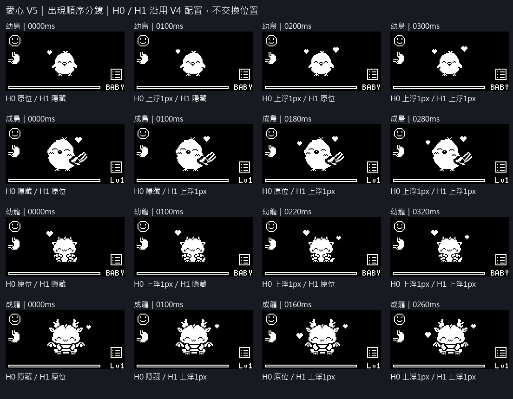
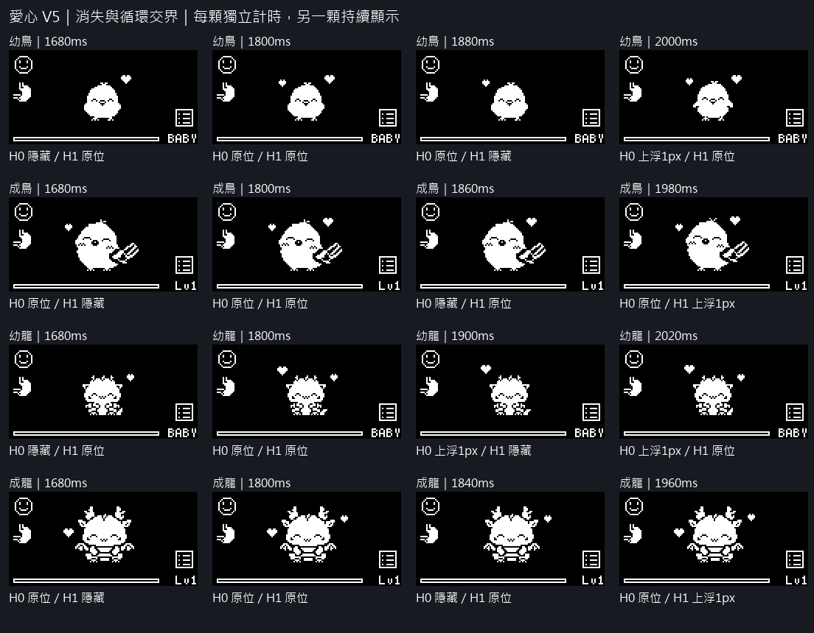
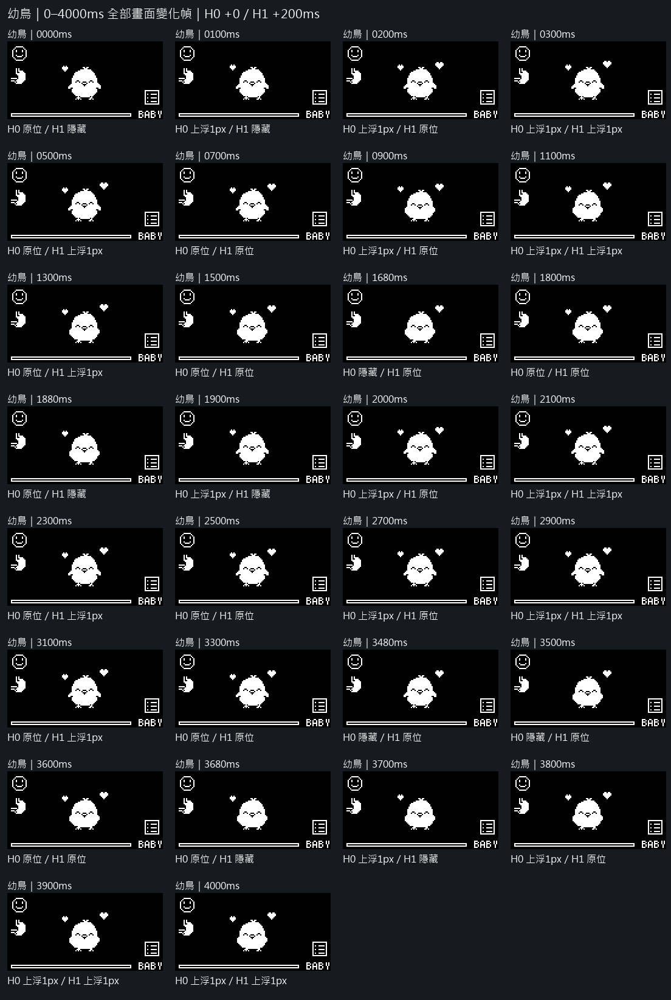
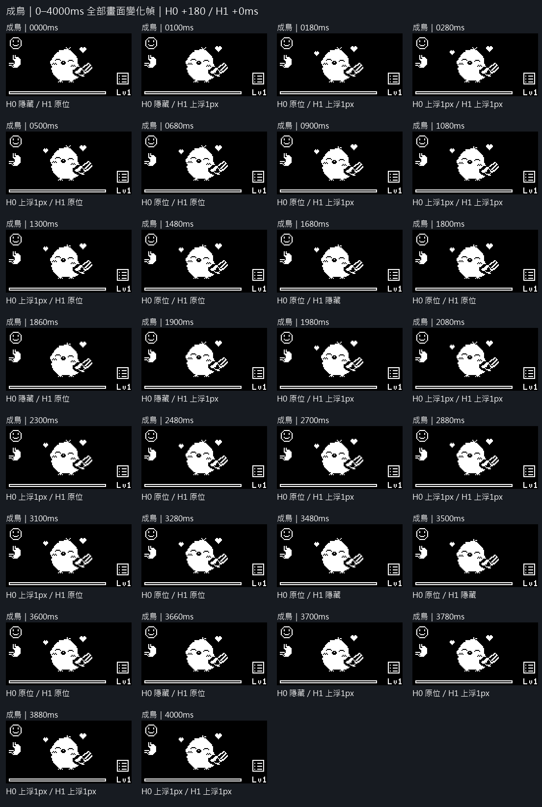
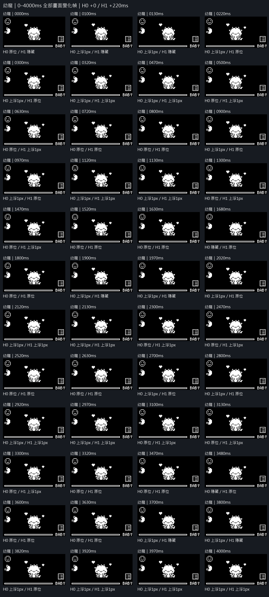
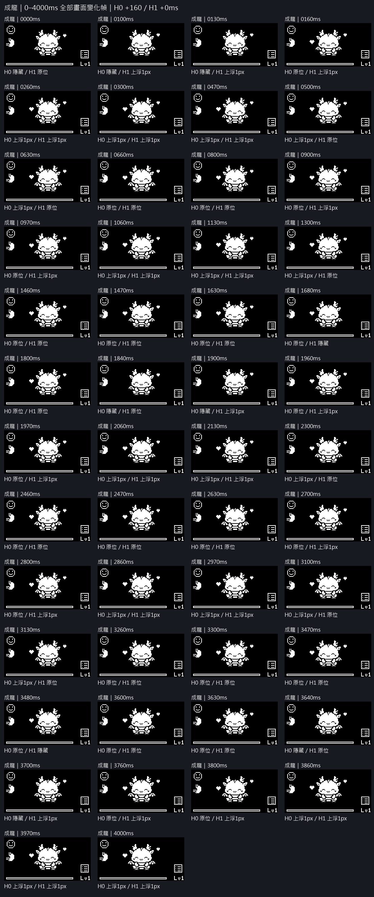

# 摸頭愛心 V5：時間錯位 PNG 提案（2026-10-20）

只調整 V4 愛心時間，角色閉眼表情、真實待機動作、HUD、愛心像素／大小／初始座標全部沿用。尚未修改正式韌體，未新增實機驗收。

## 時間安排

- 幼鳥：H0 左小愛心 0ms；H1 右大愛心 +200ms。
- 成鳥：H1 右大愛心 0ms；H0 左小愛心 +180ms。
- 幼龍：H0 左大愛心 0ms；H1 右小愛心 +220ms。
- 成龍：H1 右小愛心 0ms；H0 左大愛心 +160ms。

H0／H1 僅是 V4 配置中的固定識別碼，不按大小或左右排序決定誰先出現；這次沒有交換兩顆愛心。0ms 是開始摸頭回饋的時間，角色的待機相位沿用 V4。

每顆各自從出現時刻開始計時：0–99ms 原位；100–499ms 上移 1px；500–899ms 原位；900–1299ms 上移 1px；1300–1679ms 原位；1680–1799ms 隱藏，1800ms 開始下一輪。保持原有兩個位置，沒有新增位移、縮放、旋轉或粒子。

後出者的時鐘獨立延遲 160／180／200／220ms，並在後續每輪保持這個時間差。第一顆在 100ms 開始上浮，第二顆之後才從原定位出現；隱藏各 120ms 的區間互不重疊，因此連續摸頭沒有兩顆同步清空。單顆在隱藏期間回到初始相位，另一顆繼續自身進度。

## 分鏡 PNG

## 全部逐幀 PNG

共 158 個時間點，每個有 128×64 原尺寸及 512×256 最近鄰版本。包含 0–4000ms 所有愛心／身體幀變化事件及終點；各圖標示的 H0／H1 狀態與時間只在比較分鏡中，不畫進 OLED。

### 幼鳥

原尺寸獨立 PNG：

- [0ms](bird-baby/frame-000-0000ms-128x64.png)・[4 倍](bird-baby/frame-000-0000ms-512x256.png)
- [100ms](bird-baby/frame-001-0100ms-128x64.png)・[4 倍](bird-baby/frame-001-0100ms-512x256.png)
- [200ms](bird-baby/frame-002-0200ms-128x64.png)・[4 倍](bird-baby/frame-002-0200ms-512x256.png)
- [300ms](bird-baby/frame-003-0300ms-128x64.png)・[4 倍](bird-baby/frame-003-0300ms-512x256.png)
- [500ms](bird-baby/frame-004-0500ms-128x64.png)・[4 倍](bird-baby/frame-004-0500ms-512x256.png)
- [700ms](bird-baby/frame-005-0700ms-128x64.png)・[4 倍](bird-baby/frame-005-0700ms-512x256.png)
- [900ms](bird-baby/frame-006-0900ms-128x64.png)・[4 倍](bird-baby/frame-006-0900ms-512x256.png)
- [1100ms](bird-baby/frame-007-1100ms-128x64.png)・[4 倍](bird-baby/frame-007-1100ms-512x256.png)
- [1300ms](bird-baby/frame-008-1300ms-128x64.png)・[4 倍](bird-baby/frame-008-1300ms-512x256.png)
- [1500ms](bird-baby/frame-009-1500ms-128x64.png)・[4 倍](bird-baby/frame-009-1500ms-512x256.png)
- [1680ms](bird-baby/frame-010-1680ms-128x64.png)・[4 倍](bird-baby/frame-010-1680ms-512x256.png)
- [1800ms](bird-baby/frame-011-1800ms-128x64.png)・[4 倍](bird-baby/frame-011-1800ms-512x256.png)
- [1880ms](bird-baby/frame-012-1880ms-128x64.png)・[4 倍](bird-baby/frame-012-1880ms-512x256.png)
- [1900ms](bird-baby/frame-013-1900ms-128x64.png)・[4 倍](bird-baby/frame-013-1900ms-512x256.png)
- [2000ms](bird-baby/frame-014-2000ms-128x64.png)・[4 倍](bird-baby/frame-014-2000ms-512x256.png)
- [2100ms](bird-baby/frame-015-2100ms-128x64.png)・[4 倍](bird-baby/frame-015-2100ms-512x256.png)
- [2300ms](bird-baby/frame-016-2300ms-128x64.png)・[4 倍](bird-baby/frame-016-2300ms-512x256.png)
- [2500ms](bird-baby/frame-017-2500ms-128x64.png)・[4 倍](bird-baby/frame-017-2500ms-512x256.png)
- [2700ms](bird-baby/frame-018-2700ms-128x64.png)・[4 倍](bird-baby/frame-018-2700ms-512x256.png)
- [2900ms](bird-baby/frame-019-2900ms-128x64.png)・[4 倍](bird-baby/frame-019-2900ms-512x256.png)
- [3100ms](bird-baby/frame-020-3100ms-128x64.png)・[4 倍](bird-baby/frame-020-3100ms-512x256.png)
- [3300ms](bird-baby/frame-021-3300ms-128x64.png)・[4 倍](bird-baby/frame-021-3300ms-512x256.png)
- [3480ms](bird-baby/frame-022-3480ms-128x64.png)・[4 倍](bird-baby/frame-022-3480ms-512x256.png)
- [3500ms](bird-baby/frame-023-3500ms-128x64.png)・[4 倍](bird-baby/frame-023-3500ms-512x256.png)
- [3600ms](bird-baby/frame-024-3600ms-128x64.png)・[4 倍](bird-baby/frame-024-3600ms-512x256.png)
- [3680ms](bird-baby/frame-025-3680ms-128x64.png)・[4 倍](bird-baby/frame-025-3680ms-512x256.png)
- [3700ms](bird-baby/frame-026-3700ms-128x64.png)・[4 倍](bird-baby/frame-026-3700ms-512x256.png)
- [3800ms](bird-baby/frame-027-3800ms-128x64.png)・[4 倍](bird-baby/frame-027-3800ms-512x256.png)
- [3900ms](bird-baby/frame-028-3900ms-128x64.png)・[4 倍](bird-baby/frame-028-3900ms-512x256.png)
- [4000ms](bird-baby/frame-029-4000ms-128x64.png)・[4 倍](bird-baby/frame-029-4000ms-512x256.png)

### 成鳥

原尺寸獨立 PNG：

- [0ms](bird-adult/frame-000-0000ms-128x64.png)・[4 倍](bird-adult/frame-000-0000ms-512x256.png)
- [100ms](bird-adult/frame-001-0100ms-128x64.png)・[4 倍](bird-adult/frame-001-0100ms-512x256.png)
- [180ms](bird-adult/frame-002-0180ms-128x64.png)・[4 倍](bird-adult/frame-002-0180ms-512x256.png)
- [280ms](bird-adult/frame-003-0280ms-128x64.png)・[4 倍](bird-adult/frame-003-0280ms-512x256.png)
- [500ms](bird-adult/frame-004-0500ms-128x64.png)・[4 倍](bird-adult/frame-004-0500ms-512x256.png)
- [680ms](bird-adult/frame-005-0680ms-128x64.png)・[4 倍](bird-adult/frame-005-0680ms-512x256.png)
- [900ms](bird-adult/frame-006-0900ms-128x64.png)・[4 倍](bird-adult/frame-006-0900ms-512x256.png)
- [1080ms](bird-adult/frame-007-1080ms-128x64.png)・[4 倍](bird-adult/frame-007-1080ms-512x256.png)
- [1300ms](bird-adult/frame-008-1300ms-128x64.png)・[4 倍](bird-adult/frame-008-1300ms-512x256.png)
- [1480ms](bird-adult/frame-009-1480ms-128x64.png)・[4 倍](bird-adult/frame-009-1480ms-512x256.png)
- [1680ms](bird-adult/frame-010-1680ms-128x64.png)・[4 倍](bird-adult/frame-010-1680ms-512x256.png)
- [1800ms](bird-adult/frame-011-1800ms-128x64.png)・[4 倍](bird-adult/frame-011-1800ms-512x256.png)
- [1860ms](bird-adult/frame-012-1860ms-128x64.png)・[4 倍](bird-adult/frame-012-1860ms-512x256.png)
- [1900ms](bird-adult/frame-013-1900ms-128x64.png)・[4 倍](bird-adult/frame-013-1900ms-512x256.png)
- [1980ms](bird-adult/frame-014-1980ms-128x64.png)・[4 倍](bird-adult/frame-014-1980ms-512x256.png)
- [2080ms](bird-adult/frame-015-2080ms-128x64.png)・[4 倍](bird-adult/frame-015-2080ms-512x256.png)
- [2300ms](bird-adult/frame-016-2300ms-128x64.png)・[4 倍](bird-adult/frame-016-2300ms-512x256.png)
- [2480ms](bird-adult/frame-017-2480ms-128x64.png)・[4 倍](bird-adult/frame-017-2480ms-512x256.png)
- [2700ms](bird-adult/frame-018-2700ms-128x64.png)・[4 倍](bird-adult/frame-018-2700ms-512x256.png)
- [2880ms](bird-adult/frame-019-2880ms-128x64.png)・[4 倍](bird-adult/frame-019-2880ms-512x256.png)
- [3100ms](bird-adult/frame-020-3100ms-128x64.png)・[4 倍](bird-adult/frame-020-3100ms-512x256.png)
- [3280ms](bird-adult/frame-021-3280ms-128x64.png)・[4 倍](bird-adult/frame-021-3280ms-512x256.png)
- [3480ms](bird-adult/frame-022-3480ms-128x64.png)・[4 倍](bird-adult/frame-022-3480ms-512x256.png)
- [3500ms](bird-adult/frame-023-3500ms-128x64.png)・[4 倍](bird-adult/frame-023-3500ms-512x256.png)
- [3600ms](bird-adult/frame-024-3600ms-128x64.png)・[4 倍](bird-adult/frame-024-3600ms-512x256.png)
- [3660ms](bird-adult/frame-025-3660ms-128x64.png)・[4 倍](bird-adult/frame-025-3660ms-512x256.png)
- [3700ms](bird-adult/frame-026-3700ms-128x64.png)・[4 倍](bird-adult/frame-026-3700ms-512x256.png)
- [3780ms](bird-adult/frame-027-3780ms-128x64.png)・[4 倍](bird-adult/frame-027-3780ms-512x256.png)
- [3880ms](bird-adult/frame-028-3880ms-128x64.png)・[4 倍](bird-adult/frame-028-3880ms-512x256.png)
- [4000ms](bird-adult/frame-029-4000ms-128x64.png)・[4 倍](bird-adult/frame-029-4000ms-512x256.png)

### 幼龍

原尺寸獨立 PNG：

- [0ms](wyvern-baby/frame-000-0000ms-128x64.png)・[4 倍](wyvern-baby/frame-000-0000ms-512x256.png)
- [100ms](wyvern-baby/frame-001-0100ms-128x64.png)・[4 倍](wyvern-baby/frame-001-0100ms-512x256.png)
- [130ms](wyvern-baby/frame-002-0130ms-128x64.png)・[4 倍](wyvern-baby/frame-002-0130ms-512x256.png)
- [220ms](wyvern-baby/frame-003-0220ms-128x64.png)・[4 倍](wyvern-baby/frame-003-0220ms-512x256.png)
- [300ms](wyvern-baby/frame-004-0300ms-128x64.png)・[4 倍](wyvern-baby/frame-004-0300ms-512x256.png)
- [320ms](wyvern-baby/frame-005-0320ms-128x64.png)・[4 倍](wyvern-baby/frame-005-0320ms-512x256.png)
- [470ms](wyvern-baby/frame-006-0470ms-128x64.png)・[4 倍](wyvern-baby/frame-006-0470ms-512x256.png)
- [500ms](wyvern-baby/frame-007-0500ms-128x64.png)・[4 倍](wyvern-baby/frame-007-0500ms-512x256.png)
- [630ms](wyvern-baby/frame-008-0630ms-128x64.png)・[4 倍](wyvern-baby/frame-008-0630ms-512x256.png)
- [720ms](wyvern-baby/frame-009-0720ms-128x64.png)・[4 倍](wyvern-baby/frame-009-0720ms-512x256.png)
- [800ms](wyvern-baby/frame-010-0800ms-128x64.png)・[4 倍](wyvern-baby/frame-010-0800ms-512x256.png)
- [900ms](wyvern-baby/frame-011-0900ms-128x64.png)・[4 倍](wyvern-baby/frame-011-0900ms-512x256.png)
- [970ms](wyvern-baby/frame-012-0970ms-128x64.png)・[4 倍](wyvern-baby/frame-012-0970ms-512x256.png)
- [1120ms](wyvern-baby/frame-013-1120ms-128x64.png)・[4 倍](wyvern-baby/frame-013-1120ms-512x256.png)
- [1130ms](wyvern-baby/frame-014-1130ms-128x64.png)・[4 倍](wyvern-baby/frame-014-1130ms-512x256.png)
- [1300ms](wyvern-baby/frame-015-1300ms-128x64.png)・[4 倍](wyvern-baby/frame-015-1300ms-512x256.png)
- [1470ms](wyvern-baby/frame-016-1470ms-128x64.png)・[4 倍](wyvern-baby/frame-016-1470ms-512x256.png)
- [1520ms](wyvern-baby/frame-017-1520ms-128x64.png)・[4 倍](wyvern-baby/frame-017-1520ms-512x256.png)
- [1630ms](wyvern-baby/frame-018-1630ms-128x64.png)・[4 倍](wyvern-baby/frame-018-1630ms-512x256.png)
- [1680ms](wyvern-baby/frame-019-1680ms-128x64.png)・[4 倍](wyvern-baby/frame-019-1680ms-512x256.png)
- [1800ms](wyvern-baby/frame-020-1800ms-128x64.png)・[4 倍](wyvern-baby/frame-020-1800ms-512x256.png)
- [1900ms](wyvern-baby/frame-021-1900ms-128x64.png)・[4 倍](wyvern-baby/frame-021-1900ms-512x256.png)
- [1970ms](wyvern-baby/frame-022-1970ms-128x64.png)・[4 倍](wyvern-baby/frame-022-1970ms-512x256.png)
- [2020ms](wyvern-baby/frame-023-2020ms-128x64.png)・[4 倍](wyvern-baby/frame-023-2020ms-512x256.png)
- [2120ms](wyvern-baby/frame-024-2120ms-128x64.png)・[4 倍](wyvern-baby/frame-024-2120ms-512x256.png)
- [2130ms](wyvern-baby/frame-025-2130ms-128x64.png)・[4 倍](wyvern-baby/frame-025-2130ms-512x256.png)
- [2300ms](wyvern-baby/frame-026-2300ms-128x64.png)・[4 倍](wyvern-baby/frame-026-2300ms-512x256.png)
- [2470ms](wyvern-baby/frame-027-2470ms-128x64.png)・[4 倍](wyvern-baby/frame-027-2470ms-512x256.png)
- [2520ms](wyvern-baby/frame-028-2520ms-128x64.png)・[4 倍](wyvern-baby/frame-028-2520ms-512x256.png)
- [2630ms](wyvern-baby/frame-029-2630ms-128x64.png)・[4 倍](wyvern-baby/frame-029-2630ms-512x256.png)
- [2700ms](wyvern-baby/frame-030-2700ms-128x64.png)・[4 倍](wyvern-baby/frame-030-2700ms-512x256.png)
- [2800ms](wyvern-baby/frame-031-2800ms-128x64.png)・[4 倍](wyvern-baby/frame-031-2800ms-512x256.png)
- [2920ms](wyvern-baby/frame-032-2920ms-128x64.png)・[4 倍](wyvern-baby/frame-032-2920ms-512x256.png)
- [2970ms](wyvern-baby/frame-033-2970ms-128x64.png)・[4 倍](wyvern-baby/frame-033-2970ms-512x256.png)
- [3100ms](wyvern-baby/frame-034-3100ms-128x64.png)・[4 倍](wyvern-baby/frame-034-3100ms-512x256.png)
- [3130ms](wyvern-baby/frame-035-3130ms-128x64.png)・[4 倍](wyvern-baby/frame-035-3130ms-512x256.png)
- [3300ms](wyvern-baby/frame-036-3300ms-128x64.png)・[4 倍](wyvern-baby/frame-036-3300ms-512x256.png)
- [3320ms](wyvern-baby/frame-037-3320ms-128x64.png)・[4 倍](wyvern-baby/frame-037-3320ms-512x256.png)
- [3470ms](wyvern-baby/frame-038-3470ms-128x64.png)・[4 倍](wyvern-baby/frame-038-3470ms-512x256.png)
- [3480ms](wyvern-baby/frame-039-3480ms-128x64.png)・[4 倍](wyvern-baby/frame-039-3480ms-512x256.png)
- [3600ms](wyvern-baby/frame-040-3600ms-128x64.png)・[4 倍](wyvern-baby/frame-040-3600ms-512x256.png)
- [3630ms](wyvern-baby/frame-041-3630ms-128x64.png)・[4 倍](wyvern-baby/frame-041-3630ms-512x256.png)
- [3700ms](wyvern-baby/frame-042-3700ms-128x64.png)・[4 倍](wyvern-baby/frame-042-3700ms-512x256.png)
- [3800ms](wyvern-baby/frame-043-3800ms-128x64.png)・[4 倍](wyvern-baby/frame-043-3800ms-512x256.png)
- [3820ms](wyvern-baby/frame-044-3820ms-128x64.png)・[4 倍](wyvern-baby/frame-044-3820ms-512x256.png)
- [3920ms](wyvern-baby/frame-045-3920ms-128x64.png)・[4 倍](wyvern-baby/frame-045-3920ms-512x256.png)
- [3970ms](wyvern-baby/frame-046-3970ms-128x64.png)・[4 倍](wyvern-baby/frame-046-3970ms-512x256.png)
- [4000ms](wyvern-baby/frame-047-4000ms-128x64.png)・[4 倍](wyvern-baby/frame-047-4000ms-512x256.png)

### 成龍

原尺寸獨立 PNG：

- [0ms](wyvern-adult/frame-000-0000ms-128x64.png)・[4 倍](wyvern-adult/frame-000-0000ms-512x256.png)
- [100ms](wyvern-adult/frame-001-0100ms-128x64.png)・[4 倍](wyvern-adult/frame-001-0100ms-512x256.png)
- [130ms](wyvern-adult/frame-002-0130ms-128x64.png)・[4 倍](wyvern-adult/frame-002-0130ms-512x256.png)
- [160ms](wyvern-adult/frame-003-0160ms-128x64.png)・[4 倍](wyvern-adult/frame-003-0160ms-512x256.png)
- [260ms](wyvern-adult/frame-004-0260ms-128x64.png)・[4 倍](wyvern-adult/frame-004-0260ms-512x256.png)
- [300ms](wyvern-adult/frame-005-0300ms-128x64.png)・[4 倍](wyvern-adult/frame-005-0300ms-512x256.png)
- [470ms](wyvern-adult/frame-006-0470ms-128x64.png)・[4 倍](wyvern-adult/frame-006-0470ms-512x256.png)
- [500ms](wyvern-adult/frame-007-0500ms-128x64.png)・[4 倍](wyvern-adult/frame-007-0500ms-512x256.png)
- [630ms](wyvern-adult/frame-008-0630ms-128x64.png)・[4 倍](wyvern-adult/frame-008-0630ms-512x256.png)
- [660ms](wyvern-adult/frame-009-0660ms-128x64.png)・[4 倍](wyvern-adult/frame-009-0660ms-512x256.png)
- [800ms](wyvern-adult/frame-010-0800ms-128x64.png)・[4 倍](wyvern-adult/frame-010-0800ms-512x256.png)
- [900ms](wyvern-adult/frame-011-0900ms-128x64.png)・[4 倍](wyvern-adult/frame-011-0900ms-512x256.png)
- [970ms](wyvern-adult/frame-012-0970ms-128x64.png)・[4 倍](wyvern-adult/frame-012-0970ms-512x256.png)
- [1060ms](wyvern-adult/frame-013-1060ms-128x64.png)・[4 倍](wyvern-adult/frame-013-1060ms-512x256.png)
- [1130ms](wyvern-adult/frame-014-1130ms-128x64.png)・[4 倍](wyvern-adult/frame-014-1130ms-512x256.png)
- [1300ms](wyvern-adult/frame-015-1300ms-128x64.png)・[4 倍](wyvern-adult/frame-015-1300ms-512x256.png)
- [1460ms](wyvern-adult/frame-016-1460ms-128x64.png)・[4 倍](wyvern-adult/frame-016-1460ms-512x256.png)
- [1470ms](wyvern-adult/frame-017-1470ms-128x64.png)・[4 倍](wyvern-adult/frame-017-1470ms-512x256.png)
- [1630ms](wyvern-adult/frame-018-1630ms-128x64.png)・[4 倍](wyvern-adult/frame-018-1630ms-512x256.png)
- [1680ms](wyvern-adult/frame-019-1680ms-128x64.png)・[4 倍](wyvern-adult/frame-019-1680ms-512x256.png)
- [1800ms](wyvern-adult/frame-020-1800ms-128x64.png)・[4 倍](wyvern-adult/frame-020-1800ms-512x256.png)
- [1840ms](wyvern-adult/frame-021-1840ms-128x64.png)・[4 倍](wyvern-adult/frame-021-1840ms-512x256.png)
- [1900ms](wyvern-adult/frame-022-1900ms-128x64.png)・[4 倍](wyvern-adult/frame-022-1900ms-512x256.png)
- [1960ms](wyvern-adult/frame-023-1960ms-128x64.png)・[4 倍](wyvern-adult/frame-023-1960ms-512x256.png)
- [1970ms](wyvern-adult/frame-024-1970ms-128x64.png)・[4 倍](wyvern-adult/frame-024-1970ms-512x256.png)
- [2060ms](wyvern-adult/frame-025-2060ms-128x64.png)・[4 倍](wyvern-adult/frame-025-2060ms-512x256.png)
- [2130ms](wyvern-adult/frame-026-2130ms-128x64.png)・[4 倍](wyvern-adult/frame-026-2130ms-512x256.png)
- [2300ms](wyvern-adult/frame-027-2300ms-128x64.png)・[4 倍](wyvern-adult/frame-027-2300ms-512x256.png)
- [2460ms](wyvern-adult/frame-028-2460ms-128x64.png)・[4 倍](wyvern-adult/frame-028-2460ms-512x256.png)
- [2470ms](wyvern-adult/frame-029-2470ms-128x64.png)・[4 倍](wyvern-adult/frame-029-2470ms-512x256.png)
- [2630ms](wyvern-adult/frame-030-2630ms-128x64.png)・[4 倍](wyvern-adult/frame-030-2630ms-512x256.png)
- [2700ms](wyvern-adult/frame-031-2700ms-128x64.png)・[4 倍](wyvern-adult/frame-031-2700ms-512x256.png)
- [2800ms](wyvern-adult/frame-032-2800ms-128x64.png)・[4 倍](wyvern-adult/frame-032-2800ms-512x256.png)
- [2860ms](wyvern-adult/frame-033-2860ms-128x64.png)・[4 倍](wyvern-adult/frame-033-2860ms-512x256.png)
- [2970ms](wyvern-adult/frame-034-2970ms-128x64.png)・[4 倍](wyvern-adult/frame-034-2970ms-512x256.png)
- [3100ms](wyvern-adult/frame-035-3100ms-128x64.png)・[4 倍](wyvern-adult/frame-035-3100ms-512x256.png)
- [3130ms](wyvern-adult/frame-036-3130ms-128x64.png)・[4 倍](wyvern-adult/frame-036-3130ms-512x256.png)
- [3260ms](wyvern-adult/frame-037-3260ms-128x64.png)・[4 倍](wyvern-adult/frame-037-3260ms-512x256.png)
- [3300ms](wyvern-adult/frame-038-3300ms-128x64.png)・[4 倍](wyvern-adult/frame-038-3300ms-512x256.png)
- [3470ms](wyvern-adult/frame-039-3470ms-128x64.png)・[4 倍](wyvern-adult/frame-039-3470ms-512x256.png)
- [3480ms](wyvern-adult/frame-040-3480ms-128x64.png)・[4 倍](wyvern-adult/frame-040-3480ms-512x256.png)
- [3600ms](wyvern-adult/frame-041-3600ms-128x64.png)・[4 倍](wyvern-adult/frame-041-3600ms-512x256.png)
- [3630ms](wyvern-adult/frame-042-3630ms-128x64.png)・[4 倍](wyvern-adult/frame-042-3630ms-512x256.png)
- [3640ms](wyvern-adult/frame-043-3640ms-128x64.png)・[4 倍](wyvern-adult/frame-043-3640ms-512x256.png)
- [3700ms](wyvern-adult/frame-044-3700ms-128x64.png)・[4 倍](wyvern-adult/frame-044-3700ms-512x256.png)
- [3760ms](wyvern-adult/frame-045-3760ms-128x64.png)・[4 倍](wyvern-adult/frame-045-3760ms-512x256.png)
- [3800ms](wyvern-adult/frame-046-3800ms-128x64.png)・[4 倍](wyvern-adult/frame-046-3800ms-512x256.png)
- [3860ms](wyvern-adult/frame-047-3860ms-128x64.png)・[4 倍](wyvern-adult/frame-047-3860ms-512x256.png)
- [3970ms](wyvern-adult/frame-048-3970ms-128x64.png)・[4 倍](wyvern-adult/frame-048-3970ms-512x256.png)
- [4000ms](wyvern-adult/frame-049-4000ms-128x64.png)・[4 倍](wyvern-adult/frame-049-4000ms-512x256.png)

## GIF 循環預覽

PNG 的 V5 時間安排亦可用 `tools/render_touch_staggered_hearts_gif.py` 匯出 GIF。採已開始摸頭後的連續循環片段，不在 GIF 重播時同時重設兩顆愛心；小鳥 23.4 秒、小飛龍 9 秒，皆為愛心與待機動作的共同週期。

- 幼鳥：[4 倍](bird-baby-staggered-512x256.gif)・[原尺寸](bird-baby-staggered-128x64.gif)。
- 成鳥：[4 倍](bird-adult-staggered-512x256.gif)・[原尺寸](bird-adult-staggered-128x64.gif)。
- 幼龍：[4 倍](wyvern-baby-staggered-512x256.gif)・[原尺寸](wyvern-baby-staggered-128x64.gif)。
- 成龍：[4 倍](wyvern-adult-staggered-512x256.gif)・[原尺寸](wyvern-adult-staggered-128x64.gif)。

## 驗證界線

沿用先前真實 U8g2 的 V4 framebuffer。新圖僅在原有愛心像素及既有上移 1px 的位置範圍變更；全部其他像素與同一待機姿勢的 V4 畫面相同。兩顆同在原位時可逐位元還原 V4。原 PNG、V4 所有產物及正式韌體未改動。

逐毫秒檢查連續三輪：無兩顆同時隱藏、獨立相位循環一致、先上浮再出現第二顆、消失錯開。PNG 回讀核對通過；詳細原座標／遮罩雜湊、每幀狀態及來源雜湊見 [validation.json](validation.json)。這是待審核的時間提案，不是正式觸摸功能或 OLED 實機驗收。

重建 PNG：以有 Pillow 的 Python 執行 `tools/render_touch_staggered_hearts_preview.py`。GIF 另由 `tools/render_touch_staggered_hearts_gif.py` 匯出；兩者均不執行 V4 renderer、不修改正式 UI。
