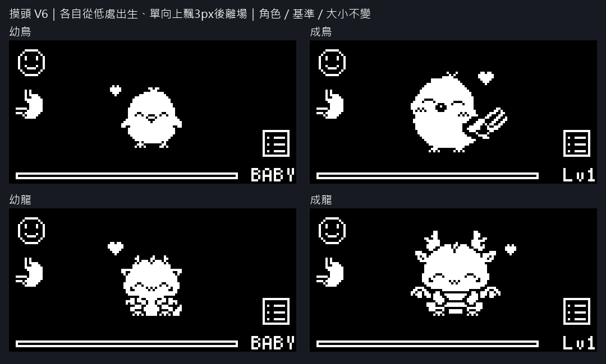
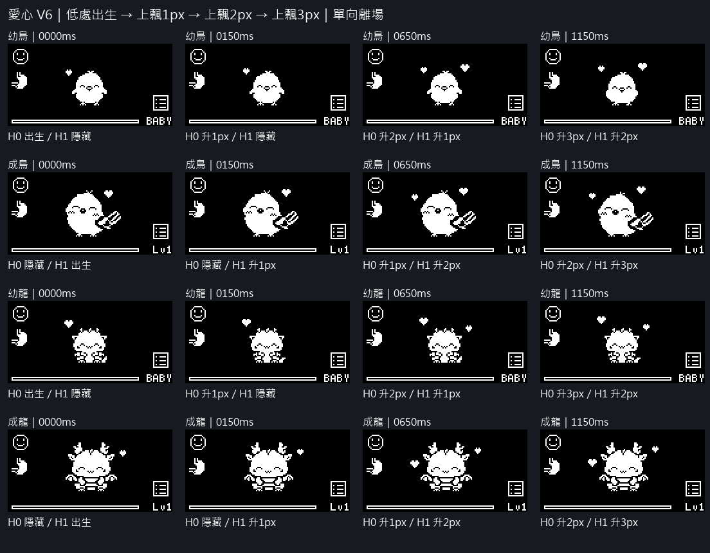
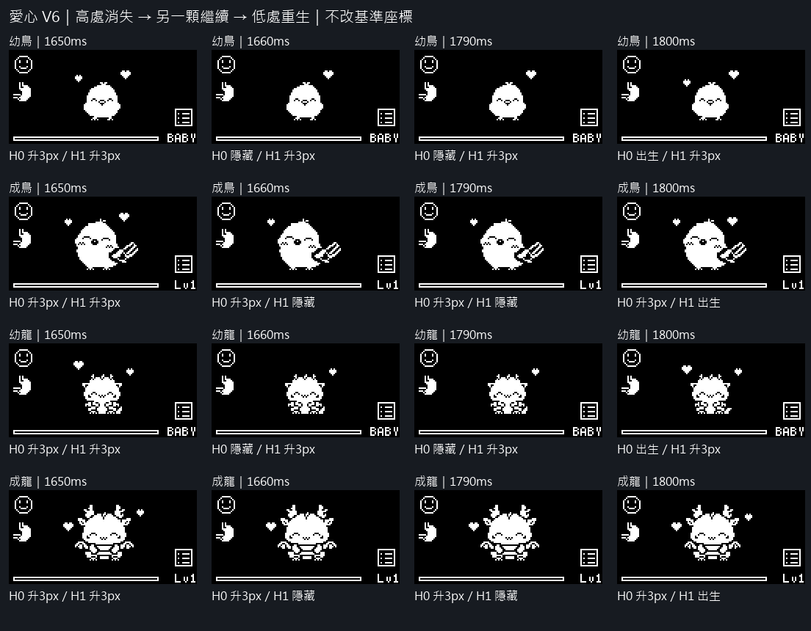

# 摸頭愛心 V6：單向上飄、離場、低處重生（待審核）

基準座標直接作為較低出生點（dy=0），出生停 150ms → dy=-1 → dy=-2 → dy=-3 → 高處消失，隱藏後才回到 dy=0。沒有在可見期間往下擺動，也沒有水平偏移。

時間：0–149ms 出生；150–649ms 上飄1px；650–1149ms 上飄2px；1150–1659ms 上飄3px；1660–1799ms 隱藏；1800ms 低處重新出生。

先後不變：幼鳥左先／右+200ms，成鳥右先／左+180ms，幼龍左先／右+220ms，成龍右先／左+160ms。先出者先上飄、先在高處消失；每顆各自循環。

## 連續循環 GIF 與全部逐幀 PNG

- 幼鳥：[循環 GIF 4倍](bird-baby-floating-loop-512x256.gif)・[原尺寸](bird-baby-floating-loop-128x64.gif)・[完整逐幀 PNG](bird-baby-all-frames.png)。
- 成鳥：[循環 GIF 4倍](bird-adult-floating-loop-512x256.gif)・[原尺寸](bird-adult-floating-loop-128x64.gif)・[完整逐幀 PNG](bird-adult-all-frames.png)。
- 幼龍：[循環 GIF 4倍](wyvern-baby-floating-loop-512x256.gif)・[原尺寸](wyvern-baby-floating-loop-128x64.gif)・[完整逐幀 PNG](wyvern-baby-all-frames.png)。
- 成龍：[循環 GIF 4倍](wyvern-adult-floating-loop-512x256.gif)・[原尺寸](wyvern-adult-floating-loop-128x64.gif)・[完整逐幀 PNG](wyvern-adult-all-frames.png)。

共 151 個 PNG 時間點（各有原尺寸與4倍）。GIF 原尺寸／放大共16檔，另有四角色起始總覽；循環版使用角色與愛心共同週期，重播相位連續。起始版播放一次，保留第一次生成的真實順序。

角色／閉眼表情／待機／HUD 使用 V4 真實 framebuffer 原像素；愛心遮罩、基準點、大小、左右配置與順序取自 V5，未重新定位。只擴充向上路徑為0/-1/-2/-3px。

逐毫秒核對三輪：可見期間 y 單調遞減，只在高處消失，完整隱藏140ms後才回到低處，連續循環無兩顆同步隱藏。全部來源、美術、V4/V5產物及正式韌體雜湊不變；GIF逐幀像素／時長回讀通過。這是預覽，不是觸摸／OLED實機驗收。

重建：以有 Pillow 的 Python 執行 `tools/render_touch_floating_hearts_preview.py`。詳見 [validation.json](validation.json)。
