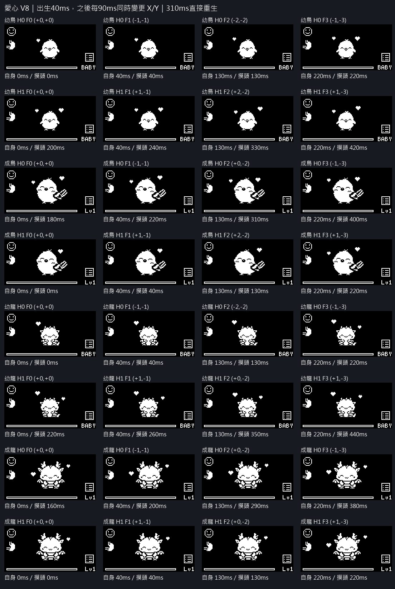
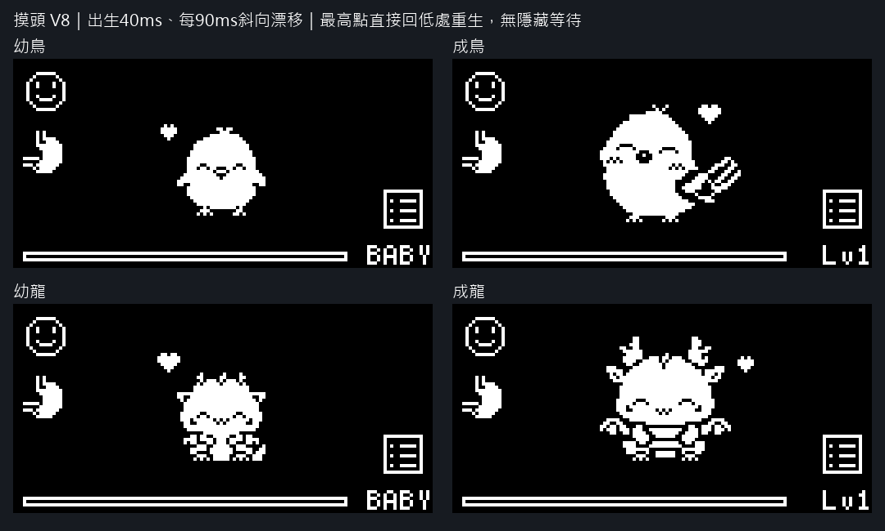

# 摸頭愛心 V8：40ms 出生＋90ms XY 漂移，直接重生（待審核）

原基準點出生只停 40ms，接著在 40／130／220ms 三個節點同時改變 X、Y；310ms 最高點直接切回低處重生，不插入隱藏幀。每輪310ms。每步向上1px，整段上飄3px，水平偏移最多2px。

先後／時間差不變：幼鳥左先右+200ms、成鳥右先左+180ms、幼龍左先右+220ms、成龍右先左+160ms。基準點、愛心形狀／大小／左右配置、閉眼表情、角色與UI原像素完全沿用。

## 相對基準座標的逐幀路徑

- 幼鳥左 H0：(0, 0) → (-1, -1) → (-2, -2) → (-1, -3)；右 H1：(0, 0) → (1, -1) → (2, -2) → (1, -3)。
- 成鳥左 H0：(0, 0) → (-1, -1) → (0, -2) → (-1, -3)；右 H1：(0, 0) → (1, -1) → (2, -2) → (1, -3)。
- 幼龍左 H0：(0, 0) → (-1, -1) → (-2, -2) → (-1, -3)；右 H1：(0, 0) → (1, -1) → (0, -2) → (1, -3)。
- 成龍左 H0：(0, 0) → (-1, -1) → (0, -2) → (-1, -3)；右 H1：(0, 0) → (1, -1) → (0, -2) → (1, -3)。

## GIF 預覽

- 幼鳥：[循環4倍](bird-baby-drifting-loop-512x256.gif)・[循環原尺寸](bird-baby-drifting-loop-128x64.gif)・[首次生成](bird-baby-drifting-entry-512x256.gif)・[全部逐幀PNG](bird-baby-all-frames.png)。
- 成鳥：[循環4倍](bird-adult-drifting-loop-512x256.gif)・[循環原尺寸](bird-adult-drifting-loop-128x64.gif)・[首次生成](bird-adult-drifting-entry-512x256.gif)・[全部逐幀PNG](bird-adult-all-frames.png)。
- 幼龍：[循環4倍](wyvern-baby-drifting-loop-512x256.gif)・[循環原尺寸](wyvern-baby-drifting-loop-128x64.gif)・[首次生成](wyvern-baby-drifting-entry-512x256.gif)・[全部逐幀PNG](wyvern-baby-all-frames.png)。
- 成龍：[循環4倍](wyvern-adult-drifting-loop-512x256.gif)・[循環原尺寸](wyvern-adult-drifting-loop-128x64.gif)・[首次生成](wyvern-adult-drifting-entry-512x256.gif)・[全部逐幀PNG](wyvern-adult-all-frames.png)。

維持 V7 獨立 overlay，位移節點不等待角色換幀。小鳥1600/1000ms、小飛龍約6FPS的原待機與閉眼表情不變。正式整合時，overlay狀態變更應獨立設 dirty_，讓UI可在角色同一幀內重繪；本輪未改正式UiController。

驗證：158個PNG時間點、17個GIF回讀；每步X/Y都有位移、Y只上升、先後及獨立循環、無同步全空白、所有軌跡與兩種角色姿勢無重疊／裁切、HUD／角色像素保留。循環GIF使用共同週期，重播相位連續。舊V4/V5/V6與來源PNG、正式韌體雜湊未變。

重建：有Pillow的Python執行 `tools/render_touch_drifting_hearts_preview.py --no-hidden`。詳見 [validation.json](validation.json)。這是預覽，尚未正式實作或實機驗收。
