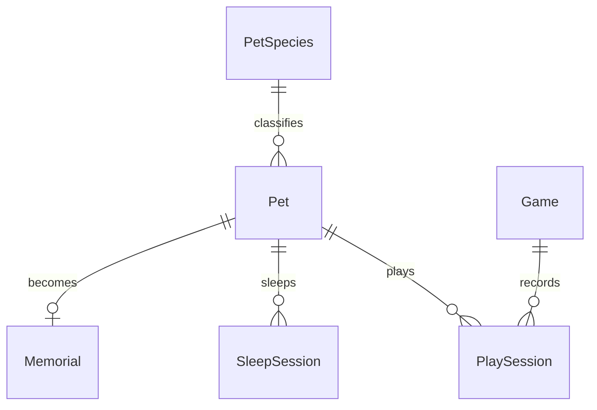

# 神秘蛋電子寵物：專題企劃與進度追蹤

> 從一顆蛋開始，陪伴小鳥或小飛龍長大。

- 更新日期：2026-10-22（Web 增量與觸摸焊接後校正；正式韌體驗收仍以各日期紀錄為準）。
- 文件角色：產品需求與唯一進度台帳。直接查看 [第 10 節進度](#progress)、[文件導覽](README.md) 或 [歷史證據](history/development-history.md)。
- Web 角色美術任務：agent 在生成或修改寵物精靈圖、動畫圖集及其 Web 整合前，先讀 [Web 寵物精靈圖製作規則](web-sprite-workflow.md)。第 1～8 節為各角色通用流程，第 9 節僅適用小龍；再核對目標角色的素材說明與已確認參考，避免重新討論既有決策。
- 版本依據：目前工作目錄的實際程式；美術素材須接入對應的 Web 或韌體呈現才算該端已整合，生成成功不代表功能完成，Web 整合亦不代表韌體已更新。
- 本文件整合舊企劃、現有程式、資料庫草圖與新增睡眠需求。附件中的建議視為規劃素材，不代表已採用或已實作。
- 第 1～9 節描述需求與程式結構，第 10 節唯一記錄實作／驗收／下一步；不再用單一核取框混合這三種狀態。
- 標記「建議／待決定」的內容是本次補充方案；未出現在程式裡的舊功能，不直接推定為團隊已決議刪除。

## 1. 專案目標與範圍

以 ESP32 NodeMCU-32S 製作可離線、獨立運作的電子寵物。玩家從神秘蛋開始，透過餵食、遊戲、清潔與休息培養寵物；目前支援小鳥與小飛龍，每顆新領養的蛋各以 50% 機率決定種類並保存。後續再評估更多種類、環境互動與手機擴充；正式名稱與數值平衡尚待決定。

開發範圍：

- **A：核心電子寵物**。OLED、搖桿含按壓開關、蜂鳴器、養成、存檔及基本省電；不以網路或感測器為必要條件。
- **B：環境互動**。優先評估 BH1750 明暗與睡眠整合；溫濕度、MPU6050 維持後續候選，不視為已確認採購或必做項目。
- **第二階段：手機與連線**。先做 Flutter 與 BLE 唯讀整合，再依授權與驗收依賴擴充；圖鑑、歷史資料、Wi-Fi／MQTT／伺服器／AI 依後續需求評估。進度只見第 10 節。

預期核心循環：神秘蛋（小鳥／小飛龍各 50%）→ 互動孵化 → 餵食／遊戲／清潔／休息 → 成長 → 保存並繼續養成。

## 2. 已確認的範圍

操作以搖桿整合；目前核心版本不含體力，支援小鳥與小飛龍，包含疾病、治療、死亡、紀念冊與重養。一般睡眠與 Deep Sleep 分別承擔養成展示及省電用途。首版使用 NVS，不需要 SQL、網路或日曆時鐘。

決策沿革見 [開發歷史](history/development-history.md)，實作及驗收見 [進度台帳](#progress)。

## 3. 資料與程式依據

硬體與模組關係見 [架構](reference/architecture.md)；OLED 規格見 [排版手冊](reference/ui-layout-guide.md)；BLE 格式只在 [PROTOCOL.md](../esp32_pet_app/PROTOCOL.md) 維護。本節資料說明不是另一份完成清單。

### 3.3 寵物資料

目前 `PetData` 與 `PetSnapshotV1` 擁有：

- `petId`：新存檔從 1 開始；每次領養以當前寵物及墓碑群的最大 ID 加 1。在連續有效存檔內遞增，NVS 完全重建後可能重用；不是跨裝置或跨存檔代次的全域唯一鍵。
- `name`：ASCII 1～8 字元。新蛋自動產生固定六字母 ABB 名字，例如 `Tamama`；舊存檔的既有名字維持不變。
- `speciesId`：小鳥 Bird=1、小飛龍 Wyvern=2；每次新蛋獨立各 50% 抽選並保存，孵化／重啟／睡醒不重抽。`lifeStage` 為蛋、幼年、成年，適用兩種寵物。舊存檔的已孵化數值 1 對應成鳥，維持格式相容。
- `satiety`：飽食度，初始 80，限制 0～100；數字越高越飽。
- `mood`：心情，初始 80，限制 0～100。
- `cleanliness`：清潔度，初始 100，限制 0～100。
- `level`：初始 1，型別 `uint8_t`；限制 Lv1～Lv20，setter 將 0 修正為 1。
- `exp`：初始 0，型別 `uint16_t`，表示本級進度；升級需求為 `50 + 25 × (level − 1)`，保留餘額並支援跨多級。Lv20 滿等，EXP 固定 0；玩法與驗收見 [經驗與升級](features/exp-level-plan.md)。
- `healthState`：健康、生病、死亡三種互斥狀態；既有 `isSick()`、`isDead()` 查詢介面維持相同行為。
- `dangerSeconds` 與沿用舊欄位名的 `sickAwakeSeconds`：記錄連續危險暴露與生病後有效時間；清醒及一般睡眠都會累計。死亡時停止在 24 小時門檻，不把同批次超出的時間算入年齡或需求衰減。
- `ageSeconds`：累計有效生命秒數，包含清醒與一般睡眠，並隨寵物快照保存；真正斷電期間因尚無可信時間基準，不補算離線時間。
- 成年寵物清醒基礎衰減間隔：飽食 600 秒、清潔 900 秒各降 1 點，心情每 1200 秒扣 1／2／3 點（依第 4.2.1 節低需求項目數）。幼年寵物飽食／清潔每 60／90 秒各降 1 點，心情每 120 秒扣 1／2／3；蛋不衰減需求。各階段均保留未滿一輪的秒數。
- `PetSnapshotV1` 會保留三項衰減餘數、出生／死亡可信時間、死亡原因，以及一般／Deep Sleep 所需的模式與結算時間欄位。快照在還原前會完整驗證；UI 修訂號不保存。

已實作的衍生狀態區間：

- 飽食：76～100 飽足、51～75 稍餓、26～50 飢餓、11～25 很餓、0～10 極餓。
- 心情：81～100 非常開心、61～80 開心、41～60 普通、21～40 難過、0～20 非常難過。
- 清潔：76～100 乾淨、51～75 稍髒、26～50 髒、0～25 非常髒。

`Save` 已將上述欄位逐一序列化，以 CRC32 驗證並輪替寫入 Preferences／NVS A／B 槽；墓碑群使用獨立的固定格式 A／B 槽。啟動時載入序號較新的有效快照，無存檔才建立具新 ID 與 ABB 名字的蛋。蛋階段每分鐘及裂痕／孵化里程碑會建立檢查點，降低重開機造成的孵化進度回退。首版不提供名字輸入或日曆時間設定；睡眠功能進度見 A5-SLEEP／A6-S。體力不列入 MVP。

依據：[PetData 宣告](../src/pet/PetData.h)、[初始值與區間](../src/pet/PetData.cpp)。

## 4. 功能規劃與規則

### 4.1 執行順序

請依 [進度台帳的下一步](#progress) 執行；本節只維護玩法規則，不另存完成狀態。

### 4.2 養成、孵化與遊戲

- 餵食固定增加飽食度 `+20`；成功後回到主畫面播放約 3 秒的各種類幼年／成年吃飯與碗逐步清空動畫，接著沿用摸頭開心動畫 1.2 秒並播放摸頭音（傷心時也播，播完回傷心圖）。驗收追蹤見 A5-VIS。
- 清潔不建立大便事件、數量或額外存檔。兩種寵物的幼年與成年依既有清潔度四階段顯示 0～3 個髒污圖：乾淨無髒污、稍髒 1 個、髒 2 個、非常髒 3 個。Clean 固定增加清潔度 `+30`，畫面依新階段減少或移除髒污。
- 髒污會出現在主畫面、3 秒餵食動畫及一般睡眠畫面，位置避開角色、碗、側邊狀態與 `Zzz`。清潔頁再短按成功後回首頁播放 2.4 秒水面上升動畫，最後全白停留 1.2 秒，不退水；期間只替換中央寵物及髒污，保留兩側狀態與 EXP 條，播完依當下清潔度恢復髒污並留在首頁，接著在寵物身上沿用治療恢復星芒 2 秒並播放孵化音（傷心時也播）。開心／星芒期間鎖定按鍵與觸摸，睡眠或死亡立即中止。驗收追蹤見第 10 節清潔動畫增量（A5-CARE／A5-VIS）及 2026-10-23 照顧後續獎勵紀錄。
- 一般睡眠沿用主畫面兩側的心情、飢餓、髒污、生病及狀態圖示，但狀態圖示不顯示按鈕焦點框；中央顯示該種類的閉眼寵物及靠近角色且不重疊的 `Z → Zz → Zzz` 動畫。畫面不提示起床操作，短按 SW 可起床。睡眠期間飽食、清潔、疾病及死亡照常推進；2026-10-03 起，心情依第 4.2.1 節每 20／40 分鐘恢復 1 或暫停，不套用清醒扣分；2026-10-01 起，恢復餘數在持續供電期間跨多次一般／省電睡眠累積，RTC 保留跨 Deep Sleep 的餘數，真正斷電或一般重開機則清除不足一輪的恢復餘數；不增加體力數值，寵物可能在睡夢中死亡。
- 新蛋建立時抽選並保存種類：小鳥／小飛龍各 50%；孵化、重開機與睡醒不重抽。孵化需保存生命階段與進度；重開機不可重新播放出生或建立另一隻寵物。同次領養保存失敗重試時保留候選個體的 ID、名字與種類。
- 目前已接入小鳥與小飛龍的孵化、待機、照顧、睡眠、成長、升級、告別及紀念冊畫面。更多種類與原定 3～5 種目標留待後續評估；韌體寵物美術由使用者繪製，Agent 負責轉成韌體素材並接入。Web 美術可依使用者確認的參考透過圖像生成工具另行製作，依 [精靈圖製作規則](web-sprite-workflow.md) 整理與整合，不直接為韌體單色圖套色。
- 第一個迷你遊戲採猜拳，取代原本一按心情 +15 的陪玩：固定三回合，平手也算一回合，整場贏／和／輸分別增加心情 10／6／3，第三回合揭曉時只結算一次。左右選招、短按確認、長按退出；蛋與生病時不能開始。規則及 128×64 版面見 [猜拳企劃](features/rps-game-plan.md)。第二種遊戲為物種共用的「記憶音符」，1.5.0 加入五回合四方向記憶玩法，規則及驗收見 [記憶音符](features/memory-notes-plan.md)；1.4.0 加入 15／10／5 EXP 獎勵、餘額升級與兩秒慶祝，詳見 [經驗與升級](features/exp-level-plan.md)。
- 生命階段依有效年齡與健康狀態決定，不以 EXP 卡住成長；經驗值只用於後續等級與遊戲獎勵。蛋 4 分鐘顯示小裂痕、4 分 30 秒固定切換大裂痕、5 分鐘孵化，幼年寵物再經 60 分鐘進入成年；成長點生病時延後至治療完成。

日常照顧亦累積經驗：有效餵食／清潔各 +3 EXP，成功治癒 +5 EXP；數值已滿或無效操作不給，睡眠不給。滿值時仍可餵食／清潔並播放動畫，數值維持 100 且不給 EXP，與韌體 `PetData::feed()`／`clean()` 一致；2026-10-22 起 Web 展示亦移除原有的滿值攔截。升級沿用現有慶祝，先完成照顧畫面及其後續開心／星芒，再接成長／升級，詳見 [經驗與升級](features/exp-level-plan.md)。

#### Web 記憶音符展示規則（2026-10-20 使用者指定）

- 僅 Web Mock 改為三回合，音符長度依序 2／3／5；進場先準備 5 秒。示範每音符亮 250ms、間隔 450ms，每次回答限 5 秒，最後音符 180ms，回合回饋至少 800ms。韌體既有五回合不改。
- 完成三回合後才單次結算；初版獎勵依答對回合數：3 回合心情／EXP +10／15，2 回合 +6／10，0～1 回合 +3／5。此為新回合數配套，待試玩確認；中途退出不結算。猜拳規則與獎勵不變。

#### Web 展示摸摸與樹枝互動（2026-10-20 使用者新增）

- Web 摸頭／順毛讓心情變好、樹枝戳碰讓心情下降，適用小鳥與小飛龍幼年／成年。戳碰視覺依後續確認改為嚇一跳，取代初版生氣反應。首輪暫定摸摸+3、戳碰−3，限制0～100，兩工具共用3秒冷卻，不給EXP，數值可依試玩調整。
- 僅Mock、清醒健康且非終止個體可操作；蛋、睡眠、生病、死亡、送別、遊戲與照顧／轉場中停用。2026-10-23 起比照韌體銅箔：在角色身上按住滿 700 ms 為摸摸（按住當下結算並開始冒愛心，放開收尾），未滿 700 ms 放開為戳戳（放開即結算，不再等待雙擊）；不再有工具切換。鍵盤或不便點角色時用展示工具「模擬寵物」的「摸摸」「戳戳」按鈕。每次手勢只結算一次。原獨立觸碰面板已併入展示工具；寵物狀態改由花園左上角的圓形狀態按鈕開啟（裝置與展示模式皆可，無寵物資料時隱藏），取代原本不易發現的雙擊角色；狀態卡片為輕觸外部即收合的彈出卡片，見 10-23 狀態圓鈕段落。網頁不套用韌體 100 ms 的防誤觸下限，因為滑鼠／觸控點擊沒有銅箔雜訊。
- 摸摸顯示愛心（按住即在頭部左右輪流冒出、大小交錯並上飄，放開後收尾；用按鈕摸摸時播 1.2 秒），成年小龍另使用開心表情（滑鼠／觸控按下即顯示瞇眼笑格並持續到按住結束，放開後再維持1.2秒）；戳碰顯示1.2秒驚嘆號，成年小龍同時改用專用驚嚇靜態圖並搭配小幅彈動（減少動態不彈動），結束回待機；幼年小龍同樣使用自己的瞇眼笑格與驚嚇圖（2026-10-23），小鳥仍用既有呈現。不新增healthState、不更改物種／階段。心情變化走DataManager與本地保存，冷卻只限當次頁面執行；BLE不新增命令。韌體玩法不因本段Web展示功能更動。

#### Web 角色素材與顯示（2026-10-21）

- 圖源依物種與成長階段分離，角色本體與食碗、藥水、愛心、Zzz、靈魂等效果分開。素材可分多份圖集，分別設定切格、錨點與畫格時間；同一循環內不逐格重新縮放，不受 OLED 解析度與速度限制。
- 成年小龍使用獨立彩色待機、傷心、生病、開心、驚嚇、蜷縮睡眠、閉眼側躺死亡、四格吃飯及六格飛行素材；預設依實際狀態顯示，睡眠優先於生病，生病與需求造成的傷心分開。開心用於摸頭反應與治療恢復，驚嚇只用於戳碰反應，不新增心情門檻或領域狀態。幼年小龍（2026-10-23）使用自己的彩色待機、傷心、生病、開心、驚嚇、坐著打瞌睡（靜態）、正面攤平死亡、吃飯（咬／嚼後以開心笑眼收尾）及四格走路，狀態優先順序與成年相同，顯示約成年的73%；睡覺與死亡姿勢刻意與成年的趴睡／側躺不同（使用者2026-10-23確認）。圖片尚未載入時保留既有遮罩呈現。
- 素材選單在 Mock 小龍及小鳥幼年／成年非終止狀態開放，僅覆蓋外觀；狀態文字、養成數值、照顧限制與保存仍依真實寵物資料。成年小龍六格飛行已接入共同繪製入口：健康清醒待機穿插地面停留、離地、低空左右移動及落地，向左按固定身體中心鏡像；照顧、互動、傷心、生病、睡眠及對話框優先中斷，減少動態時使用靜態地面待機。幼年小龍不飛，改為地面走路：同樣地面停留24秒後左右來回約9.8秒、往左鏡像、轉身停在站立格，中斷條件與減少動態同成年。死亡流程（2026-10-24 起）改為 Web 專用四段時間軸：倒下並暗場、身體化成光點同時靈魂飄出、墓碑升起長花、安息；靈魂由各物種自己的待機圖程式生成並戴冷白光環，新物種不需另畫，詳見第 10 節。不使用 XX 眼。
- 飛行只改呈現位置與朝向，觸碰範圍隨角色移動，不新增養成或 BLE 狀態。本輪飛行／待機呈現及地面 24 秒／飛行 6480 ms 的最終節奏已由使用者確認；不延伸為其他流程驗收。成年小龍吃飯使用四格專用圖：低頭咬與抬頭嚼交替三口，每口抬頭時共用食盆少一格，碗空後才播微笑，全部在 3 秒餵食內完成；食盆放在下巴前下方。成年小龍驚嚇圖以兩眼間距對齊待機頭身，腳底同線。待機眨眼留待後續；新版靈魂已改由程式從待機圖生成（2026-10-24）。詳細進度見第 10 節。
- 白色小鳥採單獨的待機搖尾、含淚傷心、疲倦生病圖集，活動及啄食沿用完整低頭／抬頭圖格；腳底及顯示比例固定，不切割頭部。幼年成年暫共用圖源按大小區分，睡眠、開心／驚嚇及長眠專用新圖仍未製作，目前用白鳥基準配既有效果示意，不能視為這些動作已完成；長眠圖未補前，死亡流程中的白鳥是睜眼站姿。Web 共用藍色食盆分滿盆／部分／少量／空盆，仍沿用3秒餵食單次結算；韌體原素材不改。整合後的實際瀏覽器外觀待確認，詳細進度見第 10 節。

#### 4.2.1 心情與基本需求連動（2026-10-03 已確認）

心情應反映生活品質：飽食度或清潔度偏低時，加快清醒心情衰減並降低睡眠恢復速度，避免只靠遊戲與睡眠維持滿心情。低需求門檻為 **≤50**，50 本身即納入；兩項都高於 50 才屬正常。

| 飽食度、清潔度狀況 | 成年清醒心情 | 幼年清醒心情 | 一般／省電睡眠心情 |
|---|---|---|---|
| 兩項都 >50 | 每 20 分鐘 −1 | 每 2 分鐘 −1 | 每 20 分鐘 +1 |
| 恰有一項 ≤50 | 每 20 分鐘 −2 | 每 2 分鐘 −2 | 每 40 分鐘 +1 |
| 兩項都 ≤50 | 每 20 分鐘 −3 | 每 2 分鐘 −3 | 暫停恢復 |

- 清醒扣分由原本每輪 −1 加上每個低需求項目額外 −1；需求改善後依新狀態恢復較低扣分。飽食與清潔本身的衰減速度沿用既有規則。
- 幼年寵物不另設扣分保護上限，直接採相同倍率；健康時孵化後約 60 分鐘長大（從蛋開始約 65 分鐘），成長點生病仍依既有規則延後。
- 睡眠不套用清醒心情扣分；兩階段共用表中的恢復速度。飽食、清潔、年齡、疾病與死亡仍照常推進，Deep Sleep 醒後補算須套用同一規則。
- 猜拳心情獎勵採贏／和／輸 +10／+6／+3（2026-10-05 調整），EXP 維持 +15／+10／+5，不新增心情上限或因低需求禁止遊玩；心情仍限制在 0～100，蛋不衰減或恢復需求。
- 以上取代既有「睡眠每 10 分鐘 +1」及不受需求影響的清醒心情規則；實作／驗收追蹤見 A3-MOOD。結算在需求變化、清醒心情扣分及成長點分段：同秒先扣需求，再依當下狀態扣清醒心情；睡眠已經過的時間依變化前速率累積，之後改採新速率。恢復進度按正常每秒 2 單位、一項低需求 1 單位、兩項 0 單位累積，正式版每 2400 單位 +1；跨睡眠與暫停保留已累積進度，正常重啟／斷電清除不足一點的進度，NVS V1 格式不變。

#### 4.2.2 傷心表情與照顧提醒（2026-10-07 已確認）

- 幼寵／成寵主畫面在心情 ≤40、飽食度 ≤25、清潔度 ≤25 或生病時顯示各自種類的傷心圖，加上共用三條線；倒藥與空瓶期間隱藏三條線，固定傷心第 1 格。心情恢復到 ≥45、飽食度／清潔度各恢復到 ≥30 才解除對應原因；所有原因解除才恢復正常。睡眠、照顧／成長／升級動畫、死亡與送別沿用自己的呈現，治療成功的恢復動畫優先，結束後再依實際狀態顯示。
- 正常轉傷心、新生病（即使原本已傷心）或醒來仍傷心時，排入一次照顧提示；持續傷心不週期重播。開機讀取傷心狀態保持安靜，Deep Sleep 恢復視為醒來。只有回到閒置主畫面且其他音效、照顧動畫及待處理動作完成後才播放，播放前重新確認狀態，原因全解除就取消。同一次執行期間兩次實際播放至少相隔 5 分鐘，睡眠靜音；快速測試版為 10 秒，重新啟動（含 Deep Sleep 恢復）後重建冷卻。
- 音效為 659／523／392 Hz 的三個下降短音，中間各休止 40ms，全長 500ms；採非阻塞播放，實際音量／聽感的使用者驗收回報見第 10 節傷心提醒增量。緩衝原因、提醒待播與冷卻為本次執行狀態，不改 NVS／BLE 格式；正常重啟重新判斷原因並抑制開機提示，新領養個體重設提醒狀態。

#### 4.2.3 電容觸摸互動（已實作，使用者回報實機驗收通過）

- GPIO32（T9）搭配外殼內側銅箔；MODE 1採MeasureCycles=40000（約5ms）、SleepCycles=4096及Core 2.0.17的0.5～2.7V，初始化後套用週期。2026-10-22焊接完成，使用者更正MODE 1標籤後為觸摸592～642、放開718～745，現改為固定觸摸 `<670`／放開 `>690`，Debug開啟。原1400／1450、80／82及焊接前820／830皆非現行門檻。30ms讀取及連續三筆確認，硬體量測包含RTC sleep，相鄰讀值不保證為不同硬體週期；參數集中於HardwareConfig，首版不做自動校正。GPIO32與其他配置無衝突；使用者於2026-10-22回報實機驗收通過，未提供逐項結果或量測紀錄，不延伸推定未明確回報的配置／壓力測試皆已執行。
- 100～699ms有效短觸在確認放開後觸發一次戳戳；持續達700ms立即開始摸頭，放開不再產生戳戳。起點取第一筆低值，短觸長度在第一筆高值凍結；同次按住不重啟、動畫不堆疊。摸頭感測中斷採120ms釋放寬限，短觸只用三筆放開確認；raw=0或取樣停頓超過150ms取消手勢與畫面，穩定放開才解鎖。詳細邊界見[觸摸驗收](testing/touch-test.md)。
- 僅健康、清醒、非傷心、閒置Home的幼年／成年寵物接受互動；蛋、睡眠／Deep Sleep、死亡／送別、其他頁面與照顧／遊戲／成長／升級流程不觸發。搖桿與特殊流程優先，切頁取消並鎖定到穩定放開；不因觸摸喚醒、不改心情／EXP／需求。
- 美術基準為戳戳V3與使用者重繪的摸頭V9：幼鳥14幀、成鳥13幀各5 FPS，幼龍／成龍各8幀各7 FPS。完整採用happy.png的角色與愛心時序，不再加入V4～V8的待機／愛心疊加。戳戳右移1px停160ms、回原位停340ms；兩種幼寵結束用shock第二幀復原至下一次原待機換幀。保留原點(32,6)、兩側狀態、底部EXP及現有髒污。
- 硬體層判定事件，Application協調資格、UI情境修訂及個體／階段，UI非阻塞顯示並沿用Dirty Flag；Sound遵守靜音與既有高優先音，忙碌略過觸摸音。正常養成時間照常推進，不改NVS或BLE格式。首版採5秒摸頭上限與250ms持續動畫收尾，仍按住不重播；參數可集中調整。每次接受反應只嘗試一次短音，聽感待實機確認。
- 此處「第二階段」專指觸摸正式實作，與第1節手機／連線階段分開。實作、自動驗證及硬體驗收分別追蹤於第10節TOUCH-P2；第一階段歷史成果已保存於0a25af4。
- 2026-10-21使用者曾回報部分畫面成功觸發摸頭與戳戳，當時因尚未焊接而未完成驗收；2026-10-22完成焊接與MODE 1校正（`<670`／`>690`）後，使用者明確回報實機驗收通過。逐項結果、裝置配置與壓力測試數據未提供；詳細紀錄見第10節TOUCH-HW-ACCEPTED及[觸摸驗收](testing/touch-test.md)。

### 4.3 疾病、治療、死亡與重養（MVP 必做）

以下是交給實作 Agent 的**首版預設規則**，數值應集中設定，實機試玩後可調整，不要求人類先決定每個門檻：

1. 清醒及一般睡眠時，只要飽食或清潔至少一項持續為 0，累計 6 小時後生病；離開危險區間即清除尚未生病的連續計時。治療前畫面要明顯提示病情。
2. 增加「治療」操作，不消耗尚未定義的道具；治療使 `isSick=false` 並清除疾病倒數，但仍需餵食／清潔才能避免再次生病。先做可玩的明確規則，之後再評估道具系統。
3. 生病後累計 24 小時**有效時間**而未治療即死亡；一般睡眠不暫停疾病倒數，因此可能在睡夢中死亡。未來 Deep Sleep 結算也沿用相同規則。死亡前要有持續可見的警告，不能只在一次音效裡提示。
4. 死亡是終止狀態：立刻停止餵食、遊戲、治療與時間結算。原寵物資料轉成唯讀墓碑紀錄，含 `petId`、名字、種類及累計有效年齡；首版墓碑顯示「名字＋活了多久」，不要求日曆日期。同一死亡事件只能新增一次墓碑。
5. 顯示死亡／墓碑畫面，提供「查看紀念冊」與「領養新蛋」。領養新蛋產生新 `petId`，保留舊墓碑；主畫面顯示新蛋，不把已死亡寵物重設成活著。
6. 主選單提供「紀念冊」，先以遠行／長眠／說明三項列表選擇，前兩項顯示筆數；上下選擇、短按進入。紀錄頁左右翻頁，短按進入既有刪除確認（預設保留），長按回分類，再長按回原入口；說明頁列出左右／短按／長按操作。共保留 32 筆，另留一個死亡溢位槽；滿額不得主動送別，自然死亡仍保存，領養前須由玩家自行刪除舊紀錄。當前已告別寵物的紀錄在領養前受保護，不自動覆寫。
7. 不要求玩家輸入名字。新蛋建立時由 ESP32 硬體亂數產生六字母 ABB 名字：A 與 B 均為兩字母音節，組合成 `A+B+B`；A、B 相同時改用下一個 B，並對墓碑群中的同名最多重抽八次。名字與新 `petId` 立即保存，重開機、孵化與成長不重新命名。首版無須設定日期時間；完全斷電後不補算未知的離線時間。

### 4.3.1 主動送別與紀念冊（2026-10-05）

- 2026-10-08 統一操作回饋：紀念冊分類／說明／紀錄瀏覽、送別說明／確認／阻擋頁的有效長按返回均播放取消音；明確選擇取消亦播放取消音。進入說明、確認或刪除確認等有效短按導覽播放確認音；阻擋頁有效重試有確認回饋。實際照顧、遊戲、保存、領養及失敗保留各自結果音效，忽略的輸入不額外發聲。所有回饋遵守全域靜音。

- 不設自然壽命，不加入壽終正寢或紀念冊死因；現有疾病死亡規則沿用。
- 清醒的幼年、成年寵物（小鳥／小飛龍）可主動送別，生病可用且文案相同；蛋不能送別。遊戲／照顧动画完成後返回選單操作。
- 「送別」先顯示名字與有效陪伴時間，再提示「送別後無法召回」，選項預設「留下」。確認期間正常結算，死亡先於送別處理。
- 已送別是與健康狀態獨立的終止旗標，停止需求、年齡、疾病、遊戲與睡眠操作，不發獎勵。
- 保存完成才播放取景框＋2.6 秒平常眨眼＋100ms 全白拍照，沿用現有角色圖；接著停格在明信片，玩家按下後可查看紀念冊或領養新蛋。未完成保存停在重試畫面，每 10 秒自動重試。
- 紀念冊保存 ID、名字、種類、有效年齡、遠行／長眠及告別成長階段。舊墓碑歸入長眠，成長階段未知。
- 存檔與故障恢復、預覽及上板步驟見 [送別驗收](testing/farewell-test.md)。

### 4.4 自動命名規則

- A 前綴：`Ba Be Bo Da Do Fu Ha Ho Ka Ki Ko Ku Ma Mi Mo Na Ni No Pa Pi Po Ta Te To`。
- B 尾音：`ka ki ko ma mi mo na ni no pa pi po ra ri ro ru ta to`。
- 名字固定六個 ASCII 英文字母，首字母大寫，例如 `Tamama`、`Dororo`、`Kururu`；存檔欄位仍保留最多八字元。
- 同一寵物只在建立新蛋時命名一次；墓碑保存名字快照。歷代寵物允許極少數重名，裝置當前存檔內以 `petId` 識別；雲端歷史需另加存檔代次或 UUID。

疾病進度與墓碑群屬存檔資料。改版前應以「生病 → 治療 → 復發 → 死亡 → 看墓碑 → 領養新蛋 → 斷電續玩」做完整驗收；斷電或睡醒後不得重複新增墓碑。兩個門檻採累計有效時間，不以 `millis()` 跨重啟相減；無可信時間的真正斷電期間仍不補算。

### 4.5 蜂鳴器聲音設定（2026-10-08 已確認）

- 裝置提供「靜音／有聲音」兩種模式，預設有聲音；主選單第三頁依序為紀念冊／送別／聲音。蛋階段與死亡／送別後的結束選單亦提供入口。
- 使用者已核准 [新版六狀態畫面](previews/sound/sound-focus-proposal.png)：喇叭右側 X 表示靜音，聲波表示有聲音。喇叭列左右 `< >` 與下方按鈕的 `>` 游標互斥，底部常駐「確定／取消」，沒有標題、外框、頁碼與長條。[實際 UI 畫面](previews/sound/sound-focus-ui-preview.png)。
- 進入預設焦點在喇叭列，左右循環切換模式；有聲音試聽 1047 Hz、120ms。向下進入按鈕列並預選確定；按鈕列左右循環選確定／取消，不變更模式或試聽。向上回喇叭列，再往下重新預選確定；已在按鈕列重複向下不重設選項。喇叭列短按只將焦點移到確定，避免未選按鈕即保存。
- 按鈕列短按確定，變更後保存成功直接返回主選單原位置並播放確認音；未變更不寫入、同樣返回並確認。短按取消或任一列長按都恢復進入前設定，再播放取消音並返回。結束選單入口沿用返回結束選單，避免死亡流程重新播放。音效在畫面清理後播放，靜音則無聲。保存失敗留在按鈕列，確定改標「重試」，保留取消按鈕；成長／死亡打斷撤回尚未保存變更。
- 全部蜂鳴器音效共用此設定，包含返回、確認／失敗、遊戲、孵化、升級、照顧提醒與告別。GPIO27 使用 8-bit PWM，有聲音固定 duty=128（50%），靜音輸出 0；不再調整多級音量，也不承諾不同音高同響度。靜音保留非阻塞音序計時與遊戲等待，不得提前跳步或卡住。
- 偏好獨立保存在 NVS `pet-prefs`，測試版使用 `pet-prefs-test`，不修改寵物、紀念冊或 BLE 格式。V2 記錄只允許 0／1；有效舊 V1 四級資料中 0 保留靜音，1／2／3 映射為有聲音。開機讀取不寫入，後續實際保存才寫 V2；無效或缺少資料預設有聲音。重啟、Deep Sleep 喚醒與領養後保留偏好；既有睡眠靜音規則優先。
- 硬體回報：5V、16Ω、兩腳無源電磁式蜂鳴器，曾直接接 ESP32，未加電阻或電晶體；使用者回報 25% 比 50% 響亮、返回音與試聽音聽感不同，尚未量測原因。聲音開關不解除低阻抗感性負載的電氣限制；上板試音前核對限流、驅動與反衝保護，不能把 GPIO 當作蜂鳴器電源。220Ω 串聯限流方案與完整 MOSFET 驅動方案皆尚未實機驗證。
- 實作、驗證及下一步統一見第 10 節 A5-SOUND；操作與硬體驗收見 [聲音設定驗收](testing/volume-test.md)。

## 5. 硬體與接線規劃

以下 GPIO 為目前程式設定，實際模組供電與接腳標示仍須核對：

- OLED：SDA → GPIO21、SCL → GPIO22，共地，I2C 地址 `0x3C`。使用符合模組規格且 I2C 訊號為 3.3V 的供電／上拉配置。
- 搖桿：VRX → GPIO34、VRY → GPIO35、SW → GPIO26；以 3.3V 供應電位器，避免類比輸出超過 ESP32 輸入範圍。SW 按下接地，未按為高。
- 蜂鳴器：控制訊號 → GPIO27；目前軟體按無源蜂鳴器設計。驅動方式須依實際蜂鳴器電流確認，必要時加電晶體，不能把未知負載直接當 GPIO 可供電元件。
- 文件中硬體代號有差異：程式註解寫 HW-504，需求寫 B103348；先核對實物是否為 VRX／VRY／SW 五腳搖桿，不直接視為完全相同型號。
- 類比輸入 GPIO34／35 保留給方向控制；睡眠喚醒使用 SW，不依賴持續讀取類比搖桿。
- 觸摸使用GPIO32（T9）連接外殼內側銅箔，HardwareConfig::Pins::Touch與TouchInput已接入；與現有GPIO配置無衝突，不新增觸摸喚醒源。實際接線／感測驗收見TOUCH-P2。

### 5.1 SW 喚醒接線

建議 SW／GPIO26 對 3.3V 加約 10kΩ 外接上拉、按鍵對 GND，並核對模組是否已內建上拉。上拉接常供電端；若未來關掉搖桿電位器電源，SW 仍必須可用。

GPIO26 是經典 ESP32 的 RTC GPIO，可採 `esp_sleep_enable_ext0_wakeup(GPIO_NUM_26, 0)` 設定低電位喚醒。一般執行時的 `INPUT_PULLUP` 不應被當成睡眠期間偏壓的唯一保證；若採內部上拉，依 RTC GPIO API 明確設定。醒來先 `rtc_gpio_deinit(GPIO_NUM_26)`，再恢復一般輸入初始化。此方案針對 NodeMCU-32S 的經典 ESP32，不套用 S2／S3／C3 的腳位表。[ESP32 睡眠模式文件](https://docs.espressif.com/projects/esp-idf/en/stable/esp32/api-reference/system/sleep_modes.html)

## 6. 一般睡眠與 Deep Sleep

### 6.1 一般睡眠：展示與遊戲狀態

- ESP32 及主迴圈保持運作，OLED 顯示各種類的閉眼寵物及以 ASCII 繪製的 `Z → Zz → Zzz` 動畫。
- 睡眠中忽略方向操作，短按 SW 起床；畫面不顯示操作提示。飽食、清潔、年齡、疾病與死亡繼續更新。已確認的新心情規則見第 4.2.1 節：正常每 20 分鐘 +1、一項需求 ≤50 時每 40 分鐘 +1、兩項都 ≤50 時暫停恢復。實作／驗收見 A3-MOOD。
- Rest 入口已提供一般睡眠及省電睡眠的選擇，避免使用者把關屏誤認為當機。
- 目前沒有閒置自動 Deep Sleep，省電睡眠由玩家手動選擇；自動睡眠門檻與夜間時段仍屬後續規劃。
- 一般睡眠的歷史驗收見 A5-SLEEP；1.8.1 修復後的一般／省電睡眠回報見 A6-SAVE。

### 6.2 Deep Sleep：省電狀態

- OLED 進入關屏／省電狀態，蜂鳴器停止輸出，ESP32 不執行一般主迴圈。
- 不持續播放動畫、音效、讀取 VRX／VRY 或透過一般 I2C 程式輪詢感測器。
- SW 或 Timer 喚醒後重新走啟動／初始化流程，不從睡眠函式後面繼續原本 UI。
- 正式版採手動睡眠、只由 SW 喚醒；相對時間 Timer 保留於測試版，閒置自動睡眠另行規劃；沒有可信時鐘前不承諾「每天晚上固定時間」自動入睡。

### 6.3 進入與恢復流程

1. 確認不在遊戲結算、孵化結果寫入等中途；先把當前寵物更新至現在。
2. 等待 SW 放開並穩定後才入睡。EXT0 是電位觸發，若仍按住會立刻醒來；等待期間仍允許取消，不使用無限阻塞等待。
3. 記錄睡眠開始時間、最後結算時間、保存版本與完整寵物狀態；檢查寫入結果，失敗則顯示錯誤並取消入睡。
4. 停止音序並確保蜂鳴器睡眠時不會浮接鳴叫；由 Display 封裝新增 OLED 省電介面，僅清空畫面不等於關屏。
5. 配置 RTC 記憶體、SW 與 Timer 喚醒來源，檢查 API 回傳值，最後呼叫 `esp_deep_sleep_start()`。
6. 開機最前端辨識 `esp_sleep_get_wakeup_cause()` 與重置原因；選擇有效 RTC 快照或 NVS 存檔，而非先建立新寵物覆蓋。
7. 計算實際經過時間，套用一次狀態更新，推進最後結算時間；再次睡眠不得重複累算同一時段。
8. 恢復一般 GPIO、I2C、OLED、音效與輸入。把此次喚醒按壓消耗掉，放開後才接受新的操作。
9. Deep Sleep 的 RTC 檢查點保留有效搖桿中心校正，醒來交給 `Input::init(savedCenterX, savedCenterY)`，避免搖桿仍偏移時被當成中心；一般冷開機才重新校正。
10. 使用者真正起床時回主畫面；首版不另做起床動畫。B 階段若加入定時量光而繼續睡眠，再設計不點亮 OLED 或播放音效的流程。

### 6.4 Timer 與時間基準

Timer 以相對時間設定，例如 `esp_sleep_enable_timer_wakeup(60ULL * 1000000ULL)` 為 60 秒測試；測試版 SW 與 Timer 可同時啟用，先發生者喚醒；正式版停用 Timer，每次喚醒最多結算 48 小時，超出時間捨棄。API 與 RTC 保留行為需以專案實際安裝的 Arduino／ESP-IDF 版本編譯及上板確認，不能因官方最新文件有某 API 就假設本機版本相同。[ESP32 睡眠模式文件](https://docs.espressif.com/projects/esp-idf/en/stable/esp32/api-reference/system/sleep_modes.html)

**不要跨 Deep Sleep 以 `millis()` 差值計算睡眠，也不要把設定的 Timer 時長當作實際睡眠時間**，因為 SW 可能提早喚醒。

建議睡前／醒後透過 RTC 支援的系統時間（如 `gettimeofday()`）取差值，保留同一時間基準；醒來不要任意重新設定時間。RTC 系統計時可跨 Deep Sleep，但斷電後無法靠它知道經過多久，且內部時鐘可能漂移。[ESP32 系統時間文件](https://docs.espressif.com/projects/esp-idf/en/stable/esp32/api-reference/system/system_time.html)

- 無網路首版：正式版只由 SW 喚醒，獨立測試版另有 60 秒 Timer 喚醒；目前沒有自選睡眠時長介面。年齡以累計有效秒數計算。
- 若要「22:30 睡、07:00 醒」，先要有可信日期／時間，例如手動設定且持續供電，或未來加具備備援電源的外部 RTC；網路校時僅是後續可選項。
- 真正斷電且無可信時鐘：讀回最後存檔，**不猜測離線時長**；該未知時段不衰減或恢復，也不要求使用者設定日曆時間才能繼續遊玩。
- 睡眠結算建議：`elapsed = max(0, now - lastUpdatedAt)`；設定合理的補算上限與餘數累積方式，避免過長離線導致暴增或短週期四捨五入損失。恢復速率、飢餓衰減、年齡是否含睡眠都須形成明確規則。
- 8.5 小時等於 30,600 秒，只能在時間基準有效時依此結算；睡眠會更新年齡、需求、心情及疾病倒數，並可能在結算時死亡。

### 6.5 保存策略

`Preferences` 是 Arduino 封裝，NVS 是其使用的非揮發性儲存機制，資料存於 Flash；它們不是三個互不相關的保存選項。[Preferences 官方文件](https://docs.espressif.com/projects/arduino-esp32/en/latest/api/preferences.html)

- **RTC Memory**：使用 `RTC_DATA_ATTR` 保存小型快照、睡眠時間與結算資訊，供 Deep Sleep 快速恢復；不能作為斷電保存的唯一依據。
- **Preferences／NVS**：保存可斷電恢復的寵物檢查點。首版建議手動入睡前、孵化完成及重要里程碑寫入，平常合併變更後限頻保存，不每幀／每秒寫 Flash。
- 1.8.1 自動保存失敗時依序等待 5／10／30／60 秒重試，保留最新待存變更，成功後重設退避；明確操作的同步檢查點仍可立即重試。以實際保存完成時間避免同次迴圈的舊時間取樣產生額外寫入。NVS free entries 低於 160 時顯示容量提示，持續失敗顯示存檔原因，不阻擋選單導航；容量每 30 秒及保存嘗試後重新檢查。
- 正式與測試 namespace 共用同一個 NVS 分割區。維護韌體只在收到明確清理命令後清九個固定舊測試 namespace，保留正式寵物／紀念冊／偏好與其他資料；先完整備份、完成後恢復正式版。正常遊玩不會自動清理，操作與白名單見 [存檔修復](guides/storage-recovery.md)。
- B 階段頻繁定時量光再睡時，以 RTC 更新為主，NVS 按既定檢查點保存，文件與 UI 應說明突然斷電最多可能損失多少近期進度。
- 存檔包含 magic、`schemaVersion`、長度、序號與校驗資訊；使用明確欄位序列化，不直接保存含指標的物件或依賴 C++ 結構 padding。
- 建議用完整快照搭配 A／B 槽與有效性檢查，寫入新槽確認成功後才採用；避免多個 key 寫到一半形成混合版本。
- 載入順序：有效且符合此次 Deep Sleep／版本的 RTC 快照 → 最新有效 NVS 快照 → 無存檔時才建立新寵物。損毀或不支援版本應提示，不能靜默覆蓋唯一舊存檔。
- 新增寵物身分、疾病計時與墓碑等欄位時，定義舊版本遷移與預設值；存檔錯誤、NVS 空間不足及斷電中斷寫入納入驗收。墓碑寫入成功後才能提供「領養新蛋」。

### 6.6 電池與整機耗電

2026-10-08 使用者決定專題展示沿用 USB 供電；電池、充電與完整續航量測暫不列展示前必要項目。展示前仍須以最終接線確認供電穩定與預計展示時間內正常運作。以下電池與耗電項目保留為後續規劃，尚未量測。

Deep Sleep 是本次新增的軟體目標，**尚不能據此承諾續航天數**。NodeMCU-32S 板上的電源指示燈、USB 轉序列晶片、穩壓器，以及 OLED 模組、搖桿電位器和蜂鳴器驅動都可能持續耗電；晶片睡眠電流不等於整台裝置電流。

- 確認電池種類／容量、充電保護與供電轉換方案，再依實際板卡規格確認供電入口；不直接把未穩壓電池當作 3.3V 電源。
- 分別量測正常操作、一般睡眠、Deep Sleep、定時喚醒期間的整機電流，記錄電壓與 USB 是否連接。
- 以實測平均電流、可用容量與轉換損耗估算續航。
- 若 Deep Sleep 仍耗電高，再評估切斷 OLED／搖桿電位器電源、低靜態電流穩壓器或其他板卡；不在第一版直接修改未知開發板電路。
- 外設斷電時檢查 I2C／GPIO 是否反向供電，並維持 SW 喚醒電路常供電。

## 7. BH1750 與環境互動（B 階段）

BH1750FVI 的標準接腳沒有明暗門檻 INT／警報輸出，不能直接規劃成「BH1750 發中斷喚醒 ESP32」。若要硬體即時明暗喚醒，需另選帶中斷的感測器或增加比較器等電路，屬於另一個硬體方案。[ROHM BH1750FVI 原廠資料表，由 WEMOS 提供副本](https://www.wemos.cc/en/latest/_static/files/bh1750fvi-tr.pdf)

第一版採定時輪詢：

1. BH1750 與 OLED 共用 SDA21／SCL22；核對模組供電、3.3V 上拉與地址，BH1750 常用 `0x23` 或 `0x5C`，不同於 OLED `0x3C`。
2. Timer 喚醒 → 初始化必要硬體 → 發出量測命令並等候量測完成 → 讀取照度。
3. 仍暗：更新時間結算，讓感測器進入低耗電模式，再次 Deep Sleep。
4. 夠亮：恢復使用者操作、OLED 與起床動畫；SW 喚醒則優先尊重玩家操作，不因房間暗就立即睡回去。
5. 建議先試每 5～15 分鐘量一次，作為待調參數；不是全天連續 I2C 讀取，也不是已確認規格。
6. 使用不同入睡／起床照度門檻及連續確認次數，避免陰影、開燈造成反覆切換。
7. 感測器遺失或讀取失敗應保留手動／Timer 模式，不永久卡住或禁止玩家喚醒。

溫濕度與 MPU6050 後續先確認可帶來的互動，再決定是否實作。不要在主 CPU 深睡時假設一般感測迴圈仍運作。

## 8. 資料模型：由草圖整理為可實作版本

這是**邏輯模型提案**，目前 ESP32 沒有 SQL 資料庫，也不需為了 ER 圖導入資料庫伺服器。A 階段可用 C++ 資料結構、固定資源目錄與 NVS 快照；完整歷史紀錄留給後續有需求的儲存／App。

### 8.1 草圖的關係修正

- 「寵物種類 1 → N 寵物」成立：同一種類可有多隻寵物；MVP 裝置先只有一隻當前寵物。
- 「遊玩」應連接**寵物與遊戲**，不接在「心情值」屬性上；心情變動是結果，不是關係主體。
- 同一寵物可多次玩同一遊戲，因此抽成有獨立 ID 的 `PlaySession`，不能只拿 `petId + gameId` 當唯一紀錄鍵。
- 生命階段依有效年齡與健康判定並寫入快照，不由等級推導；未來分支進化需另定存檔規格。
- 「圖像編號」若只指一張靜態預設圖可放種類；若含不同階段、表情、動畫幀，建議改為資源集合或獨立 Asset 定義。

本專案採蛋與寵物共用同一身分；領養即建立 petId 並獨立各 50% 抽選 Bird／Wyvern；共用蛋圖，孵化只改生命階段，不另建個體。候選保存成功才替換當前寵物；持續供電的同一次領養重試保留候選種類、名字與 ID。

### 8.2 建議實體與欄位

**PetSpecies：靜態種類目錄提案。**

- `speciesId` 主鍵、`speciesName`、`assetSetId`；韌體目前有小鳥與小飛龍，新蛋各 50% 抽選；資料庫目錄仍屬 Web 設計提案，未部署。
- 圖像資料先放韌體資源，不把整張 bitmap 重複寫入每隻寵物的 NVS。

**Pet：當前寵物快照。**

- `PetSnapshotV1` 已定義 `petId`、ASCII 名字、種類（小鳥／小飛龍）、蛋／幼年／成年階段、三項需求、等級、經驗、互斥健康狀態與年齡。
- 已納入三項衰減餘數、單一連續危險時間、生病後有效時間（快照欄位沿用舊名 `sickAwakeSeconds`）、各自帶有效性標記的出生／死亡時間、死亡原因，以及睡眠模式與睡眠結算時間。
- `SaveEnvelopeV1` 已定義 magic、schemaVersion、payloadSize、sequence 與 CRC32 欄位；目前版本 2 使用 93-byte payload、109-byte 完整紀錄及 NVS A／B 槽，仍可讀取 V1 的 92／108-byte 格式；新增獨立 departed 旗標。
- 快照逐欄位以 little-endian 編碼，不直接寫入 C++ 結構，避免 padding 或 enum 表示方式改變存檔。
- 飢餓／心情／清潔分級從數值推導，不重複保存；死亡後不得再切回存活狀態，並需對應墓碑紀錄。

**Game：靜態遊戲目錄提案。**

- `gameId` 主鍵、`gameName`；必要時增加規則版本，供未來比較分數。

**PlaySession：一次遊玩結果提案。**

- `sessionId` 主鍵、`petId` 與 `gameId` 外鍵、`result`、`score`。
- 拆清楚 `startedAt`（有有效時鐘才填）與 `durationSeconds`，不要讓「遊玩時間」混用開始時刻和耗時。
- 可選擇保存獎勵／心情／經驗變化，並確保重開機不重複領取。
- MVP 建議只存次數與最高分等摘要；若要逐局歷史，先訂筆數上限／循環覆寫策略。

**SleepSession：睡眠處理資料提案。**

- `sleepId`、`petId`、`mode`、`startedAt`、`endedAt`、`elapsedSeconds`、`wakeReason`、`timeValid`。
- MVP 僅需目前睡眠快照與最後結算時間，完整歷史並非 Deep Sleep 的先決條件。
- Timer 量光只是同一次睡眠中的檢查；以最後結算時間避免重複更新心情／年齡，不把每次檢查都當玩家起床。

**Memorial：遠行／長眠的唯讀紀念紀錄，沿用模組名稱；驗收見 A6-MEM 與 A6-FAREWELL。**

- `petId` 為唯一鍵；首版保留 `name`、`speciesId`／種類顯示名及 `ageSeconds`，本版不增加死因；V2 增加告別類型與成長階段。既有寵物快照中的 `bornAt`／`diedAt` 可保留供日後擴充，首版墓碑不依賴或顯示日曆時間。
- 墓碑顯示名字與有效累計年齡（活了多久）；沒有外接 RTC 也能完成墓碑與重養。
- 存檔需保證同一 `petId` 最多一筆墓碑、死亡事件不重入；墓碑群滿額時由玩家明確刪除才能繼續領養。

## 9. 軟體分工與擴充位置

目前：

- `src/main.cpp`：Application 擁有唯一 PetData，協調輸入、UI、音效與保存物件。
- `src/hardware/`：硬體介面；UI 不直接讀 GPIO 或操作 U8g2。
- `src/ui/`、`include/ui/`：畫面狀態、圖示與中文字圖。
- `src/pet/`：寵物資料、界限與衍生狀態。
- `src/storage/`：保存邊界；當前寵物與墓碑群均使用版本化、CRC32 保護的 NVS A／B 槽。獨立 `DeviceSettings` 以 `pet-prefs`／`pet-prefs-test` namespace 保存聲音偏好，使用四位元組 V2 模式／反碼記錄及寫後讀回核對，不變更寵物、墓碑或 BLE 格式。
- `include/HardwareConfig.h`：GPIO 與硬體參數的集中來源。
- `src/ble/`：NimBLE 唯讀服務、固定裝置 ID、分片收送；格式見共用協定。
- `web-preview/wyvern-adult-view.js`：成年與幼年小龍 Web 圖源、切格、錨點、節奏及純外觀預覽；`wyvern-view.js` 銜接彩色圖與載入備援（原遮罩）。`app.js`、`growth-view.js` 與 `memorials.js` 共用該繪製入口，不修改 DataManager 的領域資料、保存格式或 BLE 命令邊界。

後續建議新增寵物行為／時間更新、遊戲、電源／睡眠管理及時間服務模組，名稱於實作時決定。資料變更由應用／領域邏輯負責，UI 只送出意圖與顯示結果；保存負責序列化，睡眠管理負責協調入睡與恢復。正常互動維持非阻塞更新，不以長時間 `delay()` 實作睡覺。

## 10. 唯一進度台帳

有日期與版本的增量段落保留當時建置、燒錄與驗收證據；其中「未燒錄／待驗收」代表當時狀態，後續結案及本輪 2026-10-09 回報優先。功能規則以第 1～9、11 節與目前程式為準。

最後核對：2026-10-09。目前正式韌體為 1.8.1，已支援小鳥／小飛龍與新蛋各 50% 抽選；本輪存檔卡頓及睡眠修復、筆電 BLE 連線與檢視已由使用者確認通過，範圍見本節 2026-10-09 紀錄。聲音頁最新核准版已由使用者回報「實機測試OK」，本輪聲音頁版面與基本操作記為實機通過；使用者再回報其他音效測試也都通過，本輪共用確認／取消及其他頁音效亦記為實機通過，專項邊界見 A5-SOUND。本輪傷心表情、共用三條線與照顧提醒已實作，正式／成鳥／幼鳥快速測試版建置及原生回歸通過；使用者於 2026-10-07 回報「驗收通過」，本輪功能記為實機驗收通過，詳細範圍見下方傷心提醒增量。心情與基本需求連動已實作，自動測試及三環境編譯通過；使用者於 2026-10-03 決定跳過該輪心情倍率實機驗收，不記為新版倍率實機通過。使用者先前確認治療動畫、新 sad 表情、「不需治療」原地提示及最終睜眼／閉眼節奏的實機驗證均無問題。目前核心 A3～A6 部分完成；BLE Stage 2 手機歷史連線／通知／一次重連及本輪筆電連線與檢視已實機確認，長時間穩定性仍待專項驗收；Deep Sleep 已實作並有測試版實機證據；第一個小遊戲猜拳已實作、基本操作與心情 BLE 通知已實機確認；經驗／升級、主頁經驗框、等間距狀態頁及手機同步的本輪實機驗收已由使用者確認，第二個遊戲「記憶音符」1.5.1 本輪上板驗收已由使用者確認通過；送別／紀念冊與蛋階段操作修正的 1.6.1 本輪實機驗收亦已由使用者於 2026-10-06 確認通過；Web 雲端功能未實作。

**實作**使用「未實作／部分實作／已實作／選配未啟動」；**驗證**分別記錄建置、自動測試、實機及其版本／日期。舊版實測不自動延伸到目前 NimBLE 版；下列「歷史通過」是已存文件中的使用者回報，本次未重跑硬體。

**2026-10-06 A6-FAREWELL 本輪實機驗收（1.6.1）：使用者確認通過。** 最終正式韌體已於 COM4 燒錄並確認載入原寵物與 4 筆紀念紀錄；使用者在本聊天回報「好了，其他驗收也都OK！」，據此將本輪送別／紀念冊及蛋階段操作修正記為實機驗收通過。範圍包括送別流程、紀念冊遠行／長眠／說明與左右翻閱、既有刪除確認、兩行名字／年齡排版、遠行睜眼／長眠閉眼與小墓碑、兩類角色共同左移，以及蛋階段不可用操作原地錯誤音。這是使用者整體回報，未逐項提供各階段／病況、寫入中斷／滿額／自然病死或 BLE 專項結果，這些專項不因本句回報追加為逐項驗證證據。前述原生回歸、逐像素比對、建置與開機記錄仍保留於下方增量；下方「待確認」文字是實作當時的歷史狀態，本段取代本輪功能驗收的待辦狀態。功能驗收已完成；下一步僅依使用者安排提交／推送或後續工作，本次記錄回報未重跑建置、未再次燒錄。

**2026-10-06 A6-FAREWELL 核准寵物／小墓碑構圖（1.6.1）：已實作並燒錄，畫面實機待確認。** 使用者核准閉眼長眠預覽後，PetIcons／UiController 接入原尺寸角色：遠行睜眼、長眠閉眼，兩者共同由 canvas x=3 左移 6px 至 x=-3，按可見像素在內容區垂直置中；長眠使用 13×14 白底黑十字小墓碑，x=53、底部與鳥腳對齊。兩類名字／年齡維持 baseline 37／51，共用右側 x=73..120 文字欄。舊長眠階段未知時保留原大墓碑／RIP，不猜階段；送別明信片、原始素材與一般睡眠不變。原生完整回歸通過（`.pio/memorial-composite-tests.log`），遠行／長眠幼鳥／成鳥四種真實 UiController framebuffer 均與核准 128×64 預覽逐像素相同（`.pio/memorial-composite-pixels.log`、[實作預覽](previews/farewell/memorial-composite-implemented.png)）。正式 esp32dev 建置通過（`.pio/memorial-composite-build.log`）：Flash 723,477／1,310,720 bytes（55.2%）、RAM 54,308／327,680 bytes（16.6%）；COM4 正式燒錄與 hash 驗證成功（`.pio/memorial-composite-upload.log`）。開機確認載入原寵物及 4 筆紀錄、進入 HOME（`.pio/memorial-composite-boot.log`）。下一步：使用者在遠行／長眠分類查看新版，包含 TestRIP；framebuffer／建置／燒錄與開機載入不代表實體 OLED、搖桿、音效或 BLE 驗收通過。

**2026-10-06 A6-FAREWELL 紀錄兩行排版（1.6.1）：已實作並燒錄，畫面實機待確認。** 使用者要求刪除紀錄內重複的遠行／長眠第三行，分類僅留在頂部。名字 baseline 37、年齡 baseline 51，各依字寬於右側文字欄水平置中；小鳥／墓碑、頂部分類／筆數及操作流程不變。幼鳥／成鳥／TestRIP 長眠／空分類的真實 OLED 字型 framebuffer [預覽](previews/farewell/memorial-record-layout.png) 已檢視，原生完整回歸通過（`.pio/memorial-record-layout-tests.log`）。正式建置通過（`.pio/memorial-record-layout-build.log`）：Flash 723,361／1,310,720 bytes（55.2%）、RAM 54,308／327,680 bytes（16.6%）；已燒錄 COM4 正式 esp32dev，hash 驗證成功（`.pio/memorial-record-layout-upload.log`）。重開機確認載入原寵物、4 筆紀錄並到 HOME，開機證據見 .pio/memorial-record-layout-boot.log。下一步：使用者查看遠行／長眠兩行版面，確認字體位置與閱讀感受；這些建置／framebuffer／燒錄結果不等於 OLED 或搖桿實機驗收。

**2026-10-06 A6-FAREWELL 分類精簡與測試紀錄（1.6.1）：已實作並燒回正式版，操作驗收待使用者確認。** 依使用者指定，說明三行文字由 x=4 右移至 x=6，分類移除全部，只保留遠行／長眠／說明，前兩項顯示筆數；左右翻閱與既有刪除確認維持。UiController／字型 framebuffer 預覽已檢查，原生完整回歸通過（`.pio/memorial-refinement-tests.log`），新增樣本去重、保存失敗、原寵物存檔 bytes 保留及滿額保護測試。一次性 `esp32dev_memorial_sample` 使用 Save 既有 API 新增 `TestRIP` 長眠紀錄（成鳥、3 天 2 小時），不修改当前寵物；正式環境不含新增樣本路徑。正式／樣本建置通過（`.pio/memorial-refinement-build.log`），正式 Flash 723,313／1,310,720 bytes（55.2%）、RAM 54,308／327,680 bytes（16.6%）。COM4 樣本燒錄與開機確認成功（`.pio/memorial-sample-upload.log`／`.pio/memorial-sample-boot.log`），隨後已燒回正式 `esp32dev` 並確認開機載入 4 筆紀念紀錄、原寵物載入並到 HOME（`.pio/memorial-refinement-upload.log`／`.pio/memorial-refinement-boot.log`）。這是燒錄／開機／資料載入證據，尚未由使用者驗收 OLED、實體搖桿、音效或 BLE 同步；下一步：紀念冊→長眠查看 TestRIP，測試後可自行刪除。正式版刪除樣本後不會重新生成。

**2026-10-06 A6-FAREWELL 操作修正（1.6.1）：已實作，實機待驗收。** 依使用者確認方案，由 UiController 在蛋階段選單入口擋下餵食／清潔／治療／陪玩／休息／送別，只播放錯誤音、停留原選單；狀態與紀念冊可查看。紀念冊加入全部／遠行／長眠／說明四項列表及分類筆數，紀錄改左右循環翻閱、移除右下箭頭，短按沿用「確定刪除？」並預設保留；長按逐層返回，當前紀錄保護不變。說明頁使用指定三行文字，字型子集新增所需字元；真實 framebuffer [預覽](previews/farewell/memorial-navigation-preview.png) 已檢視。`tools/test_rps.ps1` 全套原生回歸／存檔故障注入通過，包含蛋六項限制、混合分類、說明返回、左右翻頁、空頁及刪除確認（`.pio/memorial-navigation-tests.log`）。正式 `esp32dev` 建置通過（`.pio/memorial-navigation-build.log`）：Flash 723,313／1,310,720 bytes（55.2%），RAM 54,308／327,680 bytes（16.6%）。下一步：依 [送別驗收](testing/farewell-test.md) 上板確認實體搖桿、錯誤音、分類／說明／刪除流程，以及前次送別重開機問題；本輪未燒錄、未執行實機或 BLE 驗收。

**2026-10-06 A6-FAREWELL 修正（1.6.1）：已實作，實機重測待辦。** 使用者回報送別時跳至開機畫面，紀念冊角色腳部被下框遮住。檢查發現紀念冊保存／讀回與送別流程堆疊過大；將大型暫存移入 Save 持有的固定工作區，追加及刪除保持「保存成功後才更新當前紀念冊」。送別寫入呼叫鏈的編譯器 frame 合計由約 6560 bytes 降至 752 bytes（不含 Arduino／NVS 底層呼叫），可能改善堆疊溢位；尚未取得 panic log，不能將重開機原因記為實機證實。紀念冊改按可見像素在標題下方置中，腳部與下框保留空隙；使用者撤回文字簡化要求，保留原「遠行／長眠」內容標示。原生回歸與故障注入通過（`.pio/farewell-fix-tests.log`），編譯器堆疊證據見 `.pio/stack-before`／`.pio/stack-after`。正式／墓碑／一般睡眠／Deep Sleep 四環境建置通過（`.pio/farewell-fix-build.log`）。下一步：上板確認送別不重開機、取景／白光／明信片正常，若仍重開機需串口 reset reason 與 panic/backtrace；本輪未燒錄。圖與測試方法見 [送別驗收](testing/farewell-test.md)。

**2026-10-05 A6-FAREWELL（1.6.0）：已實作。** 主動送別、雙步確認、既有素材取景／拍照／定格明信片、紀念冊三分類、容量／當前紀錄保護、V1→V2 存檔讀取及中斷重試、BLE `is_departed` 與 Flutter 顯示已接入。原生 UI／養成／遊戲／心情及新增存檔故障注入測試通過（`.pio/farewell-postcard-tests.log`）；正式／墓碑／一般睡眠／Deep Sleep 四環境建置通過（`.pio/farewell-postcard-build.log`）。原生測試只模擬 NVS 寫入，不能視為 ESP32 實機斷電驗收。Flutter SDK 本機未找到，App 改動尚未執行 Dart 測試或 Flutter 建置。下一步：依 [送別驗收](testing/farewell-test.md) 進行上板與 BLE 實測；本輪未燒錄、未提交或推送。

**下一步順序**：使用者已回報猜拳獎勵調整上板驗收，第二個遊戲正式命名「記憶音符」；記憶音符 1.5.1 的遊戲修正與核准總結頁已上板驗收通過，接續完整離線整合。A3-MOOD 已完成程式與自動驗證，本輪實機驗收依使用者決定跳過，可銜接其他開發；日後試玩若發現心情或同步異常再排查。本輪治療與表情操作已由使用者回報實機通過，可銜接既有待辦；保存故障與特殊中斷專項另行追蹤。猜拳基本操作與心情 BLE 即時同步已有實機回報；接著補存檔及特殊中斷情境、回歸目前正式版省電睡眠，1.4.0 經驗／升級本輪驗收已確認，兩個遊戲已接入。BLE 長時間與反覆重連驗收持續追蹤；Web 組可依既定協定並行開始 W0／W1。Stage 3 遠端操作仍須先通過 Stage 2 實機驗收。

### 韌體與裝置（負責：韌體組；實機回報：使用者）

**2026-10-05 A5-GAME 記憶音符實機結案（1.5.1）：** 使用者回報「上版測試都OK~請更新進度~」，確認本輪記憶音符修正及最後核准總結頁的上板測試通過，包含簡化說明、最後選擇音播完再進入答對畫面／音效，以及最外圈框線、標題和結果三列的最終配置。建置與原生回歸證據沿用下方核准總結頁增量的紀錄；本次僅更新進度，未重跑或燒錄。此為使用者總括實機回報，未附逐項量測或精確建置識別，不延伸為長時間離線整合、BLE 壓力、存檔故障或特殊中斷專項通過。下方各歷史增量的「待驗收」為當時狀態，本輪驗收以此結案為準；A7 及其他專項繼續追蹤。

**2026-10-05 A5-GAME 核准總結頁實作（1.5.1 工作目錄）：** 使用者完成逐次像素預覽並回報「OK就這樣，可以實作了」。已接入最後核准構圖：最外圈 1px 畫面框線，標題「記憶音符」baseline 14；答對／心情／EXP 及數值 baseline 31／46／60，E／X／P 在 x=27／35／43，表格無格線，右欄維持 x=101 靠右。真實 UiController／U8g2 輸出的 3/5、+6、+10 案例與核准 PNG 全部 8192 像素相同；六種得分畫面已重產生，[總結頁](previews/memory-notes/memory-notes-summary-preview.png) 及規則文件同步。`tools/test_rps.ps1` 原生領域、實際 UI、猜拳、核心與心情回歸通過（`.pio/memory-notes-approved-layout-tests.log`）；正式 `esp32dev` 建置通過（`.pio/memory-notes-approved-layout-build.log`）：Flash 717,473／1,310,720 bytes（54.7%），RAM 50,420／327,680 bytes（15.4%）。本輪未燒錄；待使用者上板確認，先前排版增量均為歷史方案，以此配置為準。

**2026-10-05 A5-GAME 總結 EXP 等間距修正（1.5.1 工作目錄）：** EXP 標籤改為大寫，第三列標籤與數值共同上移 3px，baseline 由 53 改為 50；前兩列維持 21／37，沿用無框線及左右對齊。真實 U8g2 framebuffer 六種得分均核對：標籤亮點 y=11..21／27..37／43..49，答對→心情及心情→EXP 均有 5px 空白，EXP 數值亮點同步到 y=43..49。預覽與規則文件已更新、檢視；原生回歸及正式建置通過（`.pio/memory-notes-summary-tests.log`／`.pio/memory-notes-summary-build.log`）。本輪未燒錄，實機待確認；此增量取代先前小寫 exp／baseline 53 的配置。

**2026-10-05 A5-GAME 總結頁無框線修正（1.5.1 工作目錄）：** 依使用者補充「外框應該要是透明的」，移除總結頁的表格外框、格線及畫面外框，只保留置中的兩欄三列文字；標籤靠左、數值靠右及原座標保持。規則文件與實際 framebuffer 預覽已更新、檢視。`tools/test_rps.ps1` 回歸及正式 `esp32dev` 建置通過，紀錄 `.pio/memory-notes-summary-tests.log`／`.pio/memory-notes-summary-build.log`；本輪尚未燒錄，實機排版待使用者確認。本增量取代下方先前有框線的構圖。

**2026-10-05 A5-GAME 總結表格排版（1.5.1 工作目錄）：** 依使用者要求，記憶音符總結頁改為置中的兩欄三列表格，外框 (20,7)、88×49，左欄「答對／心情／exp」靠左、右欄答對回合數及心情／EXP 實際增加量靠右；欄線 x=63，列線 y=23／39，保留畫面外框，不另放標題。獎勵、音效及切頁流程沿用。驗證：`tools/test_rps.ps1` 全部回歸通過（`.pio/memory-notes-summary-tests.log`）；正式 `esp32dev` 建置通過（`.pio/memory-notes-summary-build.log`）。已用實際 U8g2 framebuffer 檢視各得分表格及放大預覽，文字／數值無裁切或與格線交疊；構圖已同步到規則文件。本輪未燒錄，最新總結頁仍待上板確認。

**2026-10-05 A5-GAME 記憶音符修正（1.5.1）：** 依使用者上板回饋，準備頁說明簡化為「記住箭頭順序」。最後一個正確方向先停留在回答畫面並完整播放 180ms 音符，且等待 Sound 確認播放結束，再切入答對畫面／音效、累計答對回合及發出完成獎勵；等待期間消耗方向／短按，長按仍可退出。驗證：原生領域與實際 UI／猜拳／核心／心情回歸通過（`.pio/memory-notes-feedback-tests.log`），新案例確認 179ms 不切頁、180ms 但音效尚在播放仍等待、最後音符確實觸發、等待期間無答對音效或獎勵、播放結束只切換／結算一次。正式 `esp32dev` 建置通過（`.pio/memory-notes-feedback-build.log`）：Flash 717,309／1,310,720 bytes（54.7%），RAM 50,420／327,680 bytes（15.4%）。準備頁及最後音符→答對的真實 framebuffer 預覽／動畫已更新並檢視；本輪未燒錄，實際聽感仍待使用者確認 1.5.1。

**2026-10-05 A5-GAME 記憶音符（1.5.0）：** 實作：已實作。陪玩新增猜拳／記憶音符選擇頁；物種共用的四箭頭示範及四音高，五回合 2～6 個隨機音符，250ms 發聲／亮起＋450ms 留白，回答不判踩拍、每步限時 5 秒。遊戲透過既有 Input 的回中判斷鎖定獨立推動，保留選單連發；示範／切換事件不當答案。答錯／逾時仍可繼續，五回合後心情按得分 5／4／2～3／0～1 發 10／8／6／3，EXP 發 15／15／10／5；沿用單次結算、升級、保存及 BLE 通知，不改 NVS／BLE 格式。驗證：`tools/test_rps.ps1` 原生記憶音符／猜拳、實際 UI／寵物核心／心情回歸通過（`.pio/memory-notes-tests.log`），包含各得分與四方向、連續相同方向、回中／連發、示範留白、5 秒邊界、溢位／延遲、一次結算、滿心情 EXP、升級、再玩及蛋／疾病／成長／死亡中斷。正式 `esp32dev` 建置通過（`.pio/memory-notes-build.log`）：Flash 717,253／1,310,720 bytes（54.7%），RAM 50,420／327,680 bytes（15.4%）。真實 U8g2 framebuffer [畫面](previews/memory-notes/memory-notes-preview.png) 與 [動畫](previews/memory-notes/memory-notes-preview.gif) 已產生並檢視；新增所需字圖，既有字圖保持一致。本輪未燒錄；蜂鳴器聽感、實物回中／連發、BLE 無線通知、保存／睡眠回歸仍待上板，不將自動測試記為實機通過。下一步：依 [記憶音符規則及驗收](features/memory-notes-plan.md) 燒錄 1.5.0 並由使用者回報，再做完整離線整合。

**2026-10-05 A5-GAME 猜拳獎勵調整：** 實作：贏／和／輸的心情改為 +10／+6／+3，EXP 維持 +15／+10／+5；應用層分開套用兩種獎勵，沿用一次性完成事件、心情上限、保存及 BLE 通知。驗證：本次工作目錄 `tools/test_rps.ps1` 通過，包含九種配對／27 種三回合序列、實際 UI 獎勵路徑、心情滿值仍取得原 EXP、勝利升級餘額、重複領取拒絕及核心／心情回歸，紀錄 `.pio/rps-reward-tests.log`。正式 `esp32dev` 編譯通過：Flash 713,257／1,310,720 bytes（54.4%），RAM 50,380／327,680 bytes（15.4%），紀錄 `.pio/rps-reward-build.log`；重新產生並檢視猜拳 framebuffer 預覽，平手／落敗 EXP 顯示正確。本輪原先未燒錄；使用者隨後回報「已上板驗收」，記為本輪猜拳獎勵調整已驗收，不延伸為 BLE 壓力或存檔故障專項通過。使用者指定第二個遊戲正式名稱為「記憶音符」，接續該項實作。

- **A3-MOOD｜心情與基本需求連動** — 實作：2026-10-03 已實作第 4.2.1 節；幼鳥／成鳥清醒每輪扣 1／2／3，一般／Deep Sleep 每 20／40 分鐘 +1 或暫停，跨門檻分段結算，恢復進度跨短睡／RTC 保留，NVS V1 不變。驗證：原生心情、寵物核心、猜拳領域及實際 UI 回歸通過（可攜 Zig C++11，紀錄 `.pio/mood-native-tests.log`）；含 50／51 邊界、需求改善、同秒事件、暫停／奇數恢復進度、成長／疾病／死亡、20 組 48 小時補算對照逐秒更新。正式／一般睡眠測試／Deep Sleep 測試三環境編譯通過（`.pio/mood-build.log`）。2026-10-03 使用者決定跳過本輪實機驗收：新倍率、睡眠恢復及短睡已有自動測試／編譯證據；本輪未新增 BLE 同步專項測試，亦未燒錄，不記為新版規則或 BLE 實機通過。下一步：可銜接其他開發，不以本輪實機驗收作為前置；若日後試玩發現數值或同步異常，再依 [心情驗收](testing/mood-test.md) 排查。

**2026-10-03 A3-TREAT 實機結案：** 使用者總括確認本輪實機驗證均無問題，接受睜眼 1.6 秒／閉眼 1 秒的最終節奏；新版 sad、生病治療動畫及健康時「不需治療」原地提示列為使用者回報通過。下方先前增量中的「待驗收」描述為當時狀態，以此結案回報為準。

**2026-10-03 A3-TREAT 表情節奏：** 經實機觀察後調整為睜眼 1600ms、閉眼 1000ms，完整循環 2600ms；健康與生病共用。治療固定第一格及閃光恢復正常臉的邏輯沿用。使用者於 2026-10-03 確認「OK就這樣！實機驗證也都沒問題」，最終節奏及本輪治療／表情流程記為使用者回報實機通過；未提供逐項量測或建置識別，不延伸為存檔故障／特殊中斷專項通過。

**2026-10-03 A3-TREAT 素材更新：** 使用者再次更新幼鳥／成鳥 `sad.png`，姿勢壓低以表現生病沒力氣；已重新產生 `BirdSprite.h`，四格共 11,264 像素比對來源通過。正式版與兩種治療測試版編譯通過（`.pio/sad-update-build.log`），生病／治療／恢復閃光的切換邏輯沿用。原 PNG 放大檢視完成，未燒錄；新版實機視覺仍待驗收。

**2026-10-03 A3-TREAT 流程統一：** 使用者回報治癒後再按治療會進入舊頁；依討論移除 `TreatCare`。不能治療時留在主選單，原列顯示「不需治療」1200ms，不播失敗音；生病仍直接播放動畫，結算失敗回主選單。已补「不／需」字圖，選單三列 baseline 改為 32／46／60，實際中文字圖預覽檢查通過（未包含 ASCII 字型／游標完整渲染）。正式版、成鳥／幼鳥治療測試版編譯通過，紀錄 `.pio/treatment-menu-build.log`；回歸案例已更新並通過交叉編譯器語法檢查，本機無 host C++ 編譯器，本輪未執行原生 UI 測試。尚未燒錄；下一步依 [治療快速測試](testing/treatment-test.md) 驗收提示、逾時、導航與音效。

**2026-10-03 A3-TREAT 增量：** 已接入幼鳥／成鳥 `sad.png`，生病主畫面及治療倒藥／空瓶期間維持 sad，成功恢復閃光開始時換回正常臉。新增 `esp32dev_treatment_test`／`esp32dev_treatment_baby_test`，冷開機直接生病、RESET 可重測，使用 `pet-treat-a`／`pet-treat-b` 獨立 NVS。驗證：四格素材 11,264 像素比對通過；正式版與兩個治療測試版編譯通過（本機框架與建置目錄隔離，紀錄 `.pio/treatment-build.log`）。本輪未執行原生 UI 測試，未燒錄；座標沿用既有畫布，最新表情與切換瞬間視覺待實機確認。操作及容量見 [治療快速測試](testing/treatment-test.md)。下一步：上板檢查 sad 持續至閃光、汙點恢復及連按單次結算。

- **A1-HW｜硬體、輸入與音效** — 實作：已實作。驗證：2026-10-01 建置通過；新版完整硬體回歸待做。下一步：記錄板型、接線、顯示、方向／短長按及音效；依據 `src/hardware/`、`include/HardwareConfig.h`。
- **A2-UI｜主畫面、中文選單及狀態頁** — 實作：已實作。驗證：2026-09-28 歷史畫面／照顧操作通過；Status 長按返回、最長文字及最新版本回歸待補。下一步：依 [排版手冊](reference/ui-layout-guide.md) 驗收；依據 `src/ui/UiController.cpp`。
- **A3-CORE｜需求、年齡、疾病、治療與死亡** — 實作：已實作。驗證：歷史回報數值下降及死亡畫面正常；正式 6 小時／24 小時門檻尚未完整實測。2026-10-01 猜拳增量已重跑完整 `test/pet_core_native.cpp`，門檻、分段／溢位及睡眠案例通過，見 [猜拳驗收](testing/rps-game-test.md)。下一步：補正式時長及疾病跨重啟證據；依據 `src/pet/`。
- **A3-TREAT｜治療藥水與恢復閃光** — 實作：2026-10-02 已實作核准構圖；選治療直接播放 21×21 藥水五幀，倒完才治癒及結算既有 +5 EXP，再播放兩秒恢復星芒（X=33／94，共用升級節奏）。汙點僅在動畫期間隱藏，結束按當下清潔度恢復。驗證：2026-10-02 本次提交前工作目錄的正式 `esp32dev` 建置通過；原生核心、實際 UI 測試及幼鳥／成鳥 framebuffer 預覽通過，含連按單次結算、健康／蛋拒絕、失敗回應、死亡中止、最新清潔度恢復及治癒觸發成長／升級排序。Flash 708,953 bytes，佔 1,310,720-byte 應用程式分區 54.1%；RAM 50,372 bytes（15.4%）。此段為 2026-10-02 建置證據，後續治療動畫與操作已收到實機通過回報，見本節總覽及 A3-TREAT 結案增量；故障及特殊中斷仍按專項追蹤。座標及流程見 [UI 排版規範](reference/ui-layout-guide.md#治療動畫)，預覽見 [治療構圖](previews/treatment/treatment-preview.png)。
- **A3-EXP｜經驗與升級** — 實作：已實作，韌體 1.4.0；猜拳 15／10／5 EXP、遞增門檻、餘額／多級、Lv20 上限、既有 V1 保存、兩秒升級動畫、主頁／一般睡眠底部固定框與 EXP 進度線、狀態頁將等級和 EXP 合頁及 BLE／Flutter 顯示。驗證：2026-10-02 本次提交來源（測試於提交前工作目錄完成），原生核心及實際 UI 測試通過；成鳥／幼鳥各 16 幀與 EXP／MAX 等預覽已檢查；Dart 資料驗證測試、正式韌體建置、Flutter analyze／Web release 建置通過；主頁固定框及 0／半滿／近滿／升級重置／Lv20／蛋的進度線像素測試與預覽通過；等級／EXP 合頁、健康／階段頁的同字型預覽已檢查。2026-10-02 使用者先確認升級動畫實機畫面，後續總括回報其餘實機驗收皆 OK，確認主頁固定經驗框、等間距等級／EXP 頁、音效、獎勵結算、重啟／睡醒保存及手機同步的本輪驗收通過。此為使用者回報，未附逐項測量、精確建置識別或故障注入紀錄。完整證據見 [規則及驗收](features/exp-level-plan.md)。2026-10-02 後續增量：有效餵食／清潔各 +3 EXP、治癒 +5 EXP，照顧畫面結束後接升級慶祝，成長／死亡優先；自動核心與實際 UI 測試通過，正式韌體建置結果見經驗文件。使用者已上板回報照顧獎勵其餘操作均 OK，但日常照顧難以觸發升級，該瞬間未測到。下一步：照顧獎勵一般操作實機通過，使用者決定跳過餵食／清潔／治療觸發升級銜接的實機驗收，此項僅有自動 UI 測試證據，不記為實機通過；可接續完整離線整合與試玩數值調整；存檔故障注入等專項依 A6-SAVE 追蹤。
- **A4-GROW｜蛋／幼年／成年與 ABB 命名** — 實作：已實作。驗證：2026-09-28 階段畫面、命名、重養及正常重開機歷史通過；2.4 秒轉場細節、正式成長節奏待專項確認。下一步：使用 growth 測試環境，另評估較完整破殼動畫；依據 `PetData`、`PetName`、`UiController`。
- **A5-CARE｜餵食、清潔、治療及陪玩入口** — 實作：已實作；1.3.0 起 Play 進猜拳，不再按一下直接 +15，獎勵見 A5-GAME；2026-10-03 清潔改為清潔頁再短按後回首頁播放 2.4 秒動畫，播完留在首頁。驗證：2026-09-28 照顧操作歷史通過；2026-10-02 使用者上板確認照顧 EXP 一般操作均 OK，當時照顧觸發升級的銜接實機驗收依使用者決定跳過，已有自動 UI 測試通過。2026-10-03 清潔動畫自動測試、正式建置及使用者實機驗收通過，詳細證據見本節清潔動畫增量。EXP 證據見 A3-EXP；治療的新動畫驗證及未測範圍見 A3-TREAT。2026-10-07 新增傷心照顧提醒、冷卻與照顧期間延後／恢復取消，使用者回報本輪驗收通過，見本節傷心提醒增量。下一步：清潔及傷心提醒本輪已完成，其他照顧／治療待驗收項目依對應台帳追蹤，再接續完整離線整合與試玩數值調整。
- **A5-VIS｜餵食／清潔動畫、四階髒污與傷心表情** — 實作：已實作，2026-10-03 新增保留首頁兩側狀態及 EXP 條的清潔動畫。驗證：2026-10-01 正常及 dirty_preview 建置通過；2026-10-03 清潔動畫及結束時即時髒污重畫自動測試通過，使用者回報本輪清潔實機驗收 OK，詳見本節清潔動畫增量；不推定四階髒污的全部專項均已實測。2026-10-07 已加入四種傷心原因、恢復緩衝與幼鳥／成鳥共用三條線，原生回歸及建置通過，使用者回報本輪實機驗收通過，見本節傷心提醒增量。下一步：清潔動畫及傷心表情本輪已完成，四階專項仍可依 [預覽操作](guides/dirty-preview.md) 檢查；依據 `PetIcons`、`UiController`、`dirty_preview.cpp`。
- **A5-SLEEP｜一般睡眠** — 實作：已實作。驗證：2026-09-28 畫面、短按起床、數值及睡夢死亡歷史通過；歷史版不足 10 分鐘的心情恢復餘數未保存於 NVS 快照；本次改為持續供電時跨多次睡眠保留，並以 RTC 跨 Deep Sleep 保留，一般重啟／完全斷電仍清除。2026-10-01 使用者確認目前 NimBLE 版一般睡眠與起床正常；此次未驗證心情餘數或睡夢死亡。2026-10-03 新心情速率與恢復進度已接入，驗證及下一步統一見 A3-MOOD；依據 `PetData::restore`、`beginNormalSleep`、`main.cpp`。
- **A5-GAME｜小遊戲** — 實作：猜拳與記憶音符已實作；記憶音符目前為 1.5.1，2026-10-05 使用者確認本輪上板驗收通過，規則、證據與待辦見本節實機結案及 [規則／驗收](features/memory-notes-plan.md)。猜拳首版韌體 1.3.0；三回合、選招／倒數／揭曉／總結果／再玩、健康限制、一次性心情獎勵及既有保存／BLE 狀態路徑已接入；2026-10-02 改用使用者提供的 `assets/games/rps/gestures.png`，保留三張 24×18 手勢原像素。驗證：2026-10-01 領域九種配對／27 種三回合序列、實際 UI 流程及寵物核心原生測試通過，17 張同字型／繪圖預覽已檢查；使用者回報猜拳實機操作均正常，且猜拳後手機心情值即時更新，確認既有 BLE 狀態通知涵蓋遊戲獎勵。2026-10-02 素材替換後原生測試與正式韌體編譯通過，已更新畫面預覽，新圖尚未上板驗收。建置數據及上板步驟見 [猜拳驗收](testing/rps-game-test.md)。十場連續遊玩、特殊中斷、重連及存檔邊界未逐項回報。下一步：確認新圖實機顯示及這些邊界情境；記憶音符本輪實機驗收已完成，接續完整離線整合；EXP／升級的 1.4.0 增量與驗收見 A3-EXP。
- **A6-SAVE｜當前寵物 NVS** — 實作：已實作；1.8.1 加入失敗退避、容量提示並修正滿空間後卡頓及入睡失敗。2026-10-09 使用者確認本輪修復功能驗收通過，完整維護、驗證與邊界見下方同日增量。歷史驗證：2026-09-28 正常重啟續玩歷史通過；2026-10-01 使用者確認目前 NimBLE 版正常重開機保存正常；突然斷電、寫入中斷、損毀槽及舊版遷移待測。下一步：故障情境驗收；依據 `src/storage/Save.cpp`、`SaveFormat.h`。
- **A6-MEM｜墓碑與重養** — 實作：已實作，32 筆＋1 個死亡溢位槽。驗證：2026-09-28 一般容量的瀏覽／刪除／領養／重啟歷史通過；滿額與寫入故障待驗收。下一步：memorial 測試環境驗證第 33 筆、不可刪當前死亡個體及刪除後領養；依據 `Memorials`、`main.cpp`。
- **A6-S｜Deep Sleep** — 實作：已實作，韌體 1.2.1；休息頁可選一般／省電睡眠，正式版只由 SW 喚醒、不自動起床，獨立 pet-deep 測試版 60 秒。睡前 NVS 驗證、RTC 校驗快照／相對時間、Timer／SW 喚醒、一次性結算、OLED 關屏／蜂鳴器 LOW／NimBLE 停止、睡醒重廣播、SW 消耗與保留中心校正已接入；NVS V1 格式不變，真正斷電不補算，時間倒退拒絕補算；超過 48 小時最多結算 48 小時。驗證：2026-10-01 原生寵物測試通過，包含 Deep 結算、恢復餘數、跨多次短睡及死亡截斷；最終環境建置結果見 [深睡驗收文件](testing/deep-sleep-test.md)。1.2.0 歷史實機結果：2026-10-01 使用者確認 deep_sleep_test 的 60 秒 Timer 自動喚醒及 SW 提早喚醒均成功。使用者續報四項驗收皆正常：入睡 OLED 關屏／蜂鳴器靜音／手機 BLE 斷線、醒後手機重連及年齡／心情更新、SW 喚醒後按住數秒不誤開選單且放開可操作、至少五次反覆睡醒不卡住或重置資料。此回報確認基本數值更新，未提供逐秒結算／餘數的數據比對。使用者再確認搖桿偏移時 SW 喚醒、回中後四方向正常，以及睡眠中拔電後重新供電保留寵物／可操作／不補算未知斷電時間均正常。至此 deep_sleep_test 基本操作與斷電恢復已實機通過；1.8.1 正式版一般／省電睡眠與喚醒已於 2026-10-09 收到通過回報（見 A6-SAVE）；寫入中斷／存檔故障、睡夢死亡、精確餘數比對、1.2.1 正式版不自動喚醒／長睡上限、RTC 漂移與整機耗電仍待專項驗收。下一步：正式版已恢復且基本睡眠／喚醒通過，超過一小時不自動醒、長睡與耗電後續專項追蹤；BLE 行為依 [共用規格](../esp32_pet_app/PROTOCOL.md)。
- **A7｜離線整合** — 實作：兩個遊戲與睡眠已接入。驗證：猜拳基本操作及記憶音符 1.5.1 本輪上板測試已由使用者確認通過，完整長時間養成／遊戲／存檔／睡眠流程尚未驗收。下一步：補各邊界情境，在無手機／網路／日曆／感測器下展示完整離線循環，確認不鎖死或重複結算。
- **B1～B4｜環境互動與電池** — 實作：未實作。驗證：未量測。下一步：先確認 BH1750／電池與供電；明暗 Timer 輪詢及遲滯，失敗退回手動；溫濕度／MPU6050 待選定用途。需量測各模式整機耗電與反向供電風險，之後才設定續航承諾。

- **A5-SOUND｜聲音開關** — 實作：2026-10-08 本輪提交來源、韌體 1.7.0，已將原四級音量改為靜音／有聲音；共用確認／取消導覽處理、聲音頁及紀念冊／送別缺漏回饋修正、兩個選單入口、核准的六狀態焦點／按鈕版面、短按保存直接返回、取消、失敗重試及舊偏好映射已接入。驗證：`tools/test_rps.ps1` 全部通過，涵蓋兩種輸出、靜音計時、保存／故障／舊 V1 各級轉換、正式／測試 namespace、左右循環、試聽、取消、重試及成長／死亡打斷；新增第三頁與領養阻擋分支的確認／返回恰一次、靜音、恢復設定後回饋與不截斷驗證；既有遊戲、照顧、心情與紀念冊回歸通過。六個聲音／焦點畫面每張 8192 像素均與提案一致；已產出主選單與重試畫面，覆蓋上下焦點、按鈕循環不影響聲音、短按取消不保存與重複下推。建置結果見 [聲音驗收](testing/volume-test.md#自動驗證)。實機：2026-10-08 使用者針對最新核准版回報「我是說，我實機測試OK～」，本輪聲音頁版面與基本操作記為實機驗收通過。使用者同日補充「其他的音效測試也都通過了」，本輪共用確認／取消回饋、紀念冊／送別等其他頁音效記為實機驗收通過。這是本輪音效整體回報，未附逐項數據或建置識別；不延伸為靜音遊戲完整流程、重啟／斷電／Deep Sleep／領養保留、NVS 故障注入或蜂鳴器電氣量測逐項通過。下一步：聲音頁與本輪音效功能驗收完成，其餘專項按需求追蹤。提交前已重新建置正式與 Deep Sleep 測試版，並修正開機診斷文字為預設有聲音；不改音效行為，未由代理燒錄。

### BLE 與 App（負責：韌體組＋Web 組）

- **BLE-S1｜共用規格** — 實作：v1 已定義。驗證：已與目前欄位／UUID／16-byte 分片對照；協定健壯性測試仍待補。Flutter 對不支援的頂層 v 會直接忽略，device_info 版本不符只提示，尚未完整落實規格要求的停止命令流程。下一步：補齊此錯誤處理與測試，以 [PROTOCOL.md](../esp32_pet_app/PROTOCOL.md) 為單一介面來源。
- **BLE-S2｜唯讀連線** — 實作：已實作；2026-10-01 網頁搜尋移除名稱二次篩選，沿用服務 UUID 篩選及連線時的服務／特徵驗證，允許手機快取的舊名稱。驗證：韌體建置與 Flutter analyze／Web release 通過；使用者於 2026-10-01 回報 firmware=1.1.0 初始化無失敗訊息，手機搜尋到 EmmaBT，且該項隨 ESP32 斷電消失、供電重新出現。名稱修正及手機端排除步驟後，使用者回報 Android Chrome 成功連線，實體餵食後網頁飽食度立即增加，確認基本連線、狀態讀取及通知同步；使用者補充：在手機取消 EmmaBT 配對後，再次搜尋顯示 ESP32-PET，支持舊配對資料保留名稱的判斷；服務讀取錯誤是否由相同原因造成仍未單獨驗證。使用者後續確認一次中斷後重新連線正常，網頁裝置 ID 為 esp32-20500D0867A4，並確認一般睡眠／起床／正常重開機保存正常。反覆查詢／十次重連、離線養成及長時間穩定性仍待實機，不視為完整 Stage 2 驗收。2026-10-09 本輪筆電 BLE 連線與檢視已由使用者確認通過，見下方同日紀錄。下一步：基本連線驗收已具備，反覆重連與穩定性專項依 [2026-10-01 驗收步驟](history/firmware-capacity-handoff.md#建置及實機驗收)。
- **FW-CAP｜NimBLE／device_id** — 實作：已實作。驗證：2026-10-01 六環境建置通過，容量改善達初期目標；ID 穩定性、heap 與硬體回歸待測。最新量測見 [當日容量紀錄](history/firmware-capacity-handoff.md#容量結果)，本處不複製數字。下一步：實機驗收，目前無須更改分割區。
- **APP-NATIVE｜原生 App** — 實作：沿用 Flutter 原始碼，原生交付未完成。驗證：Windows／Android／iOS 未建置或實機驗收。下一步：確認實際需求及 FlutterBluePlus 支援後配置各平台；不可說已有可安裝替代 App。
- **BLE-S3｜遠端命令** — 實作：未實作。驗證：無。下一步：BLE-S2 通過後才設計授權、去重、效期、目標個體與失去回覆流程；與 Web W3／W5 協調。

### Web 階段（負責：Web 組；裝置擴充由韌體組負責）

角色素材的生成、切格、定位、播放預覽與整合依 [Web 寵物精靈圖製作規則](web-sprite-workflow.md) 執行；開始相關工作前先讀通用規則及目標角色設定。該文件維護製作方法與角色決策，實作／測試／待驗收進度仍記錄於本台帳。

下列狀態依目前倉庫實作判定；已加入獨立 Web 展示，但尚無 server／帳號等實作。Flutter 唯讀原型不等於 Web W0～W7 全部完成。工作內容與驗收條件只在 [Web 計畫](features/web-phase-plan.md) 定義。

- **W0｜邊界與基線** — 部分前置具備：FW-CAP 已提供 build 數據；團隊 Flash 實物、OTA、瀏覽器、登入／部署候選、資料保留決策待確認。下一步：兩組交接，不重做 NimBLE 遷移。
- **W1｜瀏覽器 BLE 驗收** — 筆電 BLE 連線與檢視本輪已由使用者於 2026-10-09 確認通過，見下方紀錄；完整平台相容矩陣與長時間穩定性仍待專項驗收。與 BLE-S2 共用驗收證據。
- **W2｜網站外殼／登入／API 環境** — 實作：部分實作，2026-10-01 新增獨立 `web-preview/` 像素小鳥展示頁（提交 `7545809`），2026-10-02 合入 main；含背景、生命階段／睡眠／生病切換、揮翅／走動與照顧模擬回饋（2026-10-23 起這些展示切換只在首頁的展示模式「展示工具」區塊出現，首頁預設為裝置模式）。尚未接入 Flutter Web，登入／登出、裝置／帳號頁、API、DB migration、session／CSRF／CORS 均未實作；不代表 W2 驗收完成。驗證：初版 JavaScript 語法檢查與桌面畫面查看，2026-10-01 使用者回報可開啟並逐次提供美術回饋；最新版完整自動測試／行動版／實機 BLE 未驗收。展示數值不是真實裝置狀態；詳細當日記錄見 [Web 交接](../web-preview/SESSION-2026-10-01.md)。2026-10-02 後續已加入獨立展示／BLE 資料層、版本化 LocalStorage、裝置快照驗證與本地墓園，見下方 Web 增量；上述未完成的帳號／API 仍屬雲端方向。下一步：依目前純前端方向驗收本地保存、唯讀 BLE 與行動版，雲端範圍啟動前另行確認。
- **W3｜配對及擁有權** — 未實作；公開 device_id 不提供認領證明，需兩組共同設計實體配對。
- **W4｜狀態上雲** — 未實作；資料模型、revision／session 語意及帳號權限待定。
- **W5｜養成命令** — 未實作；依賴 W1、W3 與 BLE-S3。
- **W6｜歷史／紀念館** — 雲端歷史與補傳未實作；依賴 saveGeneration／UUID 與事件來源，單靠 petId 不足。2026-10-02 已加入前端實際觀察紀錄的本地墓園，見下方增量；它不等於完整裝置歷史或 W6 雲端驗收完成。
- **W7｜部署及展示** — 未實作；待前述階段完成與整合驗收。
- **W8｜常駐 Wi-Fi 雲端** — 選配未啟動；只有確認瀏覽器關閉仍須遠端操作才評估。

### 跨功能待決策

- **TOUCH-SOLDERED-MODE1｜焊接後重新校正** — 2026-10-22使用者確認完成焊接，原預設觸摸57～65／放開73～76；MODE 1觸摸592～642／放開718～745（使用者更正最初反寫的兩個標籤）；MODE 2觸摸1046～1114／放開1251～1298。三組本次範圍皆未重疊；MODE 1有76間隔，沿用約5ms、sleep4096、0.5～2.7V，門檻改為`<670`／`>690`，兩側各留28的讀值餘裕，原820／830停止使用。只更新可調門檻與對應原生測試，不改電壓、比較方向、UI、養成、NVS／BLE或喚醒源。**實機：**焊接、原始讀值及使用者後續實機驗收通過回報已記錄於TOUCH-HW-ACCEPTED；逐項結果未提供。下方焊接未完成與舊門檻均為當時快照。**自動驗證：**完整原生回歸通過（`.pio/touch-soldered-mode1-native-tests.log`），含新範圍端點／中間帶及原手勢／四角色UI回歸；原有host格式截斷警告保留。正式esp32dev及deep_sleep_test建置通過（`.pio/touch-soldered-mode1-builds.log`），Flash 762625／762941、RAM皆55108 bytes。49幀打包與43個happy／8個shock／2個復原畫面、4組GIF核對通過，來源雜湊已隨新設定更新；文件連結441項／82份Markdown與diff格式檢查通過。未由工具燒錄、清NVS、commit／push。

- **TOUCH-HW-ACCEPTED｜觸摸功能實機驗收回報** — 2026-10-22使用者明確回報「實機驗收通過」。記錄為使用者完成觸摸功能實機驗收並通過；此次未附逐項勾選、角色／供電／環境、觸摸原始範圍或長時間穩定性資料，因此不另推定具體專項或其他硬體配置已逐項驗證。先前曾因未接搖桿而在開機校正時讀到浮動軸向、造成重複DOWN及觸摸取消；使用者接上搖桿並重新開機後回報正常，作為測試環境注意事項，不視為額外專項驗收證據。**文件：**已更新[觸摸驗收紀錄](testing/touch-test.md)。本輪只記錄使用者回報，未改韌體／參數／素材，未重跑自動測試或Build，未燒錄、清NVS、commit／push。

- **TOUCH-P2-CHECKPOINT｜觸摸實作與文件整合提交核對** — 2026-10-21核對本次範圍為觸摸第二階段、MODE 1暫定校正、獨立讀值測試環境、原生／像素驗證工具與產物，以及Pull後文件整合修正；排除無關的`assets/pets/cat/`新增素材。第4.2.3節、第5節接線、第6節睡眠、第10節驗證與下一步已與目前程式對照；不改養成值、NVS／BLE格式或觸摸喚醒源。**驗證：**沿用同工作目錄MODE 1完整原生回歸及正式版／Deep Sleep成功建置；本輪另以可用Pillow環境重跑49幀素材打包核對及43個happy／8個shock／2個幼寵復原framebuffer比對、4份GIF回讀，全部通過，validation.json來源雜湊已更新至目前程式。文件連結393項／65份Markdown及衝突標記檢查通過。**實機／下一步：**僅確認使用者已在部分畫面觸發摸頭及戳戳；焊接未完成、數值仍會變動，完整驗收未完成，待硬體固定後校正及補驗；不將自動驗證或本次提交視為實機通過。下方各增量的「未提交／未推送」保留為當時快照。

- **DOC-MERGE｜Pull／文件整理後整合修正** — 2026-10-21修正文件索引與主企畫的19個搬移前失效連結，合併索引重複入口及第4.2節重複角色／遊戲段落，更新過時的「觸摸未實作」描述；保留Web新增進度、精靈圖工作流程、韌體／Mock規則邊界，以及觸摸「部分實機確認、完整驗收未完成」紀錄。主企畫工作檔先前已清除的衝突標記維持清除，未改寫歷史提交。**驗證：**`python tools/check_docs_links.py`通過（65份Markdown、393個本機連結路徑；不涵蓋錨點或網路），`git diff --check`及工作目錄衝突標記檢查通過。僅更新文件，未改韌體／Web程式、參數或素材，未重跑Build／硬體驗收，未commit／push；先前診斷紀錄的19個失效路徑為修正前快照。

- **TOUCH-HW-PARTIAL｜實機部分確認，完整驗收未完成** — 2026-10-21使用者回報已在部分畫面成功觸發摸頭開心與戳戳驚嚇；僅記錄兩種互動已有實機成功觸發，不推定全部角色或測試項目通過。硬體焊接尚未完成，感測讀值仍會變動，目前無法做詳細測試；依使用者指示保留「完整驗收未完成，之後補驗」。MODE 1量測及820／830門檻仍為暫定設定。**下一步：**待焊接完成、配置固定後，重測觸摸／放開範圍並校正，再依[完整觸摸驗收流程](testing/touch-test.md#完整實機驗收流程尚未完成待硬體焊接後補驗)補驗四角色、誤觸／漏判、短觸／長觸／連觸／放開、畫面與特殊流程、音效、睡眠、存檔及BLE。這些項目尚未因本次回報視為通過。**本輪變更：**僅更新主台帳、觸摸驗收文件與README，未改程式／參數／素材，未新增測試或Build，未由工具燒錄、清NVS、commit／push。下方TOUCH-MODE1等條目的未燒錄描述為當時快照，最新實機狀態以本條為準。

- **TOUCH-MODE1｜正式輸入暫定校正** — 2026-10-21依使用者實測選MODE 1候選：MeasureCycles=40000（約5ms）、SleepCycles=4096，保留0.5～2.7V，觸摸`<820`／放開`>830`；集中HardwareConfig並在TouchInput首次touchRead初始化後套用，不於runtime重設。MODE 1完整紀錄摸800～844／放開838～846，使用者表示應曾稍微放開或移動；MODE 2摸1264～1506／放開1504～1523，兩組皆有重疊，未推斷定點觸摸已穩定。**自動驗證：**原生回歸（含更新尺度的手勢邊界、週期設定順序／一次性及四角色實際UI）通過，`.pio/touch-mode1-native-tests.log`；保留既有host格式截斷警告。正式esp32dev與deep_sleep_test建置通過（`.pio/touch-mode1-builds.log`），Flash 762625／762941、RAM皆55108 bytes；diff格式檢查通過，文件連結仍有前述19個既有失效路徑。**實機／下一步：**新校正尚未燒錄，依[MODE 1驗收](testing/touch-test.md#mode-1-正式版暫定校正)定點摸住／放開各10秒三輪，再短觸與摸頭各10次；若持續摸住仍連續出現838以上，須再確認電極／握持／供電，不能以防抖保證消除。30ms讀取不保證每筆為不同硬體週期，反應延遲待上板確認。本輪未改UI、養成、NVS／BLE或喚醒源，未由工具燒錄、清NVS、commit／push；下方診斷條目的80／82及未上板描述保留為各步驟當時快照，最新狀態以本條為準。

- **TOUCH-DIAG-MODES｜量測參數比較** — 2026-10-21使用者回報獨立2.0.17測試與正式版同為80多，支持新舊Core預設量測參數為主要量級差異。只擴充獨立`touch_read_test.cpp`：串口0為4096 cycles／0.5～2.7V基準；1為40000 cycles（約5ms）／同電壓；2為40000 cycles／0.5～1.7V。sleep均4096，初始化後套用並讀回timing，200ms直接印raw，不做顯示倍率。**驗證：**獨立環境Build通過（`.pio/touch-read-modes-build.log`，Flash 276253、RAM 21976 bytes）；首次編譯因舊SDK無1V7 high enum失敗，改以2.7V減1V attenuation後成功。**硬體／下一步：**模式1／2未上板，需按[比較流程](testing/touch-test.md#量測參數比較2026-10-21增量)記錄每模式放開／觸摸範圍；數字增加不等同訊噪比改善。正式量測、80／82門檻、UI、NVS／BLE皆未因本增量修改；取得結果後才選正式參數。未由工具燒錄、清NVS、commit／push。

- **TOUCH-DIAG｜獨立觸摸讀值環境** — 2026-10-21新增`esp32dev_touch_read_test`與`src/touch_read_test.cpp`，沿用正式Arduino ESP32 Core 2.0.17，每200ms直接輸出GPIO32 raw及開機Core版本；只編譯此測試入口，不執行電子雞Application、UI、BLE或寵物存檔操作。正式預設環境保留`esp32dev`。使用者Arduino IDE測試快取為Core 3.3.11，底層量測預設不同；以[VS Code測試步驟](testing/touch-test.md#在-vs-code-執行獨立原始讀值測試)比較同硬體讀值，不直接共用兩版門檻。**驗證：**獨立環境Build通過（`.pio/touch-read-test-build.log`，Flash 275729、RAM 21976 bytes），正式`esp32dev`也通過（`.pio/touch-read-production-build.log`，Flash 762577、RAM 55108 bytes）；`git diff --check`通過。文件連結檢查仍有19個既有失效路徑（docs索引及第2節遊戲連結），不在本次測試環境範圍內。尚未燒錄或取得獨立環境實測，不將編譯成功視為感測通過。既有TOUCH-P2回歸紀錄為10/20門檻配置的歷史結果，尚不代表目前80／82校正已驗收。

- **TOUCH-P2｜電容觸摸正式整合（工作目錄已實作，實機待驗收）** — 2026-10-20使用者指示開始第二階段。**實作：**GPIO32 TouchInput＋純TouchGesture、Application前後資格／情境／個體檢查、UI非阻塞V3戳戳／V9摸頭與低優先Sound已接入。採30ms／三筆遲滯防抖、100／700ms分類、120ms摸頭釋放寬限、5秒上限／250ms收尾；raw=0或取樣停頓超過150ms立即取消並鎖到放開。49幀17248 bytes點陣來自原PNG，小鳥5 FPS／小飛龍7 FPS；不改養成值、NVS／BLE格式或觸摸喚醒源。**自動驗證：**`tools/test_rps.ps1`完整原生回歸及新增Touch狀態機／實際UI測試通過（`.pio/touch-phase2-native-tests.log`），包括99／100／699／700ms、690ms開始放開、10秒長按、連戳／短斷訊、門檻波動、缺樣／故障取消、millis繞回、dirty flag、頁面／照顧／遊戲／睡眠／成長／升級／死亡取消與音效靜音／忙碌／高優先接管。49幀素材打包核對與43個摸頭／8個戳戳／2個復原的真實U8g2 framebuffer像素核對通過；[正式UI GIF與驗證](previews/touch-implemented/README.md)完全符合V9原畫面。PlatformIO三環境成功（`.pio/touch-phase2-final-builds.log`）：esp32dev Flash 762533／1310720（58.2%）、RAM 55108／327680（16.8%）；deep_sleep_test Flash 762833、RAM 55108；wyvern_baby_test Flash 763893、RAM 55116。首次Build因本機PlatformIO快取權限失敗，取得快取存取權後重跑成功，未刪鎖檔；保留既有host字串格式截斷警告。**硬體／下一步：**未燒錄、未清NVS、未覆蓋裝置存檔、未commit／push；真實觸摸、OLED、蜂鳴器、BLE、保存與睡眠沒有新增實機驗收。依[四角色驗收流程](testing/touch-test.md)在另行允許燒錄後檢查，固定角色使用既有獨立測試namespace並送0保持健康，不將自動測試或GIF視為硬體通過。

- **TOUCH-P1-V9｜使用者重繪摸頭動作圖集** — 2026-10-20 直接採新版happy.png整幀播放，幼鳥14幀／成鳥13幀為5 FPS、幼龍／成龍各8幀為7 FPS；依左到右、上到下讀取，略過末尾透明填充。角色／愛心時序完全由使用者圖集決定，不另疊加V8漂移或原待機；原點與HUD保留。使用者回覆「終於...好多了」，確認本版觀感，作為後續摸頭美術基準；戳戳仍用V3。8份GIF像素／順序／時長回讀及來源／韌體／舊預覽雜湊檢查通過；7 FPS以140／150ms累積捨入，56格／8秒平均精確。[V9 GIF預覽與方案](features/touch-interaction-phase1.md)。此為第一階段快照，當時正式觸摸未實作且未新增Build／完整回歸或硬體驗收；後續正式實作與驗收進度見TOUCH-P2。

- **TOUCH-P1-V8｜無隱藏直接重生試版** — 2026-10-20 依使用者要求，移除V7的90ms hidden，保留0／40／130／220ms四位置與XY路徑，310ms最高點直接回低處出生，每輪310ms。角色專屬初始先後／延遲、獨立overlay、愛心美術／基準點及角色／UI不變。158個PNG時間點與17個GIF回讀、生成後無隱藏／309→310ms直接重生／角色與來源像素保留檢查通過；[歷史方案摘要](features/touch-interaction-phase1.md#已退役的-v5v8-歷史方案)。**狀態：2026-10-20 已退役**，產物及專用工具已清除，歷史來源見 Git `0a25af4`，不再列為待審核或後續實作。上述是當時的預覽驗證，正式觸摸當時尚未實作，沒有新增Build／完整韌體回歸或硬體驗收。

- **TOUCH-P1-V7｜短節點 XY 漂移 overlay 預覽** — 2026-10-20 依使用者修正，出生縮為 40ms，再於40／130／220ms每步同時改變 X、Y；上飄3px、橫移最多2px，310ms離場、隱藏90ms、400ms低處重生。四角色使用不同左右軌跡組合，原先後／160～220ms偏移、愛心形狀／大小／基準點／左右歸屬、角色閉眼表情／待機及UI保留。核對V6預覽本已獨立於身體FPS，V7縮短位置節點並證明身體同幀時overlay仍移動；未改正式UiController。151個PNG時間點與17個GIF像素／時長回讀、全部XY節點／交疊／邊界／四輪無同步空白檢查通過，舊版本與來源／韌體雜湊保留；[歷史方案摘要](features/touch-interaction-phase1.md#已退役的-v5v8-歷史方案)。**狀態：2026-10-20 已退役**，產物及專用工具已清除，歷史來源見 Git `0a25af4`，不再列為待審核或後續實作。上述是當時的預覽驗證，正式觸摸當時尚未實作，沒有新增Build／完整韌體回歸或硬體驗收。

- **TOUCH-P1-V6｜愛心單向漂浮與低處重生預覽** — 2026-10-20 依使用者修正，取代 V5 原地上下擺動：在既有基準點出生停 150ms，依序上移 1／2／3px，1660ms 高處消失、隱藏 140ms，1800ms 從低處重新出生。各顆獨立循環，角色專屬先後與 160～220ms 偏移不變；角色／閉眼表情／待機／UI、愛心像素／大小／左右分配／基準座標保留，無水平偏移。151 個 PNG 時間點與 17 個 GIF 像素／時長回讀通過，三輪逐毫秒確認單向上飄、高處離場、隱藏後低處重生及無同步全空白；來源／V4／V5／韌體雜湊未變；[歷史方案摘要](features/touch-interaction-phase1.md#已退役的-v5v8-歷史方案)。**狀態：2026-10-20 已退役**，產物及專用工具已清除，歷史來源見 Git `0a25af4`，不再列為待審核或後續實作。上述是當時的預覽驗證，正式觸摸當時尚未實作，沒有新增Build／完整韌體回歸或硬體驗收。

- **TOUCH-P1-V5｜愛心錯位時間 PNG 提案** — 2026-10-20 依使用者要求，只調整愛心時間，逐角色設定幼鳥左先／右 +200ms、成鳥右先／左 +180ms、幼龍左先／右 +220ms、成龍右先／左 +160ms；每顆獨立進度，顯示 1680ms、隱藏 120ms 循環，沿用 V4 原位／上移 1px，先上浮後第二顆出現，消失及重現亦錯開。V4 角色、笑臉、待機、UI、愛心像素／大小／原定位與左右配置未改。158 個時間點的逐幀 PNG 回讀／範圍核對及三輪逐毫秒連續性檢查通過，無同步全空白；原素材與 V4 產物雜湊保留；[歷史方案摘要](features/touch-interaction-phase1.md#已退役的-v5v8-歷史方案)。**狀態：2026-10-20 已退役**，產物及專用工具已清除，歷史來源見 Git `0a25af4`，不再列為待審核或後續實作。上述是當時的預覽驗證，正式觸摸當時尚未實作，沒有新增Build／完整韌體回歸或硬體驗收。

- **TOUCH-P1-V4｜待機動作＋摸頭笑臉預覽** — 2026-10-19 依使用者要求，四角色 happy 改為真實 idle 兩姿勢搭配使用者笑臉；身體／翅膀／尾部沿原幀，小鳥 1600／1000ms，小飛龍約 6 FPS，愛心獨立每 400ms 輕飄 1px。戳戳保留 V3。24 組 native U8g2 畫面通過 idle 原圖／臉部替換範圍、HUD／EXP、愛心間距檢查，九個 GIF 回讀像素／時長通過；八張 idle／happy 原圖未改動。只更新 [V4 摸頭預覽](features/touch-interaction-phase1.md)，正式功能未實作，未重跑韌體 Build／完整回歸或新增實機驗收。下一步：審核摸頭動作，確認前不進第二階段；下方 V2／V3 的 happy 單張位移方案由 V4 取代。

- **TOUCH-P1-V3｜幼年戳戳放慢預覽** — 2026-10-19 依使用者回饋，幼鳥／幼龍改為成年版的兩段水平 1→0px、160／340ms，第一幀驚訝表情完整維持 500ms，結束才用各自 shock 第二幀復原；取消兩次彈跳與快速換幀。成年戳戳、全部 happy 沿用 V2。16 個反應幀及兩個復原幀的來源像素／HUD／EXP、GIF 像素與時長檢查通過；原圖與正式韌體未改，無新增實機驗收。下一步：審核 [V3 預覽](features/touch-interaction-phase1.md)，仍不進正式實作。下方 V2 幼年戳戳四段節奏為歷史方案。

- **TOUCH-P1-V2｜使用者觸摸美術預覽** — 2026-10-19 依使用者新增的八張 shock／happy PNG 更新預覽，仍待審核、未實作正式觸摸功能。幼鳥／幼龍 shock 各兩幀，採 1→2→1→2 共 500ms 的回穩節奏；其餘單幀僅換表情並保留原動畫時長／位移，happy 愛心沿原圖定位小幅上移 1px。來源圖未改動，未重畫角色或疊加重複符號。20 個反應幀、16 個獨立 GIF 與同步總覽的像素／時長檢查通過，保留 HUD／EXP 並確認愛心無交疊；本次未重跑韌體 Build／完整回歸，未有新增硬體驗收。下一步：審核 [V2 原圖預覽與播放配置](features/touch-interaction-phase1.md)，未確認前不進正式實作。下方 TOUCH-P1 的眼部草圖與 16 幀驗證為首版歷史證據。

- **TOUCH-P1｜電容觸摸提案** — 2026-10-19已完成第一階段架構分析與首版預覽；2026-10-20更新美術基準為V3戳戳／使用者確認觀感的V9摸頭。正式輸入、UI反應及音效未實作。已核對GPIO32無配置衝突，提出TouchInput／TouchGesture → Application → UI、三筆防抖與遲滯、700ms摸頭、分級放開寬限、特殊情境取消到放開及低優先音效。最初16幀眼部草圖與HUD／EXP／GIF檢查為歷史證據；最新8份V9 GIF與工具語法檢查通過，細節見V9紀錄。先前`tools/test_rps.ps1`及未加入觸摸功能的`esp32dev`基線Build通過，本次提交未重跑完整韌體回歸／Build，沒有真實觸摸、OLED或音效新增驗收。第一階段成果已保存於0a25af4；使用者後續指示開始第二階段，已採第4.2.3節的首版預設並完成程式／自動驗證，最新狀態見TOUCH-P2。下一步依[觸摸驗收](testing/touch-test.md)完成另行允許燒錄後的實機檢查，不將預覽視為硬體驗收。

- **DEC-01**：Deep Sleep 閒置門檻與展示模式；正式版 SW 喚醒及最多結算 48 小時已確認；2026-10-03 已確認新的睡眠心情恢復及需求連動規則（第 4.2.1 節），已接入程式，實機驗收見 A3-MOOD，不重列為未決。
- **DEC-02**：電池、供電與續航目標，依 B 階段實測決定；首版不需外接日曆 RTC。
- **DEC-03**：是否保留逐局遊戲／完整睡眠歷史；本機首版可先摘要，雲端歷史與 W6 分開設計。

### 2026-10-02 Web 增量（使用者確認的純前端／本地保存方向）

- **實作：部分實作。** 展示／裝置資料層分離、版本化 LocalStorage、BLE v1 唯讀搜尋／連線／分片／快照與斷線提示；硬體照顧命令仍停用。新增獨立首頁背景、平滑角色與花園素材、餵食碗動畫、治療與健康 Icon 過渡、死亡 XX／幽靈／5 秒淡出／RIP，以及按觀察裝置分組的本地墓園。新蛋使用 UUID 與第 4.4 節 ABB 音節命名，生命階段只允許蛋 → 幼鳥 → 成鳥，不可逆序或跳階；新蛋需建立新個體。（2026-10-23 起展示工具「外觀預覽」的「階段」可在成年時看幼年素材，但不寫入存檔；寫入存檔的推進改為「快轉成長」按鈕，此規則不變。）
- **邊界：** 本次依使用者要求採純前端與本地資料，不新增帳號或伺服器；Web 計畫已加註目前純前端／本地保存邊界；既有雲端段落保留為後續方向，不作目前前端展示的交付前置。墓園只包含前端實際觀察並保存的紀錄，缺少 saveGeneration 時使用觀察 session，不能代表裝置全部歷史。展示計時不補算關閉頁面時間。未修改韌體。
- **驗證：** 2026-10-02 使用者在本機預覽逐次回饋美術；本次未執行自動測試，手機、實機 BLE、保存異常及完整整合未驗收，不標 W1／W3／W5／W6 全部完成。
- **下一步：** 依已同步的純前端邊界驗收本地保存／行動版；硬體備妥後完成唯讀實機相容性與穩定性驗收，再開放養成命令。

### 2026-10-03 清潔動畫增量（A5-CARE／A5-VIS）

- **實作：已實作。** 使用者確認預覽及「不退水、全白停久一些」後，清潔頁再短按成功就回首頁，依序播放四格水面效果；前三格各 400ms、全白 1200ms，總長 2400ms。中央 84×49 在 (23,3)，只替換寵物／污漬，兩側狀態及底部 EXP 沿用原繪圖；結束按當下清潔度恢復污漬並留在首頁。清潔 +30／有效 +3 EXP 沿用既有一次性結算與保存／BLE 路徑；滿值仍播動畫但不加 EXP。方向／短按／長按和完成當次按鍵均消耗，成長／升級在動畫後接續，死亡立即中斷。
- **驗證：** 2026-10-03 本次工作目錄正式 `esp32dev` 建置通過：Flash 713,141／1,310,720 bytes（54.4%）、RAM 50,380／327,680 bytes（15.4%）。`tools/test_rps.ps1` 原生 UI／寵物核心／猜拳／心情回歸通過，包含幼鳥／成鳥四格、兩側／底部逐像素保留、最後全白、2399ms 仍鎖定／2400ms 消耗按鍵、一次性結算／滿值、即時污漬重畫、清潔不治病、升級／成長排序、死亡中斷及毫秒溢位。紀錄 `.pio/cleaning-tests.log`；使用真實 U8g2 framebuffer 重建並查看 [構圖](previews/cleaning/cleaning-preview.png)、[成鳥動畫](previews/cleaning/cleaning-adult-preview.gif)、[幼鳥動畫](previews/cleaning/cleaning-baby-preview.gif)。自動與視覺檢查不記為實機驗收。
- **實機回報：** 2026-10-03 使用者回報「實機驗收 OK」，本輪清潔動畫實機驗收通過。此為使用者總括回報，未附逐項測量或建置識別；不另推定存檔故障注入、BLE 長時間穩定性等專項已通過。
- **下一步：** 本輪清潔動畫已完成，可接續其他功能；保存／BLE 等專項仍依既有台帳追蹤。操作及驗收步驟見 [清潔驗收](testing/cleaning-test.md)。

### 2026-10-07 傷心表情與照顧提醒增量（A5-VIS／A5-CARE）

- **實作：已實作。** 使用者確認共用三條線的預覽位置後，接入四種傷心原因、恢復緩衝、非阻塞 500ms 提示音、5 分鐘冷卻、睡眠／照顧／遊戲延後與已恢復取消。幼鳥與成鳥原始圖未修改，三條線以獨立共用資源疊加。規則見 4.2.2。
- **驗證：** 2026-10-07 本工作目錄 `tools/test_rps.ps1` 全部通過，新增真實音效排程及 UI 門檻／冷卻／毫秒溢位／取消／其他音效／照顧／遊戲／睡醒／新生病／開機靜音測試；四個真實 UI 的 64×44 寵物區域與原始鳥圖加上已核准三條線逐像素一致。正式 `esp32dev` 建置通過，Flash 724,201／1,310,720 bytes（55.3%）、RAM 54,332／327,680 bytes（16.6%）；不涉及手機協定或 Deep Sleep 供電／Timer 實作。紀錄與實機步驟見 [傷心提醒驗收](testing/sad-state-test.md)，[主畫面](previews/sad-state/sad-state-preview.png)。
- **實機回報：** 2026-10-07 使用者在本聊天回報「驗收通過」，本輪傷心表情、共用三條線與照顧提醒功能記為實機驗收通過；前文包含幼鳥測試版的 COM4 燒錄問題排查。此為本輪總括回報，未附逐項測量或建置識別，不另推定成鳥／幼鳥每個情境、正式 5 分鐘冷卻、Deep Sleep 或存檔／BLE 專項均逐項實測。詳細回報與保留邊界見 [驗收紀錄](testing/sad-state-test.md#實機驗收回報)。
- **下一步：** 本輪功能驗收已完成，可接續完整離線整合與試玩；正式版復原燒錄及獨立 NVS 切換未另收到回報，按需要確認。既有原生測試的字串長度編譯警告仍存在，本輪無新增警告。
- **快速測試版（同日追加）：** 新增 `esp32dev_sad_test`／`esp32dev_sad_baby_test`，獨立 NVS `pet-sad-a`／`pet-sad-b`。初始化後約 8 秒在首頁自動低心情一次、序列數字 0～9 切換原因與恢復邊界、測試冷卻 10 秒；正式仍為 5 分鐘。兩測試版及正式版建置通過；成鳥／幼鳥 Flash 725,461／725,525 bytes（各自上限 1,310,720），RAM 都為 54,340／327,680 bytes。`tools/test_rps.ps1` 的情境預設與正式／快速 UI 全部通過，含 9,999ms 不響／10,000ms 播放及正式 299,999ms 不響／300,000ms 播放。紀錄 `.pio/sad-quick-build.log`、`.pio/sad-quick-tests.log`；操作見同份驗收文件。建置當時尚未燒錄；其後本輪實機驗收已由使用者確認，以上實機回報為最新狀態。

### 2026-10-09 第二種寵物：小飛龍（A5-PET；韌體 1.8.0 未提交工作目錄）

- 已實作：Bird=1／Wyvern=2，正式新蛋獨立各 50%；保存失敗同次重試不重抽。沿用既有 V1／V2 byte 格式、寵物 ID 與養成規則，兩種快照與混合種類紀念冊可讀寫。
- 小飛龍接入主頁、餵食、一般睡眠、孵化、成長、升等、治療／恢復、死亡消散、送別及紀念冊；每筆紀念冊使用自己的種類。19 格原始素材以 PROGMEM 保存，不改原圖。
- 普通待機 6 FPS；幼龍睡眠、兩階段傷心／生病 1 FPS；成龍睡眠單格。餵食四格各 375 ms、循環兩次共 3 秒，碗每秒滿→少→空，底部對齊 y=47。蛋、小鳥與特殊慶祝節奏維持既有規則。
- 依確認預覽：幼龍／成龍三條線原點 (74,20)／(82,12)，睡眠 Zzz 小字基線 (76,23)／(83,15)；倒藥時兩種寵物統一隱藏三條線、固定傷心第 1 格。藥水原點幼龍 (78,1)、成龍 (88,1)；恢復星光仍為 16 格每格 125 ms、共 2 秒，角色正常第 1 格。成龍升等下移 2 像素避開標題。
- BLE v1 新增可選 pet.species_id；Flutter 舊封包缺省為小鳥，未知合法種類顯示未知，蛋階段仍顯示蛋，孵化後顯示龍圖示與種類名。初次實作時未找到可執行的 Flutter SDK，App 解析測試已補但當輪未執行 Dart／Flutter 檢查；後續筆電 BLE 連線與檢視驗收已於本日收到通過回報，見下方 BLE-S2／W1 紀錄，未新增自動檢查輸出證據。
- 驗證：八環境建置通過（.pio/wyvern-build.log），正式 Flash 733813／1310720 bytes，RAM 54508／327680 bytes。C++ 回歸（含真實 U8g2 UI）改用現有 Zig + Node WASI 執行並通過 12 個目標（.pio/wyvern-wasi-tests.log）；Windows 應用程式控制阻止新編譯 PE 執行，未改系統設定。涵蓋物種／存檔／故障重試、舊 V1 相容、混合紀念冊、6 FPS／1 FPS 邊界與照護／遊戲／生命週期回歸。WASI 非 ESP32 實機驗收。
- 下一步：依 [小飛龍驗收](testing/wyvern-test.md) 上板確認兩階段外觀、動畫、手機種類、睡眠／重啟與紀念冊。此為 1.8.0 初次實作清單；後續已燒錄含小飛龍功能的 1.8.1 正式版，本日收到存檔修復與 BLE 功能驗收通過回報。兩階段外觀及全部生命週期的逐項結果未另提供，不推定每項專項均已測；未提交／推送，使用者既有 docs/features/memory-notes-plan.md 修改保留。

### 2026-10-09 存檔空間與卡頓修復（A6-SAVE；1.8.1 未提交工作目錄）

- 已實作：持續保存失敗的 5／10／30／60 秒自動退避，保留待存變更，成功重設；修正同次同步保存後舊時間取樣造成額外寫入。讀取 NVS 容量、160 free entries 預警、主選單與入睡失敗原因提示，不阻擋導航。OLED／Flutter 階段名稱改成蛋／幼年／成年。
- 實機原因已確認：COM3 25 秒紀錄有 163 次 NOT_ENOUGH_SPACE，中位間隔 153ms；同主迴圈重試拖慢操作、音效及動畫，入睡檢查點失敗則回復清醒。
- 維護：完整 4MB Flash 備份後，只清九個舊測試 namespace，保留正式寵物／紀念冊／聲音偏好、目前兩種龍測試及其他資料。正式及龍測試每個 key 的 SHA256 前後相同；底層射頻校正欄位在重啟間不同，未執行其刪除。SDK 統計 free 128→356／630、used 502→274。已恢復 1.8.1 正式版，COM3 上傳及 hash 驗證成功。
- 驗證：13 組 C++ WASI 回歸通過，含持續故障限頻、恢復與最新變更、繞回／舊取樣、容量邊界、兩物種通用階段、警示文字及睡眠重試 UI；正式與快速測試八環境及維護環境建置通過。詳細證據、備份位置、限定維護入口及驗收步驟見 [存檔修復](guides/storage-recovery.md)。初次建置時未找到 Flutter SDK，因此當輪未做 Dart／Flutter 檢查；後續筆電檢視實機回報見下方，未新增自動檢查輸出證據。
- 實機驗收：2026-10-09 使用者回報「我都驗收完了，都通過」，並明確補充包含 1.8.1 修復項目。據此將本輪存檔修復驗收清單（照顧／遊戲結算後操作、動畫與音效、通用階段文字、一般／省電睡眠及喚醒、重啟保存）記為使用者整體驗收通過；未附逐項測量，不延伸為滿空間故障注入、長期壓力或斷電寫入專項通過。
- 下一步：本輪功能驗收完成，後續依使用者安排；本次僅同步驗收紀錄，未重跑測試或燒錄，未提交／推送，保留既有 docs/features/memory-notes-plan.md 修改。

### 2026-10-09 筆電 BLE 連線與檢視驗收（BLE-S2／W1；1.8.1）

- 使用者依本聊天的 Windows 筆電／Chrome 與 Flutter 檢視網頁操作說明，回報「我都驗收完了，都通過」。本輪 BLE 連線與狀態檢視記為使用者實機驗收通過，取代本輪實機 BLE 待確認狀態。
- 此為整體回報，未提供 Flutter analyze／Web build 輸出、逐項通知或重連次數、瀏覽器版本及長時間測量；不追加自動檢查已通過的證據，亦不將全部平台相容矩陣、十次重連或長期穩定性標為完成。既有 BLE-S2／W1 的歷史證據與其餘專項待辦保留；本次未改程式、重跑測試、燒錄、提交或推送。

### 開發流程驗證（提交核對）

- **DEV-PLAN｜提交前企劃書核對** — 實作：2026-10-08 已建立專案規則、Codex 提交前 hook、Git pre-commit 及核對紀錄工具；核對功能規則、實作、驗證與下一步，無須更新時記錄理由，必要文件與功能一起提交。驗證：`python tools/test_plan_review.py` 11 項隔離整合測試通過，含實際提交攔截／放行、暫存內容變更、commit -a、紀錄損壞、Windows 換行及 Codex 啟動指令；本機 Git hook 已啟用並直接呼叫確認接線。實機：本項是開發流程，不涉及裝置驗收，未重跑韌體測試或燒錄。下一步：其他電腦取得專案後安裝 Git／Python、啟用 Git hook 並檢視信任 Codex hook；目前桌面聊天的 Codex hook 載入／信任仍待使用者確認。操作與能力邊界見 [提交核對說明](commit-plan-review.md)。

### 2026-10-16 Web 基準修正與雙種類整合（本次工作目錄）

- **文件基準修正：** 本輪透過 GitHub 連接器完整取得並閱讀本文件（原始 blob `713c4e8b6fe261e70f114afae4890d9b374f6da5`，2026-10-09 版）及其 BLE／Web／小飛龍／存檔修復／遊戲／EXP 規格。保留上方 10/9 韌體與使用者實機驗收紀錄；前次採 10/2 基準的 14 組測試不代表符合新版規則，本輪以下列更新後測試取代 Web 交付判斷。未合併或修改韌體、NVS、分割區及使用者既有 Flutter 修改。
- **實作（W2／W6 本地部分）：** DataManager 維持 UI 與 Mock／BLE 邊界，新增 speciesId、isDeparted、level／exp／expToNextLevel；種類、健康、睡眠、生命階段互相獨立，來源／連線／接收時間／stale 仍置於 metadata。舊 Mock 缺種類預設小鳥，舊 ID／名字保留；舊睡眠餘數來自被取代的 10 分鐘規則時清零，不假造新版恢復進度。
- **小飛龍與預覽：** `wyvern-sprites.js` 逐 byte 保留正式 `WyvernSprite.h`（blob `d38ab7cad2a5011c53e6ad66edc0c4faf90924ef`）19 格／6688 bytes。Web 用原點陣遮罩放大呈現幼年／成年待機、睡眠、傷心／生病、餵食、治療／恢復、死亡與送別；待機 6 FPS、傷心／幼龍睡眠 1 FPS、成龍睡眠單格，餵食四格各 375ms 循環兩次。角色外觀預覽僅改畫面，不改個體種類、ID 或紀念紀錄；BLE 模式停用預覽覆寫。原 Web 小鳥及花園美術保留，並非整機 128×64 UI 的逐像素移植。
- **領養與保存：** 新蛋小鳥／小飛龍獨立各 50%，UUID、ABB 名字與種類一起保存；同次保存失敗重試保留候選，成功才替換目前個體。LocalStorage 失敗加入 5／10／30／60 秒退避及明確重試，不清除損毀存檔、不操作 ESP32 namespace。頁面隱藏／關閉不補算；裝置模式不推進 Mock。
- **共用規則：** Mock 改依 4.2.1 的低需求 ≤50 判定清醒心情每輪 −1／−2／−3、睡眠 20／40 分鐘 +1 或暫停；需求變化與恢復按規定順序處理。有效餵食／清潔 +3 EXP、治癒 +5 EXP，遞增門檻、餘額及 Lv20 上限。陪玩改為猜拳／記憶音符，取消一按 +15；完成才一次結算、取消／生病／成長／死亡不補發未完成獎勵。Web 增加獨立聲音開關及音符，受瀏覽器音訊啟用限制；裝置聲音偏好不變。
- **送別／紀念冊：** 增加清醒幼年／成年 Mock 送別確認（預設留下）、獨立 isDeparted 終止旗標、保存後取景／閃光／明信片；遠行可領養新蛋。紀念紀錄保存自己的種類與長眠／遠行分類，小飛龍紀錄按自身階段呈現。此為本地實際觀察資料，不代表完整裝置紀念冊；未實作裝置 32＋1 容量／刪除 UI 的完整 Web 複製。
- **BLE 相容：** 唯讀接收可選 species_id（缺省小鳥、未知合法 ID 保留並顯示未知，不拿小鳥代畫）、is_departed 及成組 EXP 欄位；非法或矛盾快照整份拒絕。保留 64-bit 十進位字串、裝置 ID 驗證、舊快取 stale、版本不符停止查詢；仍只送兩個唯讀查詢，不發照顧、遊戲、送別、領養、睡眠或 reset。
- **離線驗證（2026-10-16，本工作目錄）：** `node web-preview/offline-tests.cjs` 22 組通過；含舊存檔、兩種類共用照顧／EXP／送別、候選重試不重抽、BLE 種類／遠行／EXP、未知種類、心情新倍率／同秒順序、原素材幀數／FPS、兩遊戲邊界／一次結算、存檔退避、UI DOM 替身的角色預覽／照顧／治療不重複給 EXP／送別與模式切換。方法與未測範圍見 [Web 資料層交接](../web-preview/DATA-LAYER.md)。
- **待驗收：** 本輪 JavaScript Web 的真實瀏覽器渲染、鍵盤／觸控、小螢幕、音效聽感／音訊限制與 BLE 實機未驗收；現有自動化環境阻擋 file URL 預覽，未繞過限制。使用者可重新開啟 Web 入口查看原始點陣龍，後續視覺調整保留原素材。本輪不把主管 10/9 Flutter 筆電驗收當作本版 JavaScript Adapter 驗收，不標 W2／W5／W6 或整個 Web 階段完成；Web 無法執行裝置 NVS 維護或真正 Deep Sleep。

### 2026-10-16 Web 小飛龍透明背景修正

- 實作：依使用者回饋移除 Web renderer 額外繪製的深色矩形底框；19 格原始點陣、前景像素、尺寸與動畫節奏不變。主畫面、死亡／送別與紀念冊共用透明 renderer。
- 驗證：離線 22 組測試通過；既有素材案例追加全 19 格逐點核對，確認 renderer 只畫原有前景、不畫背景。實際瀏覽器視覺仍待使用者查看；未改韌體、未提交／推送。

### 2026-10-16 Web 像素農場日夜背景

- 實作：依使用者兩張參考圖，以內建 imagegen 製作兩張 1536×1024 像素農場背景：鮮明綠色午後、暖燈與靛藍陰影的傍晚／夜晚。覆蓋 garden-detailed-day.png／garden-detailed-night.png；Web 午後／傍晚夜晚按鈕共用此新背景對，舊背景偏好遷移為像素農場，不再套舊亮度／飽和濾鏡。背景無 UI 或額外角色，中央留作寵物活動；未改角色素材或養成規則。
- 驗證：已查看兩張生成結果，確認日夜構圖、中央留白及沒有截圖中的 UI；離線 UI 案例確認日夜切換引用正確檔案。實際瀏覽器與手機畫面仍待使用者查看。提示詞與生成來源見 web-preview/assets/farm-background-prompts.md；未提交／推送。

### 2026-10-16 Web 背景第二版：參考圖可愛農場風

- 實作：依使用者要求重做午後及傍晚兩張背景，採更接近原參考圖的粗像素、簡化圓潤造型、柔和綠色草地與矮胖小屋；傍晚改為暖橘／柔紫，同構圖保留中央寵物空間。已覆蓋日夜背景 PNG 並更新快取版本；未改角色及養成規則。
- 驗證：已檢視生成結果，檔案皆為 1536×1024，工作區檔案與生成原檔 SHA256 相同。實際瀏覽器及手機視覺待使用者查看；本次為素材替換，未重跑養成測試、未提交／推送。提示詞追加於 web-preview/assets/farm-background-prompts.md。

### 2026-10-16 Web 小飛龍像素配色

- 實作：依使用者參考圖，Web 共用 renderer 增加一像素深色輪廓、淡紫身體、奶油肚皮與暖黃細節，角色外部維持透明。19 格原始 bitmap 不變；主畫面、動作與紀念冊共用配色。此為 Web 呈現調整。
- 驗證：已檢視幼年／成年靜態預覽；22 項離線測試通過，逐格確認原前景保留、輪廓存在及整數像素繪製。實際瀏覽器動畫與手機視覺待驗收；本次尚未提交／推送。

### 2026-10-16 Web 傷心表情補齊

- 實作：小鳥幼年／成年新增正式 BirdSprite.h 傷心兩格（逐 byte 匯出），依共用門檻切換，1 FPS 與三條線；治療固定第一格且隱藏三條線。小飛龍沿用正式 sad 動作與本輪配色。新增獨立傷心外觀預覽，不改寫健康或需求數值。
- 驗證：既有 22 項離線回歸通過；新增預覽控制的實際瀏覽器互動仍待驗收。清單中的餵食、睡眠、蛋、死亡、髒污、清潔、藥水及猜拳已有 Web 對應，但部分仍為程式簡化繪製，尚未全部替換成正式 PNG 圖集，不能據此宣稱素材整合全部完成。

### 2026-10-16 Web 第一角色外觀提案

- 依使用者明確指定，將參考圖融合的淡紫、奶油肚皮、深色像素邊框與握啞鈴角色套用第一角色小鳥的 Web 一般畫面及告別畫面；種類與養成資料不變。素材為獨立生成單張，非完整逐動作圖集；傷心／治療仍沿用正式傷心幀，尚未統一新外觀的全部表情。提示詞見 web-preview/assets/bird-hybrid-v1-prompt.md。
- 既有離線 22 項通過；未完成實際瀏覽器視覺驗收，未提交／推送。

### 2026-10-16 Web 小鳥外觀第二版

- 依使用者新參考，第一角色改用山雀黑頭／奶油白臉頰與肚皮、橄欖綠肩背及灰翼配色，圓潤握物姿勢與腮紅；取代前一版紫色融合外觀的 Web 引用。獨立素材 bird-tit-pixel-v2.png，非精確 64×44 動畫圖集。傷心／治療仍為既有正式幀，全部動作新造型尚未完成；未改韌體或種類資料，未提交／推送。實際瀏覽器視覺待驗收。

### 2026-10-16 Web 小鳥比例調整

- 依使用者提供的素材比例與鳥照片更新 Web 小鳥第三版：圓身、小頭、細長尾巴，保留山雀配色與握物姿勢。Web 一般及告別畫面在 64×44 邏輯框內保持原圖長寬比，取消正方形拉伸。生成圖不是原生 64×44／64×88 正式動畫圖集；韌體素材、工具與路徑未更動。提示詞見 web-preview/assets/bird-tit-pixel-v3-prompt.md。22 項離線測試通過；瀏覽器視覺待驗收，未提交／推送。

### 2026-10-16 Web 小鳥無啞鈴外觀

- 依使用者新要求移除握物設計，Web 第一角色改用鼠尾草綠、奶油黃與蜜桃腮紅的圓潤像素小鳥單張 bird-sage-v4.png，透明背景；保留前版作歷史素材。一般／告別畫面引用新圖，傷心／治療仍沿用原正式幀；不是完整新動畫圖集。已檢視生成圖並檢查 JS 語法；瀏覽器視覺待驗收，未提交／推送。完整提示詞見 web-preview/assets/bird-sage-v4-prompt.md。

### 2026-10-16 Web 小鳥黑灰白配色與幼鳥預覽

- 依使用者要求，綠色頭頂／翅膀／尾巴改為黑灰白，保留奶油肚皮、腮紅及透明背景；Web 一般畫面引用 bird-monochrome-v5.png。新增 baby-bird-preview.html 獨立幼鳥外觀展示，避免為了查看幼鳥倒退或覆寫存檔年齡。此仍為單張外觀，非完整幼年／成年差異動作圖集。已檢視生成圖；瀏覽器視覺待驗收，未提交／推送。

### 2026-10-16 Web 小鳥恢復綠色

- 使用者確認保留原綠色配色，完整 Web 與幼鳥外觀預覽皆恢復引用 bird-sage-v4.png；黑灰白版本留作歷史素材。本輪為引用與預覽文字修正，JS 語法檢查通過，未提交／推送。

### 2026-10-19 Web 幼鳥狀態與共用效果整合

- 實作：補動作規格 BIRD-ANIMATION-2026-10-19.md、綠色幼鳥六狀態 Web 圖集及 BirdView。正常／傷心依小鳥 1600ms 睜眼、1000ms 閉眼；睡眠閉眼、治療倒藥固定傷心第一格且隱藏三條線、恢復正常第一格。僅幼年接入，成年完整新造型仍待補。生成圖是 Web 設計圖，不宣稱原生 64×88 素材完成。
- 共用：匯出正式碗三格、藥水五格、髒污三格、清潔四格原始 bytes；Web 以像素繪製。碗每秒滿／少／空；清潔前三格各400ms、末格全白1200ms、2400ms結束；治癒移至1400ms倒藥完成點，恢復兩秒。仍未完成全部共用效果（如正式靈魂／猜拳圖集）的替換。
- 驗證：新增兩項 Node 邊界／共用素材檢查通過；既有22項回歸通過，包含1300ms仍生病、1400ms治癒與獎勵不重發。真實瀏覽器動畫、裁切、手機、音效及BLE未驗收。每步已送出Web開啟請求，queued不代表已實際查看。獨立 baby-states-preview.html 不改存檔。未提交／推送。
- 台帳修正：上方10/16各段「未提交／推送」為當時歷史狀態；成果其後已由628f1dc及14d7acc上傳。紀念冊previewSpeciesId僅為展示外觀中繼資料，保留實際speciesId；依使用者要求不顯示「外觀預覽」字樣。

### 2026-10-19 Web 傷心外觀調整（使用者指定）

- 健康小鳥傷心時改用與清醒相同的角色圖，保留傷心門檻與三條線；生病與治療沿用其專用圖。此為使用者明確要求的 Web 視覺差異，不修改韌體。幼鳥表情邊界與共用素材兩項檢查通過；尚未提交／推送。

### 2026-10-19 Web 清潔與傷心視覺覆寫（使用者確認要求）

- 使用者明確要求 Web 清潔只保留淡藍水面及上浮泡泡，不要最後空白：Web 不播放正式清潔最後全白格，2.4 秒結束直接恢復角色；原始素材與韌體第4.2節全白規則不改。此為本輪使用者指定的 Web 視覺差異。
- 健康幼鳥傷心保留正常身體、眼睛及腮紅，以柔和內側抬高的像素眉及三條線表現低落，移除眼周填色塊；生病／治療仍保留原流程。瀏覽器自然度待使用者查看，未提交／推送。

### 2026-10-19 Web 傷心閉眼再次確認

- 使用者澄清要憂鬱閉眼，而非睜眼加眉。由內建 imagegen 以 bird-sage-v4.png 編輯眼睛，保存 bird-sad-closed-20261019.png，Web 健康小鳥傷心引用獨立閉眼圖，移除先前眉線方案的主要呈現。提示詞：只將眼睛換為柔和憂鬱閉眼線，保留綠色角色輪廓、腮紅、身體與透明背景，不加道具。生成來源 exec-cb403c20-600f-42af-abf1-b633655019cd.png。
- 清潔維持上一輪指定的淡藍水面／泡泡，無末格全白。同步更新所有相關腳本快取版本以避免舊頁仍執行早期全白版本。瀏覽器實際效果仍待使用者確認，未提交／推送。

### 2026-10-19 Web 傷心恢復睜閉眼循環

- 依使用者最新要求，健康小鳥傷心由固定閉眼改為原綠色睜眼圖1600ms／憂鬱閉眼圖1000ms循環，角色保持原位置與大小，保留三條線。清潔無全白設定不變。未提交／推送。

### 2026-10-19 Web 憂鬱眨眼試版

- 依使用者最新要求，傷心睜眼改為獨立微垂眼神 bird-sad-open-20261019.png，搭配原閉眼圖循環，仍為1600ms／1000ms；身形與清潔流程不變。生成提示詞存於同名-prompt.md。待使用者比較自然度，未提交／推送。

### 2026-10-19 Web 成年小鳥狀態試版

- 使用者核准幼鳥憂鬱眨眼後，接續成年：獨立 bird-adult-states-20261019.png 六格 Web 圖集，正常、傷心、生病、睡眠、餵食及治療按原領域狀態接入。幼鳥核准的傷心睜／閉眼素材保留；成年用新圖集的對應眼神。兩階段圖集差異較細微，成年成熟比例仍待使用者比較核准，不宣稱完成正式原生點陣素材。
- 狀態對照頁加入幼年／成年切換，不改存檔生命階段；完整花園按實際階段選材。兩項表情／素材檢查及22項既有回歸通過；新圖實際裁切與瀏覽器外觀待驗收。已送出對照頁開啟請求，未提交／推送。

### 2026-10-19 Web 小鳥體型放大

- 依使用者要求保留傷心表情，BirdView 各狀態整體等比例放大20%，不改素材與表情節奏；幼年／成年共用比例調整。瀏覽器遮擋與大小待使用者確認，未提交／推送。

### 2026-10-19 Web 成鳥尺寸與圖集邊緣調整

- 依使用者要求，成年顯示倍率由1.2改1.45，幼年不變；傷心幀與睜閉眼節奏不變。圖集第2格起裁去最左4.5%邊界條並保持原位置，減少相鄰尾巴殘影。裁切是否足夠及角色邊緣保留情況待使用者實際查看，不視為像素驗收完成。未提交／推送。

### 2026-10-19 Web 小鳥告別與紀念冊外觀統一

- 接續使用者核准的成鳥尺寸與裁切，死亡消散及送別明信片改用 BirdView 依自身階段選材；死亡閉眼、遠行睜眼，移除新角色上錯位的舊XX眼覆蓋。新增小鳥紀念冊圖像，依每筆紀錄階段呈現，長眠閉眼／遠行睜眼；保留名字、年齡、種類與ID，不改已保存資料。圖片未載入時以load回呼補畫，不空白定格。
- 正常成長後依領域stage切換幼年／成年圖集；本輪未新增完整成長轉場設計，不宣稱整段生命週期視覺已完成。原5秒死亡淡出／送別取景流程沿用。
- 驗證：兩項表情／素材檢查及22項既有離線回歸通過；真實瀏覽器死亡／送別／紀念冊外觀待使用者確認。已送出完整Web開啟請求，未提交／推送。

### 2026-10-19 Web 孵化／成長轉場

- 新增視覺專用GrowthView：同個體蛋→幼年、幼年→成年時播放2.4秒轉場及星光，不自行改年齡、EXP或存檔；照顧動畫完成後才開始，死亡／遠行優先取消，減少動態偏好跳過。轉場期間照顧按鈕停用，結束恢復；新頁讀取已有階段不重播出生。蛋造型為Web簡化像素示意，非完整正式破殼圖集。
- 新增growth-preview.html獨立重播兩種類兩段轉場，不改存檔。兩項轉場邊界／死亡取消檢查及既有22項回歸通過；瀏覽器、手機與音效未驗收，未提交／推送。
- 後續：2026-10-24 Web 蛋改為彩色圖集，蛋→幼年轉場改為 4.2 秒破殼流程，幼年→成年改為 3.6 秒光團流程，見「2026-10-24 Web 彩色蛋、裂痕與新出生轉場」。

### 2026-10-19 Web 領蛋後孵化中畫面補齊

- 使用者回報領蛋→孵化中→幼年缺少中段。Web新增EggView及正式蛋／裂痕點陣，依有效年齡240秒小裂痕、270秒大裂痕、300秒沿用領域孵化及2.4秒轉場；不改孵化時間、不另建個體。蛋畫面顯示孵化中文字與裂痕狀態。
- growth-preview.html新增領蛋→孵化中→幼年快轉預覽（每段1.2秒），只示範外觀，不加速正式存檔。新增邊界檢查及既有22項回歸通過；真實瀏覽器待使用者查看，未提交／推送。

### 2026-10-19 Web 展示蛋快轉（使用者指定）

- 使用者明確要求完整Web領蛋停留2～3秒後顯示孵化中再出生。Mock蛋有效時間以50倍演示：約3秒開始小裂痕、4.5秒大裂痕、6秒進入既有2.4秒出生轉場；孵化後恢復正常計時，兩種類共用。此為Web展示覆寫，不改PetRules正式240／270／300秒邊界，不改BLE或韌體。舊Mock蛋會按已保存有效年齡續播，不倒退存檔；需領養新蛋查看完整流程。未提交／推送。
- 後續：展示蛋快轉節奏不變；2026-10-24 起進入的出生轉場改為 4.2 秒。

### 2026-10-19 Web 本輪核准與交接

- 使用者已確認成鳥放大／裁切、憂鬱眨眼、小鳥告別紀念冊，以及最後完整Web的蛋→約3秒孵化中→出生→幼年流程可接受；兩種類共用快轉。這些是使用者畫面回報，不延伸為全部狀態／裝置／手機／BLE驗收。
- 最終清潔保留淡藍水面與泡泡、無末格全白，Mock蛋50倍展示，均為使用者明確要求的Web差異；韌體與正式領域規則維持第1～9節。今日各段未提交字樣為當時狀態，本次按使用者要求整批提交／推送，版本以Git紀錄為準。
- 交接見 web-preview/SESSION-2026-10-19.md；提交前27項離線檢查通過。其餘正式圖集、手機、音效與真實BLE待辦保留。

### 2026-10-19 Web 正式靈魂與猜拳圖案

- 接續已核准畫面，從正式PetIcons.cpp逐byte匯出30×28上下兩格靈魂、RpsIcons.h三張24×18手勢，加入Web共用素材；死亡效果改用正式靈魂點陣，保留現有上浮及淡出。猜拳選招與揭曉各自使用正式手勢，對手只在round-result揭曉，不改遊戲結果／次數／獎勵。
- JavaScript語法及既有22項離線回歸通過；圖案尺寸／數量與來源byte額外核對。完整瀏覽器圖案與操作尚待使用者檢查，已送出完整Web開啟請求；本增量未提交／推送。

### 2026-10-19 Web 傷心原因與恢復提示

- 在角色資料區顯示實際傷心原因及恢復門檻，區分手動預覽、生病與心情／飽食／清潔緩衝；睡眠時說明使用睡眠造型。提示透過DataManager快照與純讀取規則產生，不修改數值、保存狀態或原門檻。對應使用者回報心情41仍傷心的解釋需求。
- 新增兩項提示／緩衝／多原因／無副作用檢查通過，既有22項回歸通過；真實瀏覽器文字與完整互動待使用者查看，未提交／推送。

### 2026-10-19 Web 完整流程與小螢幕排版

- 依W2純前端下一步補小螢幕排版：420px以下狀態條直排、頁首與頁尾按鈕換行、長原因文字折行、彈窗限制動態視窗高度並可捲動；猜拳手勢按鈕及紀念冊卡片隨容器縮放。不新增帳號／API或遠端命令。
- 驗證：offline-tests.cjs新增完整生命週期重載案例，23項通過，涵蓋個體／種類保存、正常長大、照顧、遊戲取消無獎勵、送別終止及新身分領養。手機／真實瀏覽器排版、鍵盤與音效尚未驗收；人工檢查步驟見web-preview/BROWSER-CHECK-2026-10-19.md。已送出最新版Web開啟請求，本增量未提交／推送。

### 2026-10-19 Web 遊戲鍵盤操作

- 猜拳左右循環選招、Enter確認，選中手勢有aria-pressed；記憶音符方向鍵作答。僅遊戲彈窗開啟且正確階段接受輸入，忽略按住連發、組字與修飾鍵；倒數／示範／結果不當答案。Enter保留退出／下一回合按鈕的原生行為，Esc沿用dialog退出與取消不結算。
- 顯示鍵盤說明並在猜拳開始移動焦點至首招；未改遊戲獎勵與時間。新增兩項鍵盤階段與連發檢查；真實瀏覽器焦點／觸控仍待使用者查看，未提交／推送。

### 2026-10-19 Web 第三點照顧銜接收尾

- 重新對照正式UiController：修正小鳥餵食為250ms／格；藥水依0／250／500／850／1200ms切五格，1200ms治癒一次、1400ms開始正常第一格及16×125ms恢復星光，3400ms結束。這段取代本日先前將治癒移至1400ms及藥水等長280ms的錯誤紀錄。小飛龍恢復期間固定正常第一格，不被低需求或手動傷心預覽覆蓋；實際數值不變。恢復星光沿用正式16格亮度與位置序列。
- 清潔保留使用者核准的淡藍水面／泡泡、無最後全白；兩種類共用碗、藥水、髒污、清潔、靈魂，遊戲用正式手勢。第3點已完成目前Web造型範圍的程式整合，Web生成圖仍非原生OLED素材；完整瀏覽器逐項驗收待使用者確認。
- 狀態預覽頁加入碗、藥水、恢復、清潔效果，可切幼年／成年檢查；純展示不改存檔。新增兩項藥水／清潔／恢復邊界檢查，既有23項回歸與2項表情素材檢查通過。未提交／推送。

### 2026-10-19 Web 整合與保存核對加強

- 本輪加強UI離線案例，實際載入今日新增角色／效果／孵化／鍵盤模組並走已載入圖像的繪圖分支；修正長延遲時Mock蛋50倍計時溢入幼年，現在上限停在孵化300秒，之後正常計時。UI間隔回呼模擬10秒延遲驗證剛出生有效年齡仍為300秒。
- 34項離線檢查通過，另所有頂層JS與HTML內嵌腳本語法及本地引用存在性核對通過。細節與界限見web-preview/VERIFICATION-2026-10-19.md；VM替身不等於真實瀏覽器、磁碟保存、手機或BLE驗收。未讀取使用者瀏覽器存檔，未清除資料，未提交／推送。

### 2026-10-20 Web 摸摸與樹枝戳碰初版

- 依使用者新增要求實作兩工具及角色點擊／滑動、替代互動按鈕。摸摸心情+3、樹枝−3、共用3秒冷卻、不給EXP；愛心與生氣反應1.2秒。數值為首輪實作暫定，待使用者試玩；適用兩種類兩階段，生命週期與BLE唯讀邊界不變。新增規則見4.2的Web展示專段。
- 驗證：offline-tests.cjs新增互動增減／上下限／共用冷卻／重載保存／EXP不變／BLE拒絕，以及遊戲、蛋、睡眠、生病與死亡拒絕案例，25項通過；新互動腳本語法通過。指標命中位置、觸控手感與生氣覆蓋位置的真實瀏覽器驗收仍待使用者查看，不把離線測試當畫面通過。未提交／推送。

### 2026-10-20 Web 遊戲美化／三回合記憶與龍配色

- 依使用者圖例，Web猜拳新增粉彩手勢與柔和卡片、揭曉對戰區；確認出招後中央顯示3／2／1各350ms，共1050ms，對手仍於揭曉前保密。記憶音符採可愛雲朵／音符字形與亮起卡片。
- 使用者明確覆寫Web記憶音符為三回合2／3／5個，進場先準備5秒再開始；其後回合沿用原示範250ms／留白450ms、回答每步5秒、最後音符180ms、結果800ms。韌體五回合規則不改。三回合以原獎勵級距按完成程度對應：全對3回合心情10／EXP15、對2回合6／10、對0或1回合3／5，不重複結算；此對應為Web新回合數的初版配套，待使用者試玩確認。
- 小飛龍兩階段各動作：原始bitmap bytes保留，Web以封閉區域補色，頭／身／角／翼／手腳改紫色，僅腹部鵝黃；小眼睛嘴巴保留深色。圖集全部幀之外觀仍待使用者逐項查看。
- 驗證：26項離線回歸通過，新增猜拳350／700ms倒數與保密、記憶4999／5000ms準備及2／3／5長度案例；原19幀測試改核對所有原前景均保留，允許新增封閉區域填色。真實瀏覽器卡片、音符手感與龍配色待查看，未提交／推送。

### 2026-10-20 Web 小飛龍中央腹部配色修正

- 實作：只調整 `web-preview/wyvern-view.js` 共用 Canvas 填色；幼年、成年頭身、手腳、背部與尾巴統一 `#B58ADD`，`#FFF0A6` 限中央腹部。保留原始 19 格遮罩、深色輪廓與表情位置、播放時序及互動規則；不修改韌體與背景。摸頭與戳戳沿用同一角色繪製來源。
- 自動驗證：本工作目錄執行 `node web-preview/wyvern-color-tests.cjs`，19 格逐像素覆蓋範圍、深色細節不變及黃色限腹部檢查通過；`node web-preview/offline-tests.cjs` 26 項通過。配色前後圖見 [對照圖](../web-preview/assets/wyvern-colors-comparison-20261020.png)，可切換動作的頁面見 [配色對照](../web-preview/wyvern-colors-preview.html)。
- 待驗收：瀏覽器實際摸頭、戳戳與各動作外觀由使用者確認；上述程式檢查不代表實機或瀏覽器操作驗收。本輪未提交、推送。

### 2026-10-20 Web 成龍腹部補色調整

- 依使用者圈圖，中央肚皮內原深色橫帶與下方紫色區塊補成鵝黃色；外側手腳維持紫色，臉部不變。只調整 Web 填色，19 格素材及動畫時序不變。
- 本工作目錄重新執行配色檢查（允許指定腹部內深色橫帶換色；其餘深色細節與覆蓋範圍維持）及 26 項離線測試通過。前後對照圖已更新，瀏覽器外觀待使用者確認；未提交、推送。

### 2026-10-20 Web 腹部黑線還原（取代上一筆補色方式）

- 使用者更正：保留腹部原本全部黑色線條，只填黑線之間及下方指定區域為鵝黃色；已還原原黑線繪製，未改手腳、動畫或功能。
- 本工作目錄配色檢查恢復為全部 19 格深色像素逐點一致（不再豁免腹部黑線），檢查及 26 項離線測試通過。瀏覽器外觀待使用者確認；未提交、推送。

### 2026-10-20 Web 成龍依指定左下參考圖微調

- 依最新參考圖，成龍恢復原本兩段紫色，下巴補紫色，中央腹部依右側近照保留鵝黃色與全部黑線；幼龍維持本輪先前版本。原遮罩、動作及互動不變。
- 本工作目錄 19 格配色／黑線檢查及 26 項離線測試通過。對照圖更新，外觀待使用者確認；未提交、推送。此筆取代前述成龍統一單色與下巴黃色的呈現。

### 2026-10-20 Web 成龍下巴橫條補紫色

- 依使用者下巴局部截圖，將成龍腹部最上方橫條（原生第 30 列）由鵝黃色改成原身體紫色；其下腹部黃色與全部黑線維持。幼龍、動畫、互動不變。
- 本工作目錄 19 格配色與深色細節檢查通過；外觀待使用者確認，未提交、推送。

### 2026-10-20 Web 幼龍配色對齊已確認成龍

- 僅調整幼龍為成龍相同的兩段紫色、紫色下巴與手腳、中央鵝黃色腹部，保留全部黑線與原遮罩。成年版本依使用者要求鎖定，修改前保存其 9 格繪製結果 SHA256，修改後逐格一致；未變更成年外觀或動畫。
- 本工作目錄 19 格配色／深色像素檢查、成年鎖定檢查及 26 項離線測試通過。前後對照圖已更新，瀏覽器外觀待使用者確認；未提交、推送。

### 2026-10-20 Web 幼龍頭頂與腹部底部微調

- 僅幼龍：頭頂取消淺紫色，統一較深紫色 `#b99ae9`；腹部底部填鵝黃色，保留原黑線、手腳及全部動作。成年保持已確認版本。
- 本工作目錄 19 格配色檢查通過，新增幼龍各格不含淺紫色與腹部底部黃色斷言；成年 9 格 SHA256 與鎖定版本一致。外觀待使用者確認；未提交、推送。

### 2026-10-20 Web 幼龍腹部依成年分段呈現

- 使用者截圖指出幼龍腹部仍像整條黃色；此次僅在幼龍中央腹部第 35、38 列加入深色分段，保留既有黑線、紫色下巴與手腳、黃色腹部底部。頭部填色使用單一較深紫色。正式原始素材與韌體未變，修改限 Web 填色。
- 本工作目錄 19 格配色檢查（新增黑線僅允許幼龍兩條腹部分段）、26 項離線測試通過；成年 9 格輸出雜湊仍與使用者確認版本完全一致。對照圖已更新，瀏覽器最終外觀待使用者確認，未提交、推送。

### 2026-10-20 Web 陪伴紀念冊明信片卡面

- 依使用者要求，Web 紀念冊以照片明信片取代原小墓碑：花園照片框、長眠／遠行標記、各筆名字／種類／階段／有效陪伴時間。分類、終止狀態、領養與既有本地紀錄不變；不修改韌體墓碑規格或 BLE 寫入。
- Mock 主動送別完成既有 2.6 秒取景與閃白後，將角色 Canvas 的 PNG 畫面附存到該寵物本地紀錄；卡面另用花園背景承接透明照片。僅允許有限大小的 PNG data URL，照片保存失敗不阻斷已完成送別。舊紀錄／無照片時以各筆保存種類與階段補繪，長眠維持閉眼；不聲稱舊紀錄已有歷史實拍照片。照片只存本瀏覽器。
- 本工作目錄執行 `node web-preview/offline-tests.cjs` 27 項通過，含照片重新開頁、身分不變、拒絕外部 URL／超大資料；JS 語法及 19 格角色配色與成年鎖定檢查通過。外觀樣式見 [明信片預覽](../web-preview/postcard-preview.html)，該頁使用示例資料、不碰正式存檔。瀏覽器實際截圖保存、窄視窗與最終外觀待驗收；未提交、推送。

### 2026-10-20 Web 明信片外框修正

- 依使用者回報，取消卡片旋轉，限制卡片與相片的寬度、使用 border-box 並預留陰影留白；照片固定在相框內等比例顯示，避免圖片原始尺寸推擠卡片。紀念冊視窗及示例頁網格可隨窄視窗收縮。不更動資料、角色或互動。
- 本輪為 CSS 版面修正，未新增功能測試；實際瀏覽器外框與窄視窗結果待使用者確認，未提交、推送。

### 2026-10-20 Web 明信片可復原移除

- 使用者指定移除 BIRD-ZBKF、BIRD-NX58、BIRD-ZYQ8 三筆空白蛋紀錄。瀏覽器工具拒絕本機 file 頁面存取，未直接刪改使用者資料；新增各卡片「移除明信片」供使用者操作，以本地標記隱藏，保留終止紀錄與照片，並在同分類提供逐筆復原。不改裝置端紀念冊。
- 本工作目錄 27 項離線測試通過，涵蓋移除標記重新開頁保存、復原與照片保留；使用者指定三筆的實際移除尚待其於頁面按鈕操作。未提交、推送。

### 2026-10-20 Web 長眠恢復墓碑，遠行保留明信片

- 依使用者更正，長眠卡片恢復原小墓碑、名字、時長與閉眼角色呈現，不使用照片明信片框與文案；遠行明信片及照片功能維持。既有紀錄、照片與可復原移除標記不變。
- 本工作目錄離線測試 28 項通過，新增長眠墓碑／非明信片檢查，既有遠行照片與復原檢查通過。瀏覽器外觀待使用者確認；未提交、推送。此筆取代先前將長眠也改成明信片的 Web 呈現。

### 2026-10-20 Web 全日存檔與提交前核對

- 使用者要求保存並上傳今日已完成工作；本次範圍限今日 Web 程式、素材、預覽頁與相關文件，保留其他韌體／Flutter 工作。前述本日各段是當時迭代紀錄，最終狀態以幼龍分段腹部、成年配色鎖定、長眠原墓碑／遠行明信片為準。
- 本次提交來源隔離工作目錄：`node web-preview/offline-tests.cjs` 28 項、bird-view 2 項、growth-view 2 項、egg-view 1 項、sad-reasons 2 項、game-keys 2 項、care-view 2 項，共 39 項通過；另 `wyvern-color-tests.cjs` 19 格配色／深色細節與成年 9 格雜湊鎖定檢查通過。
- 已對照第 3 節資料、第 4 節互動／遊戲／送別、第 8～9 節保存與架構及第 10 節 W2／W5／W6；補明 Web 記憶音符三回合規則及獎勵，不改正式韌體五回合或 BLE 唯讀邊界。對接硬體事件 Adapter 尚未實作；手機／小視窗、瀏覽器實際照片保存、長時間與實機 BLE 未於本輪自動驗收。使用者確認成年外觀，不推定其他項目通過。
- 交接入口：[今日紀錄](../web-preview/SESSION-2026-10-20.md)。Git 保存程式與素材，不包含瀏覽器 LocalStorage 寵物／照片存檔。下一步：推送後核對遠端 main 提交識別，後續補實際瀏覽器及硬體驗收。

### 2026-10-20 Web 成年小飛龍彩色像素與微幅振翅候選

- 美術確認：使用者已確認成年正面靜態及朝右四分之三側面飛行造型。Web 使用獨立彩色像素素材；韌體單色圖僅作角色與動作氣質參考，不限制 Web 的畫格、解析度或節奏。早期幼年稿及大幅振翅待機稿未採用。
- 實作：新增成年四格身側微幅振翅候選 `web-preview/assets/pets/wyvern/adult/idle-subtle-sheet-v2.png`、切格與對齊資料、透明 APNG 循環及 `web-preview/wyvern-idle-preview.html` 獨立日／夜試放。保留生成原圖，衍生圖集只切格、整數平移與補透明留白。預覽循環暫定 920 ms，正式 Web 渲染、養成、存檔及韌體素材未變。
- 自動驗證：重建腳本檢查 PNG CRC、四個 APNG 畫格與正規化圖集的無損像素往返；獨立 HTML 本地引用存在性通過。這些是檔案與封裝檢查，不是動畫美術或瀏覽器驗收。
- 待驗收／下一步：使用者確認微幅振翅的幅度、連貫性與造型一致性；實際瀏覽器渲染尚未驗證。眨眼、傷心、生病、睡眠、死亡、吃飯、被摸與被戳驚嚇，以及成年飛行連續圖集尚未製作／整合。被戳應為嚇到，現有生氣符號需在正式整合時修正；幼年待機搖尾巴、移動走路留待後續。未涉及硬體驗收，未提交或推送。

### 2026-10-20 Web 成年小飛龍六格表情候選

- 使用者已確認微幅振翅待機 v2，並確認傷心／生病的翅膀應呈現沒精神、開心需有獨立表情；睡眠改為趴著蜷縮，另行製作。
- 本輪新增傷心、生病、開心各睜眼／閉眼兩格，共六格透明表情圖集、三組 APNG、減少動態偏好的靜態圖及獨立檢視頁 `web-preview/wyvern-emotions-preview.html`。原圖留白不等，依六個實際輪廓切格並整數平移至共同定位；不縮放或重畫原圖像素，未接入正式 Web 渲染或存檔。
- 檔案驗證：六個獨立輪廓、PNG CRC、三組共六個 APNG 畫格、正規化圖集及靜態圖的無損像素往返檢查通過；獨立頁面本地引用存在性通過。表情美術、狀態間比例、動畫連貫性仍待使用者確認，瀏覽器實際渲染未驗證；不推定硬體驗收。
- 下一步：確認這組表情後續作趴睡、死亡、吃飯、被戳驚嚇及成年飛行連續畫格。舊 Web 被戳的生氣特效尚未修正，正式整合時改為驚嚇。成年素材詳見 `web-preview/assets/pets/wyvern/adult/README.md`；未提交或推送。

### 2026-10-21 Web 成年小龍彩色素材整合

- 使用者已確認待機及傷心／生病／開心預覽，並指示先把全部已完成素材接入 Web。成年待機、三組表情、蜷縮睡眠兩格呼吸與死亡側躺靜態已接入；飛行側面目前只供靜態造型預覽。睡眠圖由先前目錄原樣複製，死亡圖為本輪生成；未重畫既有素材。
- 新增 `wyvern-adult-view.js`，依狀態切換圖源、各自節奏及共同定位；正式頁成年小龍提供不改養成數值的外觀選單，`wyvern-states-preview.html` 並排查看七種外觀並切換日夜。生病、睡眠、傷心與開心分開判定；摸頭使用開心，戳擊先改為驚嘆號與小幅彈動。
- 死亡以閉眼、嘴角下垂、鬆放側躺表達，搭配既有五秒淡出／共用靈魂／墓碑；成長、送別照片及紀念冊成年替代圖也接入新素材。長眠紀念冊仍保留墓碑，遠行仍保留照片明信片。
- 驗證：提交前執行 `node --test web-preview/*tests.cjs`，45 項檢查通過，包含正式 UI 圖源切換、各圖 PNG 裁切範圍與比例、畫格節奏／固定定位、減少動態、預覽不改數值、照顧、死亡、領養、成長及 BLE 唯讀回歸。自動瀏覽器未能連上本機 HTTP 預覽，工具亦不支援 file URL；未宣稱完成瀏覽器視覺驗收。硬體未變更或重新驗收。
- 提交前檔案核對：在隔離暫存目錄重建待機與表情，共 11 個輸出檔逐位元組一致，PNG CRC 與 APNG 無損畫格檢查通過；168 個本地文件／HTML 引用存在。表情重建腳本的確認狀態已對齊現有素材紀錄，避免重建後退回未確認。
- 待辦：本機實際查看大小、接地、狀態切換及動畫自然度；製作飛行連續畫格、吃飯／驚嚇專用圖、待機眨眼與共用靈魂新版。幼年新美術尚未完成，保留既有呈現。存檔格式、養成／遊戲規則及韌體未改。另新增通用精靈圖工作流程，將小龍設定獨立為第 9 節，並從主企劃及文件導覽提供入口。

### 2026-10-21 Web 小鳥共用功能展示補齊

- 依使用者要求，為幼鳥／成鳥補與小飛龍相似的純外觀展示選單與獨立總覽：待機、傷心、生病、睡眠、開心／摸頭、驚嚇／戳碰、吃飯及長眠外觀。總覽可切幼年／成年、日夜，不讀寫存檔；主頁選單只限 Mock 非終止幼年／成年小鳥，切離小鳥／Mock 或終止時重設。
- 沿用已確認綠色角色與原圖集，不挪用小飛龍外型。開心使用既有閉眼幀＋愛心，驚嚇使用正常圖＋驚嘆號／微幅彈動，吃飯沿用既有幀；這些是展示過渡，不宣稱新專用美術圖集完成。真實摸頭／戳碰共用既有事件、數值與冷卻，預覽不改領域值。照顧及死亡真實流程優先，紀念冊靜態圖不受選單影響；小飛龍程式與素材未改。
- 本工作目錄新增 `bird-demo-tests.cjs` 2 項通過；offline 28 項（含實際載入展示模組的 UI 替身）、bird-view 2 項、wyvern-adult-view 5 項通過，JS 語法通過。瀏覽器外觀／觸控／窄視窗及硬體仍待驗收。預覽入口 `web-preview/bird-states-preview.html`；本輪未提交、推送。

### 2026-10-21 Web 小鳥待機只改動作

- 使用者澄清不要改顏色與型態，沿用原綠色小鳥及所有既有素材；未依照片換成黑頭配色。健康正常待機改成原地微幅左右擺動（以腳底為旋轉基準，最大約 0.69 度），保留原睜眼／閉眼時序；不拉伸圖片，不把整體縮放當呼吸。Mock 正常待機暫停原自動走動／飛行，照顧、傷心／生病及死亡流程沿用。
- 減少動態時取消擺動，使用固定正常幀。小鳥狀態總覽與主頁使用相同繪製方法。offline 28 項及 bird-demo 3 項通過，含固定錨點／角度上限／減少動態；瀏覽器自然度待使用者確認，未提交／推送。

### 2026-10-21 Web 小鳥待機改為微幅振翅

- 依使用者要求取代上一筆整體擺動：幼鳥／成鳥待機身體固定，只將現有圖中可見側翼作小幅旋轉收放，2.6 秒一循環、最大約 3.15 度，保留原圖顏色、比例與眨眼。透過繪圖裁切重用同張影格，不重畫或覆寫 PNG；不是新增專用振翅圖集。其餘狀態、照顧與小飛龍不變。
- 減少動態時翅膀固定。bird-demo 3 項、bird-view 3 項（含兩階段裁切／重用同圖檢查）及 offline 28 項通過；翼根接縫與實際振翅自然度待瀏覽器查看，未標視覺驗收完成，未提交／推送。

### 2026-10-21 Web 小鳥振翅幅度與不舒服表情加強

- 使用者希望振翅更明顯，待機可見側翼角度上限由約 3.15 度增加至約 9.17 度，維持 2.6 秒收放、身體固定與原配色／形態；未修改小飛龍。
- 僅 Web 小鳥生病表情改為原疲倦睜眼 700ms／原閉眼 1900ms，搭配下垂眉與獨立冷汗像素；沿用已有圖集、不重畫角色本體。睡眠、治療固定幀及健康／傷心原眨眼節奏不變。此為使用者指定的生病呈現差異，不更改韌體、健康判斷或治療數值。
- 本工作目錄 bird-demo 3 項、bird-view 4 項（新增700ms／2600ms病態邊界、睡眠／治療優先）及 offline 28 項通過。實際瀏覽器翼根接縫、眉線位置與自然度待使用者查看；未提交、推送。

### 2026-10-21 Web 小鳥雙側擺動與明顯冷汗

- 依使用者最新指示，待機由單側振翅改為兩側既有翅膀／手臂區域反向旋轉，角度上限約 13.75 度、2.6 秒循環；使用者補充身體與腳不必固定，因此加入最大 2 個 Canvas 座標的同步起伏，角色比例與配色不變，原 PNG 未改。減少動態時停止擺動及起伏。
- 生病冷汗放大並增加藍色邊緣、淺藍內部與白色亮點，沿用既有沉重眉眼／較長閉眼時序。只在清醒生病且無照顧動作時顯示，不蓋睡眠與治療。小飛龍、養成及互動數值不變。
- 本工作目錄 bird-demo 3 項、bird-view 4 項與 offline 28 項通過；後續起伏補充再跑前兩組通過。實際兩側裁切邊緣／擺動幅度及冷汗位置待使用者瀏覽器確認，未提交／推送。此筆取代前述待機身體／腳固定要求。

### 2026-10-21 Web 小鳥取消振翅，待機改小範圍走動

- 依使用者最新更正，完整移除本輪小鳥翅膀裁切／旋轉程式，待機改左右短距離走動、途中停留與輕微踏步起伏；沿用原兩格與眨眼，不宣稱新增獨立腳步圖集。正常循環8秒，左右各走3秒、各停1秒，水平範圍中心±12、起伏0～2 Canvas單位，減少動態時靜止。
- 保留原色與造型、生病沉重表情及加大冷汗。小飛龍、領域數值、照顧與告別不變。本工作目錄 bird-demo 3 項、bird-view 3 項及 offline 28 項通過；瀏覽器走動自然度待查看，未提交／推送。本筆取代本日所有小鳥待機振翅方案。

### 2026-10-21 Web 小鳥水邊玩水待機

- 使用者要求增加水邊玩水：健康正常 Mock 小鳥待機新增24秒循環，原地走動8秒→走至左下水邊4秒→玩水5秒→返回4秒→停留3秒。玩水以原角色、微幅踏步及獨立像素水波／水花呈現，不振翅、不改角色造型。幼年／成年共用，待機之外的實際狀態與照顧流程仍優先。
- 「小鳥展示」新增「水邊玩水」可直接看效果；獨立小鳥狀態總覽也使用共同繪製邏輯。預覽與玩水都不改心情、清潔度、EXP、存檔或 BLE。減少動態時停用走動與水花。
- 本工作目錄 bird-demo 4 項（含抵達／返回邊界、直接玩水、水花、減少動態及資料不變）與 offline 28 項通過；實際場景水邊對位、水花與角色腳部遮擋仍待使用者確認，未提交／推送。

### 2026-10-21 Web 小鳥玩水改喝水示意

- 依使用者要求，水邊待機改為身體前傾帶嘴靠近水面→停留啄水→抬起吞嚥，約1.25秒一輪；移除原踏水跳動與四散水花，改嘴前細水波與抬頭水滴。沿用原圖／吃飯嘴形作過渡，未新增專用低頭角色圖，未振翅或修改顏色／比例。
- 原水邊路線與5秒停留沿用，選單改名「水邊喝水」，幼年／成年適用；不發餵食、心情、清潔或EXP命令，照顧／終止狀態仍優先。減少動態維持靜止。
- 本工作目錄 bird-demo 5 項（含低頭／接水／吞嚥邊界與繪製角度）、offline 28 項及 JS 語法通過；嘴與場景水面的實際對位、前傾自然度待使用者查看。未提交、推送。

### 2026-10-21 Web 待機串接岸邊喝水節奏

- 使用者確認走動＋喝水應為同一待機循環，選單改名「待機（走動＋喝水）」；獨立喝水選項只供快速預覽。正常健康Mock待機已共用走動→岸邊→喝水→返回流程，無須手動換狀態。
- 檢視日間背景後，目的地移到橋面右側溪流草岸（角色中心125,170），不固定站橋上；路線加入緩入緩出。喝水改為2秒循環、較小前傾角度、平滑低頭及抬起停頓，嘴接近水時才出現細水波，抬頭保留水滴；仍沿用原圖的動作示意，非新繪側面低頭圖。角色配色與養成數值不變。
- 本工作目錄 bird-demo 5項及offline 28項通過；橋旁草岸與嘴尖對位、步態與喝水自然度仍待使用者本機查看，未提交／推送。

### 2026-10-21 Web 喝水只動頭部

- 使用者澄清要身體站著、頭往下；移除原全身旋轉／蹲低，喝水時身體、翅膀與腳保留原位置，只裁出同影格頭部，以頸部為基準低頭並下探，再抬頭吞嚥。原圖、角色顏色／比例不改；路線與一般走動沿用。
- 為原圖分區繪製示意，未宣稱新增專用喝水圖集；頭頸接縫、嘴尖接水位置與自然度待實際瀏覽器確認。bird-demo 5 項、bird-view 4 項（含兩階段先畫固定身體、再套頭部變換）及 offline 28 項通過，未提交／推送。

### 2026-10-21 Web 移除獨立喝水預覽選項

- 依使用者「水邊喝水預覽這部份先刪除」，移除小鳥展示選單與狀態總覽中的獨立喝水項目；待機原本走動→喝水→返回循環保留。僅移除展示入口，不刪存檔或其他功能。
- bird-demo 5 項檢查通過，瀏覽器選單外觀待使用者查看；未提交／推送。

### 2026-10-21 Web 小鳥八種動作獨立試作

- 使用者提供八狀態動作／建議時間及摸頭飛起、受驚彈跳等說明，先要求理解，後指示「做做看」。新增獨立 `bird-motion-preview.html` 與 `bird-motion-study.js`，保留原綠色小鳥，示意待機10秒、傷心5秒、生病5秒、睡眠8秒、開心6秒、驚嚇4秒、吃飯6秒、好奇睜眼5秒；可切幼年／成年、日夜、暫停重播與減少動態。
- 只用原圖分區及連續位置曲線展示頭、翅膀、胸腹與整體動作，不是3D模型／新繪專用影格；「長眼外觀」依對話理解作好奇睜眼，與長眠分開。完整2D分區的肩頸接縫、腳步、表情、喝水對位與動畫自然度仍待美術確認，不宣稱已完整達到電影動畫品質。
- 本試作不讀寫存檔／DataManager／BLE，不接入正式餵食／摸頭等獎勵流程；建議展示時間不覆寫正式照顧結算與互動時限。正式主頁本輪未替換，不影響現有小鳥／小飛龍功能。
- 自動驗證：`bird-motion-study-tests.cjs` 3項通過，涵蓋八種循環／時間／範圍、三次啄食、升空／落地、兩階段真圖裁切與減少動態；預覽JS語法／引用通過。使用實際PNG離線渲染八狀態對照並檢視，不當作瀏覽器截圖或視覺驗收。入口與重建方法見 [小鳥動作試作說明](../web-preview/BIRD-MOTION-STUDY-2026-10-21.md)。待使用者比較後再決定正式接入，未提交／推送。

### 2026-10-21 白色小鳥基準圖 Web 接入

- 使用者確認新的白色小鳥概念圖並要求套用。`white-bird-view.js` 以獨立透明 PNG 接入 `BirdView.draw`，幼年與成年暫時共用單張基準圖、大小不同；其餘狀態沿用同一造型與獨立符號，避免換回舊綠鳥。沒有改養成數值、存檔、韌體或小飛龍。
- 這是靜態造型接入，不代表完成新角色的眨眼、傷心、生病、睡眠、吃飯或喝水動作圖集；舊版頭部切割不套用在新圖。八動作獨立試作頁仍保留舊版試作，不作為新鳥素材驗收。
- 2026-10-21 本工作目錄：新 JS 語法檢查通過；原 bird-view 4 項與 bird-demo 5 項直接執行通過；新圖兩階段／四種動作入口共 8 次繪製與不改輸入資料檢查通過。PNG 1254×1254，確認有 666240 個完全透明像素。Node 隔離測試模式受 spawn EPERM 限制，改用直接執行測試檔。
- 下一步：使用者在完整 Web 確認造型比例與場景呈現，再製作專用動作圖集；尚無瀏覽器實際畫面驗收，沒有提交或上傳。

### 2026-10-21 白鳥羽毛簡化與顯示縮小

- 依使用者要求以白鳥 v1 為參考，內建 imagegen 編輯出 `web-preview/assets/pets/bird/white-idle-v2.png`：減少細碎毛流、保留原有姿態、白灰配色、五官及長尾巴；生成式修改不保證逐像素輪廓相同，實際觀感待使用者確認。
- Web 改讀 v2；成年畫布高度由 160 改 132、幼年由 128 改 106（預設 scale=3），以成年小飛龍約 126px 主體寬度為視覺參考，保持原圖長寬比，不改小龍。尚未製作新動作圖集。
- 2026-10-21 本工作目錄語法檢查通過；PNG 1254×1254，671919 個完全透明像素。待使用者於完整 Web 確認尺寸與新羽毛質感，未提交或上傳。

### 2026-10-21 白色小鳥四格待機圖集

- 依使用者指定以確認的白鳥 v2 製作四格待機原圖，整理成 2×2 圖集（每格 650×650）。僅裁切／整數平移／留白，不逐格縮放或切割旋轉部位；完整白鳥保持原型，翼尖與尾端細微收放。素材與重建說明見 `web-preview/assets/pets/bird/README.md`。
- `white-bird-view.js` 已接入 220／160／220／320ms 循環共 920ms，兩階段暫共用素材與共同定位，不宣稱獨立幼年美術。健康清醒待機取消舊走動與喝水程式位移；其他狀態仍為 v2 靜態基準，未完成專用表情。減少動態固定第一格。
- `white-bird-idle-preview.html` 與完整頁使用共同繪圖程式，可切換兩階段、暫停與減少動態。2026-10-21 本工作目錄：新圖集測試 2 項、既有 bird-demo 5 項通過；已檢視共同播放器產生的花園四格合成圖，角色完整、比例與腳底基本穩定。生成畫格仍有細微造型差異；未完成瀏覽器實際播放及使用者美術驗收，未更動養成數值或硬體，未提交／上傳。

### 2026-10-21 白鳥待機尾巴加強 v4

- 使用者允許更明顯尾巴動作；內建 imagegen 依 v3 製作尾巴抬高／返回／放低四格，保留白鳥主體與既有顯示大小、920ms 節奏。完整 Web 與共同預覽切換 v4 圖集；不使用切割旋轉假裝新畫格。
- 同日工作目錄：重新裁切與整數平移對齊（652px 方格），頭部錨點取頂部 15% 避開抬高的尾巴；播放節奏、共同定位、不改數值與照顧動作圖源共 2 項測試通過。原圖已目視檢查尾巴方向差異；瀏覽器實際播放自然度仍待使用者確認。未提交或上傳。

### 2026-10-21 白鳥散步與喝水待機循環

- 依使用者要求接入完整姿勢六格圖，保留白鳥配色及顯示比例；`white-bird-activity.js` 於健康清醒的展示待機觸發 12 秒停留／走路／低頭喝水／返回循環。身體使用完整圖格，不分割旋轉頭部；沒有養成數值、獎勵或存檔寫入。原四格搖尾待機保留於停留時段。減少動態不移動，照顧與其他狀態維持原入口。
- 原生成圖在透明區的 RGB 有深色光暈，實際量測 alpha 為 0；已由共同播放器合成花園檢查四個關鍵姿勢，沒有深色背景，喝水位置在岸邊，非橋面。圖集腳底整數平移對齊、共用縮放；新姿勢與原待機仍有細微美術差異，待使用者檢查切換自然度。
- 同日工作目錄：活動測試 2 項、四格待機 2 項、bird-demo 5 項通過；共同活動預覽內嵌程式語法檢查通過。獨立入口 white-bird-activity-preview.html，完整 Web 已接入。未完成瀏覽器實際播放驗收／硬體驗收，未提交或上傳。

### 2026-10-21 喝水節奏與嘴邊水珠

- 依使用者要求加強喝水辨識：沿用完整低頭／半抬頭／吞嚥圖格，岸邊連喝三口，結束留出抬頭吞嚥時間再返回，避免最後一口低頭直接切走路。每口啜飲加細小水光，抬頭後下喙保留小水珠，第二顆逐漸滑落淡出；水珠依圖集喙部座標與角色比例定位，不烘焙或修改角色圖。
- 2026-10-21 本工作目錄：活動測試共 3 項通過，包括三口節奏、最後抬頭、返回前後水珠時段、位置連續性、不改數值。已檢視共同播放器合成的啜飲及抬頭帶水珠畫面；完整 Web 與活動預覽更新快取版本。仍待使用者於瀏覽器確認動作自然度，未提交或上傳。

### 2026-10-21 喝水水珠位置修正

- 使用者指出水珠靠近眼睛像流淚。重新量測抬頭圖格下喙尖，將定位由腳底相對 (-80,-285) 修正為 (-122,-256) 圖集單位；啜飲喙尖為 (-138,-4)。改為一顆小水珠，僅抬頭吞嚥圖顯示，在喙下短暫停留、垂直落下淡出，不再向臉頰側移，也不帶入走路圖格。
- 2026-10-21 本工作目錄：活動測試 3 項通過，已重繪並檢視花園合成關鍵姿勢，原眼部大水珠已消除；完整 Web 與獨立活動頁更新快取版本。實際播放觀感仍待使用者確認，未提交或上傳。

### 2026-10-21 白鳥含淚傷心專用圖集

- 使用者要求以相同方式製作哭泣表情；內建 imagegen 以白鳥 v2 為基準生成含淚睜眼／閉眼落淚兩格，裁切整數平移、頭部與腳底對齊，保留原圖。白鳥共同播放器已接入 2200／240ms 節奏與原先顯示大小，幼年成年暫共用美術。
- 原有自動傷心與手動預覽皆可顯示專用圖；僅健康清醒且無照顧動作時啟用。睡眠、生病、餵食、清潔、治療保留原入口，三條線照舊且照顧時隱藏；未修改門檻、緩衝、數值、存檔或硬體。眼淚屬此次專用表情，不與嘴邊喝水水珠混用。
- 2026-10-21 本工作目錄：傷心新測試 2 項、原四格待機 2 項、活動 3 項通過，涵蓋播放邊界、減少動態、兩階段、自動／手動、優先序、不改輸入資料。已檢視共同播放器產生的花園合成圖，兩格完整且定位基本穩定；獨立入口 white-bird-sad-preview.html，完整頁亦已接入。實際瀏覽器播放及使用者美術驗收待確認，未提交或上傳。

### 2026-10-21 白鳥疲倦生病表情與間歇搖晃

- 使用者要求非常沒精神且偶爾整隻鳥搖晃；以白鳥 v2 為參考，內建 imagegen 製作半閉眼／疲倦閉眼兩格，保留白灰配色、圓身、折翼與長尾。裁切整數平移對齊後，完整頁與專用預覽共用播放器，採1400／900ms；兩階段暫共用素材按原大小顯示。
- 每10秒中有4秒緩慢左右搖晃，整張角色以腳底為支點旋轉，平滑開始／結束且其餘時間站穩；不切割肢體、不抽搐或縮放。保留獨立頭側冷汗；睡眠優先，治療倒藥／空瓶期間固定第一格、停止搖晃、隱藏效果，減少動態固定靜止。不改生病判定、治療規則或存檔。
- 2026-10-21 本工作目錄：生病測試2項、傷心2項、待機2項、活動3項，共9項通過，驗證慢速搖晃連續性／靜止區間、眨眼邊界、減少動態、兩階段、治療與睡眠優先及不改輸入。已檢視共同播放器產生的兩階段花園關鍵畫面，素材完整；獨立入口 white-bird-sick-preview.html，瀏覽器播放自然度與使用者驗收待確認，未提交或上傳。

### 2026-10-21 藍色像素飼料盆逐步吃完

- 依使用者藍盆參考，內建 imagegen 製作滿盆、部分、少量、空盆四格，保留貓臉／白爪印裝飾，去除截圖註解。裁切與整數平移對齊盆底及中心，原圖保留；Web 以64px寬共同縮放，不逐格縮放。
- `blue-seed-bowl.js` 已接入兩物種實際餵食，0／0.75／1.5／2.25秒切四格，沿用原3秒單次結算；小龍傳入完整elapsed，避免整秒截斷導致跳格。圖未載入回退原共用盆，不改韌體、數值或存檔。獨立入口 blue-seed-bowl-preview.html。
- 2026-10-21 本工作目錄：盆體測試2項、離線整合28項通過；已用共同播放器合成四階段檢查圖並目視確認透明底與飼料遞減。生成格間仍有微小盆體細節差異，實際瀏覽器切換觀感待使用者確認，未提交／上傳。圖集重建及圖源見 web-preview/assets/items/README.md。

### 2026-10-21 白鳥低頭吃飼料銜接

- 使用者要求餵食也有待機喝水般的低頭動作；沿用既有完整活動圖格，`white-bird-feed.js` 接入半低頭→啄食→抬頭吞嚥，不切割旋轉或新增水珠。三次啄食對應0.75／1.5／2.25秒盆內飼料減少，最後0.75秒抬頭，原3秒單次結算不變。
- 小鳥兩階段固定腳底、共同縮放，食盆依低頭喙尖與階段比例放在前方，主頁陰影隨腳底；完整餵食與外觀展示吃飯皆接入。小龍維持既有餵食方式。圖未就緒沿用原呈現，減少動態固定站姿、盆仍遞減。不改養成數值或存檔。
- 2026-10-21 本工作目錄：啄食測試2項、bird-demo5項、離線整合28項共35項通過；語法檢查通過，已檢視共同繪圖程式的兩階段低頭／抬頭花園合成圖，喙尖可碰到盆內飼料。獨立入口 white-bird-feed-preview.html；瀏覽器動作自然度待使用者確認，未提交／上傳。

### 2026-10-21 本輪 Web 檔案存檔與提交前核對

- 使用者要求將所有專案改動上傳既有 GitHub；本輪基於 main 的 e7ecf29，包含白鳥素材、完整圖格動畫、藍色飼料盆、啄食銜接、各獨立預覽、素材重建工具及前期綠鳥動作試作；舊試作保留作歷史比較，不代表目前正式白鳥動作。排除本機 .upload-ready 嵌套 Git 工作副本及忽略的建置／個人設定／核對收據。
- 核對第4.2 Web素材、傷心／照顧規則，第4.3終止與治療，第10節各日期紀錄；更新素材選單適用範圍及白鳥新舊美術現況。沒有變更韌體、BLE、養成數值、照顧結算與紀念冊規則；白鳥睡眠／開心／驚嚇／長眠專用圖及獨立幼年美術仍未完成。
- 本工作目錄逐檔執行全部 Web 測試：16個 Node test 檔共67項通過，另小龍19格色彩／輪廓專項腳本通過。整合測試已載入新的白鳥／活動／食盆／啄食模組，實際按餵食並核對圖源與單次數值結算。此為自動檢查，不等於瀏覽器或硬體驗收；使用者本機已查看並持續調整，但沒有總體驗收通過回報。
- 下一步維持以使用者檢視畫面自然度為準，再處理尚缺的專用動作；本次只存檔上傳，不部署網站或修改硬體。

### 2026-10-21 Web 成年小龍飛行循環初稿

- 使用者確認六格飛行提示詞並授權製圖後，接續要求循環預覽。`flight-source-v1.png` 已生成；本次將六個獨立輪廓切格、依近側眼睛中心整數平移及補透明留白，保留比例及原始 RGBA，不重畫。
- 預覽：`web-preview/assets/pets/wyvern/adult/flight-preview-v1.apng` 為透明無損版，`flight-preview-v1.gif` 為米白底共用色盤檢視版；六格各 170／130／130／170／130／170 ms，共 900 ms 無限循環。圖集、獨立畫格與定位 JSON 同目錄保存，`tools/build_wyvern_flight_preview.py` 可重建。
- 自動驗證：本次工作目錄使用 Pillow 回讀六個 APNG 畫格，逐像素等於切格平移結果；六個 GIF 畫格等於共用色盤轉換結果，時長及無限循環旗標通過。未進行瀏覽器實際播放驗收；角色一致性與拍翼自然度待使用者確認。
- 本次僅製圖與預覽，正式 Web 移動／繪製入口仍使用原有靜態飛行圖，未改養成、保存或韌體，未新增硬體驗收，未 commit／push。上段飛行待辦接續為確認此循環後再處理正式整合。

### 2026-10-21 Web 成年小龍低空飛行接入

- 使用者看過六格循環、確認接法並授權實作。`wyvern-adult-view.js` 使用 560×448 三欄兩列圖集，六格 170／130／130／170／130／170 ms。繪製以固定身體中心 `[280,310]`、172／517 比例鏡像，沒有重畫或逐格縮放。
- 跟隨寵物時地面待機 24 秒，離地／落地各 600 ms；向右、向左及回中央三段各 1200／2400／1200 ms 緩進緩出，端點停留 240 ms 後翻面，飛行合計 6480 ms，完整週期 30480 ms、約 79% 時間在地面。這是使用者回饋「大部分時間在地上，偶爾飛一下」後，由原本地面 5 秒／飛行 10480 ms 調整；拍翼仍為 900 ms 一圈。照顧、互動、傷心、生病、睡眠及對話框中停止路徑，最多 250 ms 回中央；減少動態直接地面待機。換個體／階段、展示範圍、隱藏頁面或繪製停頓超過 500 ms 重設路徑，延遲圖片載入不從半空開始。觸碰判定與效果預設位置跟隨角色。
- 主頁外觀選單、統一狀態頁與新增 `web-preview/wyvern-flight-preview.html` 共用繪製；獨立頁可切日夜、暫停、試放左右與減少動態，不讀寫養成存檔。
- 自動驗證：`node --test --test-isolation=none web-preview/*tests.cjs` 共 52 項通過，涵蓋實際 PNG 切格／比例、六格邊界節奏、鏡像中心、完整路徑不裁切、中斷與重設、觸碰跟隨、延遲圖片及既有照顧／生命週期／保存／BLE 唯讀回歸。調整待機比例後再次全數通過，包含 23999／24000 ms 起飛邊界、30480 ms 回地面週期與地面比例至少 78% 的檢查。原 Node 子行程 runner 遇本機 `spawn EPERM`，改以官方不隔離模式在同一行程執行，未修改安全設定。六格 APNG／GIF 回讀亦通過；提交前在本機忽略的獨立驗證目錄重建，10 個飛行衍生檔與待提交檔逐位元組一致，396 個本地 Markdown 引用檢查通過。
- 瀏覽器：成功開啟本機主頁與共同預覽，檢視飛行姿態、向左鏡像、夜景及減少動態地面靜格；[向左畫面](../web-preview/assets/pets/wyvern/adult/flight-web-preview-left-v1.png)已保存。地面比例調整後已重新載入目前花園頁並確認「跟隨寵物」地面呈現，[新待機畫面](../web-preview/assets/pets/wyvern/adult/flight-ground-rest-v1.png)已保存。此為有限視覺檢查，不替代未逐項測試的其他互動流程。
- 使用者確認：2026-10-21 使用者回覆「好，可以～紀錄一下吧！」，本輪 Web 成年小龍飛行／待機呈現與最終節奏記為已確認：地面待機 24 秒、飛行含起落 6480 ms（約 6.5 秒）、約 79% 時間在地面，六格拍翼仍為 900 ms 一圈，左右依行進方向翻面。後續沿用此版，不回復先前地面 5 秒／飛行 10480 ms 的比例。此確認不延伸為其他互動流程或硬體驗收。
- 提交前同步：遠端 main 新增 `e199f9d` 白鳥動畫／漸進餵食，已快進保留該提交，合併主頁兩個圖源版本標記與企劃書的共用描述／雙方台帳，不覆蓋白鳥程式、素材或進度。合併後再次執行同一 Web 測試指令共 75 項全數通過，含小龍色彩／輪廓專項；398 個本地 Markdown 引用檢查通過。沒有新增遠端版本整合後的瀏覽器或硬體驗收。
- 養成規則、保存格式、BLE 命令與韌體未修改，未新增硬體驗收；提交／推送狀態以 Git 紀錄為準。前兩段飛行靜態／初稿待辦以本段接續；吃飯、專用驚嚇、待機眨眼與新版共用靈魂仍待補。

### 2026-10-22 Web 共用清潔精靈圖與獨立動畫預覽

- 使用者確認 v4 兩端圓胖、兩側收腰的海綿輪廓，以及所有成長階段統一 60 px 基準寬、幼年不縮小；再審閱並授權六份提示詞。三組子 agent 並行製作，主 agent 整理為海綿3格、泡沫8格、蓮蓬頭1格、水束6格、水滴／水花5格、亮點5格，共6份RGBA圖集與28格有效畫格。生成原圖、實際提示、切格／錨點／Alpha／雜湊與限制保留於 [素材說明](../web-preview/assets/shared/cleaning/animation-v1/README.md)。只裁切、平移和補透明留白，未改色、重畫或逐格縮放；海綿孔洞與個別泡型仍有生成造成的細微重繪差異。
- 新增 [獨立動畫預覽](../web-preview/cleaning-animation-preview.html)，使用 `CleaningAnimationView` 與既有白鳥／小龍正式繪圖程式，共用4.2秒初始節奏：海綿進場、擦洗起泡、換淋浴、沖洗、末端水滴與亮點。可暫停、拖曳、正常／慢速、日夜、循環與減少動態。幼龍仍為原有遮罩素材；全寵物共用效果不代表未存在或尚未加入的物種已驗收。
- 自動與檔案檢查：`tools/prepare_cleaning_animation.py` 通過6份圖集尺寸、RGBA、有內容的28格及兩個第6透明留空格；各組另驗證來源裁切RGBA一致性與真Alpha亮暗底合成。`tools/render_cleaning_animation.cjs` 使用共同播放器輸出兩份成年分鏡、四種角色／階段日夜合成與每隻54張384×256畫面；`tools/build_cleaning_animation_gifs.py` 輸出4份GIF，回讀尺寸、格數及總長5240ms（含待機）通過。檢查不等於美術驗收。
- 瀏覽器有限檢查：已載入6份素材並查看正常播放、時間拖曳至2.45秒沖洗、暫停、慢速選項、日夜和減少動態靜態清潔示意；並非所有裝置／瀏覽器或長時間播放驗收。完整動畫美術、泡型連貫性與最終節奏仍待使用者確認。
- 2026-10-22 使用者授權先接上 Web：花園主頁的清潔按鈕現在直接播放這組 4.2 秒共用效果，且結束後才沿用既有 `clean` 指令套用清潔度 `+30` 與 EXP；這替換 Web 原有 2.4 秒的淡藍／全白呈現。未改養成數值、存檔、BLE或韌體，也未新增硬體驗收。
- 後續預覽回饋：使用者明確表示目前只確認素材／動畫效果，要求泡沫分成很多團。共用預覽播放器改為8團小泡群分布胸腹／兩側，錯開起泡與消散，減少動態採相同多團靜態配置；沿用原泡沫PNG，沒有重畫或逐格縮放，海綿仍固定60 px基準。分鏡、四種角色日夜合成與GIF同步重建。使用者指出重複泡群的美術表現不佳；該配置未獲確認，後續依指示先完成沖洗路徑，泡沫留待下一輪重製。
- 沖洗預覽接續：已加入2～3.4秒中央→左→右→中央的掃動，三段轉向均減速至零；完整左右行程依幼鳥／成鳥／幼龍／成龍胸腹範圍約26／32／27／35 px。單一姿態計算連動噴口、水束起點與水花落點，保留水束長度避免噴頭貼臉。3.4秒先關水、再收頭與落完殘滴、3.72秒起亮點收尾，4.2秒清空。`cleaning-animation-tests.cjs` 4項幾何／實際繪製接點／退場清空／海綿尺度檢查通過；分鏡與4份GIF重建、54格／384×256／5240ms回讀通過。泡沫圖源／配置未改，未視為使用者已確認完整動畫，仍僅獨立預覽範圍。
- 本輪瀏覽器檢視：四種角色的左／右轉向、水束接點與亮點收尾已查看，對照畫面保留於素材目錄；已恢復正常循環。此為有限視覺檢查，不代替最終速度、掃幅與美術確認。
- 海綿路徑接續：依使用者要求，0.3～1.6秒改為按胸腹範圍由上往下，右→左→右→左連續擦洗，橫向轉向減速、縱向及進出場連續銜接。幼鳥／成鳥／幼龍／成龍左右完整行程約32／40／33／42 px、上下約21／26／18／22 px；海綿本身仍各階段同一60 px基準，泡沫保留。相關測試6項通過，含新路徑範圍、向下與往返、轉向及進出場連續性，以及既有沖洗／尺度檢查；分鏡、日夜合成與4份GIF重建，54格／384×256／5240ms回讀通過。瀏覽器檢視四種角色上方起點、兩次轉向與下方終點後恢復正常循環，截圖見素材說明。仍僅獨立預覽，速度／幅度與美術待使用者確認，未新增正式流程或硬體驗收。

- 泡沫重畫小樣接續：使用者接受由34格收斂為三種輪廓各6格、共18格，先做一種6格小樣確認。本輪以內建imagegen生成[泡沫v2素材與實際提示詞](../web-preview/assets/shared/cleaning/foam-study-v2/README.md)，只做一種，另外兩種待確認。保留來源RGBA與v1圖集，現行預覽覆載泡沫6格，與其餘五份圖集共26個有效畫格。小樣在5個胸腹位置測試不同泡量，依共同海綿路徑接觸後起泡、依水流主要沖洗區接觸後局部沖散／殘泡／破泡；沒有新增擦拭拖痕，仍維持海綿60 px與4.2秒初始流程。接觸採固定時間取樣的近似幾何範圍，不是逐像素流體模擬。檔案透明／六格泡量增減／來源RGBA一致性檢查通過，相關播放器7項測試通過；分鏡、日夜合成與4份GIF重建回讀384×256／54格／5240ms通過。瀏覽器檢視四角色最高泡量、局部沖洗、日夜及清空，另檢視減少動態後恢復正常循環。完整三種造型、是否延長時長與8/10美術目標尚待小樣回饋；不記為美術或正式流程驗收。

### 2026-10-22 Web 成年小龍吃飯專用圖與滿值照顧

- 素材：使用者以 ChatGPT 生圖依 Claude 草擬的提示詞產生綠幕四格 `eat-sheet-v2.png`（1402×1122），參考已確認的成年待機造型；第一版 `eat-sheet-v1.png` 因體型、翅膀、角與腹部分段偏離基準而未採用，保留作紀錄。`tools/prepare_wyvern_eat_sheet.py` 去除綠幕、去綠邊、每格只保留最大連通角色（移除第四格尾旁飛線），以腳底同一基準線與水平置中排入 767 px 方格，輸出 `eat-sheet-v2-clean.png`／`.json`；未縮放、未重畫角色像素。生成畫格之間仍有細微造型差異。
- 呈現：`wyvern-adult-view.js` 新增 `eat` 姿態，比例依吃飯圖自身高度 `126/508` 對齊待機體型。餵食 3 秒內為低頭 450 ms／咀嚼 400 ms 交替三口，每口抬頭時食盆由滿→部分→少量→空，2.55 秒起微笑至結束；原第一格正面站姿不播放。減少動態維持咀嚼靜格，碗空後同樣換微笑。`app.js` 將成年小龍食盆移至下巴前下方（中心 x 190、底 200、寬 60），且食盆畫格跟隨同一節奏；「小龍素材」選單新增「吃飯（四格）」並同步畫碗，預覽於微笑多停約 1 秒後循環。幼年小龍與小鳥的食盆位置不變。
- 台詞：Web 依顯示物種切換照顧文字，小龍使用「牠正在低頭大口吃飯……」「把鱗片洗得亮晶晶～」「正在治療生病的小飛龍」「牠正在草地上等你」及幼年生病「嗚…不舒服，想縮起來睡一下…」；小鳥文字不變。
- 滿值照顧：移除 Web 按鈕層的飽食度／清潔度／心情 100 攔截，滿值時照常播放餵食或清潔，資料層既有規則維持數值 100、不給 EXP。此攔截原本也會在心情 100 時擋下治療，移除後治療只看是否生病，與韌體一致。資料層、保存格式、BLE 與韌體未修改。
- 自動驗證：`node --test web-preview/*tests.cjs` 共 85 項全數通過，含新增的三口節奏／食盆逐格／減少動態測試，以及滿值餵食與清潔不加數值與 EXP 的回歸測試；餵食姿態測試由舊的待機改為 `eat`。測試在雲端隔離副本執行，非本機 Windows 環境。
- 瀏覽器有限檢查：在雲端以無頭 Chromium 開啟花園主頁 `index.html?preview=wyvern`，實際按餵食／清潔、切換素材選單、將飽食度與清潔度設為 100 再操作，無頁面錯誤；逐格畫面確認三口與食盆遞減、待機與吃飯大小一致。使用者在本機主頁確認選單吃飯與食盆顯示，並回覆「很好！！很棒～～」。此確認僅限本輪吃飯呈現、碗位、台詞與滿值照顧，不延伸為其他互動流程或硬體驗收；未新增硬體驗收。
- 待辦：被戳驚嚇專用圖、待機眨眼、新版共用靈魂及幼年小龍新美術仍待製作。（被戳驚嚇專用圖已由下一段接續完成。）

### 2026-10-22 Web 成年小龍被戳驚嚇圖與觸碰面板修正

- 素材：`shock-source-v1.png` 由使用者以 ChatGPT 網頁版生圖產生，參考 `idle-preview-v1.png`，1254×1254 真透明背景；實際送出文字以使用者為準。先前以 OpenAI API（`gpt-image-1`、`gpt-image-2.5-sunburst`）試產三張未採用，其中 sunburst 版一度接入，使用者回報「變瘦」後撤換；原因與提示詞見[成年素材說明](../web-preview/assets/pets/wyvern/adult/README.md)。三份提示詞保留紀錄，生成原圖只留本機 `generated_images/`（已加入 `.gitignore`）。
- 整理：新增 `tools/prepare_wyvern_shock.py`（標準函式庫），Alpha 以 128 二值化去除光暈、清除透明處殘色、保留最大連通角色、四邊留 24 px 裁切，輸出 `shock-still-v1.png`／`.json`；未縮放、未重畫角色像素。
- 呈現：`wyvern-adult-view.js` 新增 `shock` 單格姿態，錨點 `[601,1000]`、比例 `126/924`，依兩眼間距對齊待機（角尖到腳底高度會讓此姿勢頭身縮小）；畫面總高約 133 px，比待機高約 7 px。戳碰反應由「待機＋彈動」改為「驚嚇圖＋彈動」，驚嘆號、數值、冷卻與優先順序不變；素材選單與 `wyvern-states-preview.html` 新增「驚嚇（被戳）」。
- 觸碰面板修正：`c2d1eb6` 將照顧按鈕移入花園畫面後，`pet-interactions.js` 仍以照顧按鈕為插入點，面板被放進 `overflow:hidden` 的畫面內並遭遮住，無法選擇樹枝工具（點角色只會摸頭）。改為插在花園畫面之後；照顧按鈕位置不變。
- 自動驗證：`wyvern-adult-view-tests.cjs` 將 `shock` 加入既有圖源／選單檢查，並新增戳碰驚嚇、彈動、減少動態與 1.2 秒後回待機的測試。提交 `ad6621c` 時本機尚無 Node 而未執行；同日安裝 Node v24.22.1（`D:\Tools\node`）後，於本機 Windows 工作目錄對 `ad6621c` 執行 `node --test --test-isolation=none web-preview/*tests.cjs`，86 項全數通過、0 失敗（含新增的戳碰測試）。`prepare_wyvern_shock.py` 實際執行成功（0 個游離像素被移除）。
- 瀏覽器有限檢查（本機 `python -m http.server` + 內建瀏覽器）：花園主頁以真實點擊選樹枝、戳成年小龍，狀態依序待機→驚嚇→待機，提示文字可見；讀取特效圖層確認驚嘆號 68 px 已繪製（截圖未拍到該瞬間）。並排比較驚嚇與待機的頭、角、腹部與短腿大小一致，繪製範圍在 384×256 內、腳底 y=177。新版接入後的花園實際戳碰觀感尚待使用者確認；小鳥／幼年小龍未改、未重測。
- 韌體、BLE、養成數值、保存格式未修改；未新增硬體驗收。
- 待辦：待機眨眼、新版共用靈魂及幼年小龍新美術仍待製作；尾巴未翹起等驚嚇圖細節可待後續回饋再調。

### 2026-10-23 Web 成年小龍開心圖比例與摸頭笑臉

- 比例：量測遊戲內像素，開心圖兩眼間距 46.9、眼徑 12.0，待機為 40.3、10.1，眼睛到腳底高度相同（約 67.5／67.8），即開心臉寬約多 16%。等比縮到眼距一致會使整隻縮小，因此 `wyvern-adult-view.js` 的 `happy` 改為只橫向 `scaleX:0.86`、高度比例 `126/368` 不變；`paint` 支援選用 `scaleX`，其他姿態不受影響，原圖未修改。
- 摸頭笑臉：`pet-interactions.js` 在摸頭工具按下命中角色時送出 `pet-touch-hold`（放開／取消時結束）；成年小龍按住期間維持開心，摸頭反應固定顯示閉眼笑格（開心第二格），放開後重新計時 1.2 秒以接上原本 380 ms 雙擊判斷後的互動完成反應。數值、冷卻、愛心特效與戳碰流程不變；`index.html` 更新兩支腳本的快取版本。
- 自動驗證：`wyvern-adult-view-tests.cjs` 將開心的比例檢查改為 0.86 橫向係數，新增按下即笑、放開後 1.2 秒回待機、生病優先的測試；本機 `node --test --test-isolation=none web-preview/*tests.cjs` 87 項通過、0 失敗。
- 瀏覽器有限檢查（本機 `python -m http.server` + 內建瀏覽器，以腳本模擬指標事件）：開心與待機並排比例一致；按下 0.15 秒即顯示笑臉、按住 2 秒持續、放開後仍笑、約 2.6 秒後回待機。未以真實滑鼠／觸控操作、未測飛行中按下；觀感待使用者確認。幼年小龍與小鳥未改。
- 韌體、BLE、養成數值、保存格式未修改；未新增硬體驗收。
- 待辦：小飛龍睡覺圖身體偏大；愛心、Zzz、驚嘆號特效重做加強；幼龍各狀態精靈圖；韌體吃飯／清潔後接既有開心／閃亮動畫與音效。

### 2026-10-23 Web 成年小龍睡眠圖比例

- 比例：以閉眼弧線量測，睡眠圖原比例 `180/832` 下兩眼間距約 48.0 遊戲內像素，待機為 40.3，頭身整體約大 19%。`wyvern-adult-view.js` 的 `sleep` 改為等比 `151/832`（約 ×0.84）對齊待機眼距；錨點 `[456,588]`（腳底）不變，兩格呼吸共用同一比例，原圖未修改。`index.html` 與 `wyvern-states-preview.html` 更新快取版本。
- 自動驗證：本機 `node --test --test-isolation=none web-preview/*tests.cjs` 87 項通過、0 失敗（既有睡眠圖源、裁切、穩定錨點測試涵蓋新比例）。
- 瀏覽器有限檢查（本機 `python -m http.server` + 內建瀏覽器）：花園主頁成年小龍切到睡眠，頭部大小與待機一致、完整在畫面內；量測只取第一格。使用者 2026-10-23 看過說明後回覆「做得很好」並要求提交；未另做真實裝置檢查。
- 已知：`Zzz` 位置偏右上、離頭較遠，屬特效重做待辦，本次未改。韌體、BLE、養成數值、保存格式未修改；未新增硬體驗收。
- 待辦更新：睡眠圖比例已完成；其餘愛心、Zzz、驚嘆號特效重做，幼龍各狀態精靈圖，韌體吃飯／清潔後動畫與音效仍待進行。

### 2026-10-23 韌體吃飯／清潔後續開心、星芒與音效

- 規則：使用者 2026-10-23 確認方案。吃飯 3 秒動畫後接摸頭開心動畫 1.2 秒＋摸頭音（`kPetting`）；清潔 2.4 秒動畫後在寵物位置播放治療恢復星芒 2 秒＋孵化音（`kHatch`）。傷心時也播；升級慶祝與成長轉場排在其後；期間鎖定按鍵與觸摸、延後傷心提醒，睡眠／死亡立即中止。照顧開頭的成功音不變。
- 實作：`UiController` 新增 `CareAfterglow`（None／Happy／Sparkle）階段，沿用既有 `PetIcons::drawTouchHappy`、`drawSparkles(33,94)`（125 ms／格）、`Sound::tryPlayPetting()`／`playHatch()`，未新增圖或音序；開心幀率同摸頭（小鳥 5 FPS、小龍 7 FPS）。養成數值、EXP、保存、BLE 未修改。
- 自動驗證：本機以 winget 安裝 WinLibs g++ 16.2.0 後，`tools/test_rps.ps1`、`tools/test_touch.ps1` 全部通過；新增吃飯後開心（一般／傷心）與摸頭音、清潔後星芒與孵化音、睡眠中止測試，並將既有升級（吃飯延後 1.2 秒、清潔延後 2 秒）、清潔輸入鎖定、成長延後、照顧提醒及觸摸可用時間測試改為新時序。`pio run -e esp32dev` 建置成功：RAM 55,116／327,680 bytes（16.8%）、Flash 762,973／1,310,720 bytes（58.2%）。編譯另有既有 `snprintf` 截斷警告，非本次修改。
- 實機：2026-10-23 使用者於提交 `643fe23` 後回報已實機驗收「是OK的」，本輪吃飯後開心與清潔後星芒（含音效）記為實機驗收通過。此為使用者總括回報，未附逐項測量或燒錄建置識別；照顧剛好觸發升級／成長的銜接與睡眠／死亡中止未另行確認，僅有自動 UI 測試證據。實機步驟見 [清潔驗收](testing/cleaning-test.md)。
- 待辦：Web 愛心／Zzz／驚嘆號特效重做、幼龍各狀態精靈圖仍待進行；本項已完成。

### 2026-10-23 Web 愛心／Zzz／驚嘆號特效重做

- 規則：使用者 2026-10-23 確認方向，不使用生圖，三種特效全部以程式繪製像素點陣。新增 `web-preview/pet-effects.js`：形狀以數學式在 1 canvas px 格點陣化（4×4 取樣、覆蓋過半填色），外框 2px，接近寵物顆粒與框線；載入時計算一次。
- 愛心：仿韌體節奏，頭部左右輪流冒出、大小交錯，每顆約 280 ms 出生、1150 ms 內彈出→擺動上飄→淡出；按住摸頭持續冒、放開收尾，「互動一下」播 1.2 秒。依使用者要求加彩色像素陰影：亮粉 `#ff5f8f`、往右下依序 `#ec4679`／`#c92f62`，左上白色亮點。
- Zzz：小→中→大三個 Z 從頭頂依序往右上飄，位置依睡姿頭部（成龍 (196,84)、幼龍 (214,96)、成龍點陣 (232,76)、小鳥依角色位置）。驚嘆號：彈出、短暫抖動，三條放射線 0.65 秒內消失，1.2 秒結束。減少動態時三者改為靜態。
- 接入：`pet-interactions.js`（愛心／驚嘆號，依物種與階段設定頭部位置，成龍飛行時跟隨）、`wyvern-view.js`（小龍睡眠 Zzz）、`app.js`（小鳥睡眠 Zzz）、`bird-demo.js`（小鳥素材選單預覽；觸碰反應改由特效圖層繪製，避免重複）。`index.html` 更新快取版本；新增比較頁 `effects-preview.html`（舊版 3px 格 vs 採用版，`?t=毫秒` 可凍結）。
- 過程：先試 3px 格點陣，修正半像素偏移造成的格線；比較細緻像素、向量平滑與抗鋸齒後，使用者選定 2px 外框細緻像素，愛心另加陰影；向量與抗鋸齒試作已移除。
- 自動驗證：`node --test --test-isolation=none web-preview/*tests.cjs` 87 項通過、0 失敗（特效模組本身尚無專屬測試）。
- 瀏覽器有限檢查（本機 `python -m http.server` + 內建瀏覽器）：成龍摸頭愛心／戳戳驚嘆號／睡眠 Zzz 以最終畫法確認；幼龍與幼鳥的三種特效在先前 3px 版確認位置，換成最終畫法後未逐一重看；成年小鳥、小鳥素材選單預覽與減少動態靜態版未檢查。以腳本與「互動一下」按鈕觸發，未用真實滑鼠／觸控長按。
- 已知：白色小鳥沒有閉眼睡眠圖，睡眠時眼睛睜開（既有問題，本次未改）。韌體、BLE、養成數值、保存格式未修改；未新增硬體驗收。
- 待辦：幼龍各狀態精靈圖仍待進行。（已由下一段接續完成。）

### 2026-10-23 Web 幼年小龍各狀態彩色精靈圖

- 造型：從已確認成年待機推導，舊幼年 v1 方向不採用。圖集 A v1 缺手、低頭格錯誤且與成年差異不足；依使用者回饋修正為 v2（頭約 65%、豆形短身、角只剩小鼓包、無額前突起、耳翼更小、腹部兩條淡分節、五官略低，小豆眼不變）。使用者看過 v2 後決定不重畫，並要求顏色更淡：比較後選定後製把薰衣草紫皮膚調淡 25%（外框／眼睛／腮紅／奶油色不動）。
- 素材：使用者以 ChatGPT 網頁版依 Claude 草擬提示詞生成綠幕圖（實際送出文字以使用者為準）。採用：A v2（4×3：待機4、傷心2、生病2、開心2、低頭咬、鼓臉嚼）、B 的走路3格與驚嚇（第3格走路抬同一隻腳不用）、C 的換腳走路格、v4（坐著打瞌睡＋正面攤平死亡）。睡覺／死亡的趴姿與側躺試了四次都不採用：B 尾巴糊在一起、頭部歪斜；C 尾巴像貓、兩格呼吸頭部大小不一，死亡三顆角一隻耳朵（一度接入，使用者在花園發現後撤換）；睡覺 v2／死亡 v2 結構正確但耳朵大而尖、額前突起、身體長，偏向成龍（附成龍姿勢圖與參考鏈漂移所致）；v3 只附 A 仍失敗（睡覺變笑眼麻糬、死亡頭歪）。之後依使用者同意改用正面姿勢（v4 提示詞），使用者回覆「很棒」；但該次誤附初版幼龍當參考（顏色偏深、有額前突起），附正確的 A 重畫後採用（使用者稱 V3），睡覺依使用者偏好的歪頭方向於繪製時水平翻轉。原圖另存為 `baby/*-source-*.png`，未採用的生成稿只留本機 `generated_images/`。詳見[幼年素材說明](../web-preview/assets/pets/wyvern/baby/README.md)。
- 整理：新增 `tools/prepare_wyvern_baby_sheet.py`（只需 Pillow）：綠幕轉二值 Alpha 並去綠邊、皮膚調淡、每格保留最大連通角色、以頭部帶置中＋腳底對齊；可只輸出指定格。未縮放、未重畫角色像素，重跑輸出位元組一致。
- 呈現：`wyvern-adult-view.js` 改為依階段選擇姿態表；各圖集畫的幼龍大小不同，換算繪製比例（B 為 A 的 231/219、C 再乘 220/295，依頭寬；睡覺／死亡為 A 的 107/193.8，依兩眼間距）。單一畫格可借用其他圖集的圖源與比例（走路第3格來自 C）。睡覺為靜態單格（生成的兩格呼吸頭部大小不一致，交替會抖動），Zzz 在坐姿頭頂右上 (208,86)；食盆寬 48、底 196；觸碰範圍縮小，愛心／驚嘆號頭部位置調整。主頁、成長轉場、紀念冊、清潔場景、狀態總覽頁（新增「切換幼年」）共用同一入口；走路節奏為暫定值。
- 自動驗證：`node --test --test-isolation=none web-preview/*tests.cjs` 90 項通過、0 失敗，含新增 3 項幼龍測試（各狀態切格／比例／腳底／不被裁切、狀態優先與吃飯格順序、走路路線、轉身站立格與觸碰範圍跟隨）。
- 瀏覽器有限檢查（本機 `python -m http.server` + 內建瀏覽器）：狀態總覽頁幼年九種外觀；主頁幼龍待機、餵食（嚼食格＋食盆）、戳戳（驚嚇＋驚嘆號）、摸頭（瞇眼笑＋愛心）、自動走路（x 190→249→132→回中央）、坐著打瞌睡＋Zzz 與正面攤平死亡＋共用靈魂淡出（換上最終版並翻轉睡覺後重看）。測試時暫改本機展示存檔為幼龍，結束後已整份還原。未看夜景、減少動態、成長轉場與紀念冊的幼龍畫面；以腳本與點擊觸發，未用真實觸控。
- 邊界：使用者確認了坐著打瞌睡／攤平死亡的姿勢與睡覺的歪頭方向，其他狀態的整合觀感尚未逐項確認。走路換腳格抬腳幅度比另一步大，接受為暫定。韌體、BLE、養成數值、保存格式未修改；未新增硬體驗收。
- 待辦：幼龍其他狀態的整合觀感確認；夜景、減少動態、成長轉場與紀念冊中的幼龍檢查；待機眨眼與新版共用靈魂仍待製作。

### 2026-10-23 Web 展示區「素材階段」外觀預覽

- 需求：使用者指出成年時首頁無法切回幼年。存檔的「生命階段」仍依「2026-10-02 Web 增量」段的規則只能前進，不可逆序（避免倒退存檔年齡、成長判定與紀念冊陪伴時間對不上）；改在展示區新增純外觀的「素材階段」選單（依目前存檔／幼年／成年）。
- 實作：`index.html` 新增 `#art-stage` 選單並更新說明文字；`app.js` 新增 `showcasePet()`，繪圖時改用替換階段的寵物副本（小鳥走動／飛行位置、小龍姿態表、食盆、藥水、清潔場景都跟隨），並提供 `window.PetArtStage`；`pet-interactions.js` 的摸頭／戳碰頭部位置改用預覽階段。選單只在展示模式、存檔為幼年或成年、未離世未遠行時顯示；不符合時自動回到「依目前存檔」。DataManager、保存格式、BLE、韌體未修改。
- 自動驗證：`node --test --test-isolation=none web-preview/*tests.cjs` 90 項通過、0 失敗；`offline-tests.cjs` 新增斷言：選幼年會繪製 `baby/sheet-a-v2.png`、選單顯示，且存檔階段仍為 adult。
- 瀏覽器有限檢查（本機 `python -m http.server` + 內建瀏覽器）：存檔為成年小鳥時，選單出現；選幼年後切換種類為小飛龍，主頁顯示幼年小龍待機，存檔 stage 仍為 adult；結束後選單還原為「依目前存檔」。未檢查預覽階段下的餵食、清潔、治療、觸碰與走路畫面，也未看夜景、手機寬度或減少動態。
- 邊界：純展示功能，無硬體相關內容，未新增實機驗收。使用者尚未在瀏覽器親自確認。

### 2026-10-23 Web 首頁改為裝置陪伴頁，展示功能只在展示模式出現

- 需求：使用者認為首頁混雜養成展示與裝置連線，決定首頁定位為裝置陪伴頁（依 Web 計畫，此首頁即之後連裝置用的頁面；協定 v1 只有 `get_device_info`／`get_status`），展示功能保留但收起來；之後使用者決定改用上方切換鍵進出展示模式，展示工具只在展示模式出現且直接展開。
- 實作：`index.html` 新增 `#demo-panel`「展示工具」區塊（只在展示模式顯示，直接展開，不再收合），移入整個 `.preview-controls`（背景、種類、素材階段、生命階段、展示狀態，以及動態插入的小龍／小鳥素材與傷心預覽）、送別與重新試玩；「裝置連線說明」改為主要按鈕「連接裝置」；未連線提示加「搜尋 ESP32-PET」按鈕（沿用 `#ble-search`），訊息只更新標題不再覆蓋整個提示；ribbon 顯示資料來源，右側同一顆切換鍵在裝置模式為「進入展示模式」、展示模式為「回到裝置」；原 `#mode` 選單改為隱藏欄位，只供程式保存模式。`app.js` 預設模式由 mock 改為 ble（已存偏好照舊）；`switchMode()` 在 `#aviary` 加 `device-mode`，CSS 於裝置模式隱藏照顧列、觸碰面板、領養新蛋與展示面板。修正既有問題：`.preview-controls label{display:flex}` 蓋過 `hidden`，使「小龍素材」「素材階段」在不適用時仍顯示；手機寬度的未連線提示縮短，不再壓到日夜切換。展示模式的養成、遊戲、觸碰、紀念冊行為與 DataManager、保存格式、BLE、韌體均未修改。
- 自動驗證：`node --test --test-isolation=none web-preview/*tests.cjs` 91 項通過、0 失敗；新增首頁面板結構與裝置模式隱藏規則測試，UI 啟動測試改為先確認預設 ble，並用切換鍵在 ble／mock 間往返後再執行原斷言。
- 瀏覽器有限檢查（本機 `python -m http.server` + 內建瀏覽器，清除偏好後首次開啟）：預設裝置模式、無照顧列／觸碰面板／展示面板、顯示未連線提示與搜尋按鈕；按「進入展示模式」後照顧列、觸碰與展示工具區塊出現，素材選單、送別、重新試玩可用，餵食可完成（展示存檔飽食度 +20）；「回到裝置」可切回；375 寬手機無橫向捲動；夜景下面板跟隨主題色。結束後已還原原本的瀏覽器偏好。未點擊搜尋按鈕實際連線，未看減少動態。
- 邊界：未實機驗收，裝置模式連上 ESP32 後的首頁畫面需使用者以實機確認。照顧／遊戲在裝置模式只隱藏，等 BLE-S3；傷心原因仍由網頁依數值推算，是否改由韌體提供待討論。使用者在瀏覽器看過並提出調整（改用上方切換鍵、展示工具改為直接展開），最終版未另作明確驗收；最終「直接展開」版本只以既有展示模式偏好重新整理確認區塊顯示，未再完整重跑上述流程。

### 2026-10-23 Web 展示工具整合

- 需求：使用者認為展示工具選單雜亂，要求整合重複項目、拿掉不需要的，改成好操作的呈現方式；選定「外觀預覽＋模擬寵物」兩區方案。
- 整合內容：背景選單只有一個選項，拿掉（`backdrop` 固定為像素農場，偏好格式不變）；「傷心表情預覽」勾選框由 `sad-view.js` 自行插入，功能與動作「傷心」重複，拿掉（`PetSadView.active()` 只依領域門檻，`#sad-reason` 不再有手動預覽字樣）；「小龍素材」「小鳥展示」兩個下拉合併為一組「動作」（小鳥對應 feed／startled，小鳥待機已含走動所以停用「移動」，小龍「移動」對應成年飛行／幼年走路）；「素材階段」保留為外觀預覽的「階段」，會寫入存檔的「生命階段」改為「快轉成長」按鈕（只能往下一階段，含成長轉場，原規則不變）；「展示狀態」改名為模擬寵物的「狀態」，說明它會真的改變展示存檔。
- 實作：`index.html` 的展示工具改為兩區、按鈕組（`.chips[data-for]`），原 `#species-preview`／`#art-stage`／`#stage`／`#condition` 與新增的 `#art-action` 改為隱藏欄位，按鈕寫入欄位並沿用既有 onchange，`syncDemoTools()` 每幀同步選取與停用狀態（外觀階段／動作在蛋、死亡、遠行時停用；蛋只能選清醒；已成年或離世時快轉成長停用）。`bird-demo.js`、`wyvern-adult-view.js` 不再自建選單，改提供 `setPreview()`，由 `app.js` 依目前顯示種類套用同一個動作。移除未用的 `.preview-controls` 樣式。DataManager、保存格式、BLE、韌體未修改。
- 自動驗證：`node --test --test-isolation=none web-preview/*tests.cjs` 91 項通過、0 失敗；更新面板結構測試（各按鈕組、快轉成長與隱藏欄位都在展示工具內），UI 啟動測試新增：幼年小龍動作「死亡」只換圖（畫 `baby/sleep-dead-v5.png`，存檔仍健康）、快轉成長由蛋逐階推進到成年；小龍與小鳥測試改用 `setPreview()`，小鳥展示不再自建控制。
- 瀏覽器有限檢查（本機 `python -m http.server` + 內建瀏覽器，沿用使用者的展示模式偏好）：兩區與按鈕組顯示正確，選取狀態以深色標示；切小飛龍＋幼年＋吃飯，畫面為幼年小龍吃飯與幼年尺寸食盆；切小鳥＋傷心，顯示小鳥傷心，「移動」停用；存檔維持成年小鳥健康；結束後外觀選項還原為依存檔；375 寬無橫向捲動。未在瀏覽器實際點模擬寵物的狀態與快轉成長（避免改動使用者的展示存檔，以自動測試涵蓋），未看夜景與減少動態。
- 邊界：純展示功能，未新增實機驗收。使用者在瀏覽器看過後回覆「改成這樣好很多」，記為版面方向確認；各按鈕的完整流程未逐項驗收。自動測試數字為當時結果，提交時全套為 94 項通過。

### 2026-10-23 Web 觸碰比照韌體並併入展示工具

- 需求：使用者要求觸碰互動也併入展示工具；雙擊角色開狀態視窗不易發現，需改善；摸摸／戳戳要比照韌體（長按銅箔為摸摸、短碰為戳戳）。
- 依據：韌體 `HardwareConfig::Touch::PettingMs = 700`，按住滿 700 ms 觸發 PettingStarted、放開為 PettingReleased；100～700 ms 放開為 Poke（`MinPokeMs = 100` 為銅箔防誤觸）。
- 實作：`pet-interactions.js` 移除摸頭／樹枝工具、「互動一下」、雙擊開狀態與 380 ms 單擊等待、戳戳游標；按下命中角色後計時，滿 700 ms 呼叫 `pet` 命令並開始愛心與 `pet-touch-hold`，放開收尾；未滿 700 ms 放開即呼叫 `poke`。提供 `window.PetTouch.classify`；角色畫布在可互動時擋下長按右鍵／系統選單並關閉文字選取，避免手機長按打斷摸摸（垂直捲動仍會取消手勢）。`index.html` 展示工具「模擬寵物」新增「觸碰」列（摸摸／戳戳按鈕與說明），頁尾新增「查看狀態」；移除舊觸碰面板與樣式。
- 自動驗證：`node --test --test-isolation=none web-preview/*tests.cjs` 94 項通過、0 失敗；新增 `touch-gesture-tests.cjs` 3 項（短按立即戳且不延遲重複、滿 700 ms 才摸且放開不再戳、角色外不觸發與 699／700 ms 邊界）；面板結構測試加入觸碰按鈕。
- 瀏覽器有限檢查（本機 + 內建瀏覽器，以 PointerEvent 模擬）：短按 150 ms 心情 −3；按住 500 ms 尚未變化、1200 ms 時 +3 並冒愛心，放開不戳；查看狀態視窗開啟正確；裝置模式無資料時查看狀態停用、展示工具隱藏。展示存檔心情最後回到原值。未用真實觸控螢幕或滑鼠長按、未在實體手機確認長按不跳出系統選單。
- 版面附帶調整（使用者指定）：移除頁尾模式說明 `#mode-footer`（「本頁互動只作用於展示寵物。」／裝置模式的唯讀說明），狀態訊息 `#status` 移進頁尾與「查看狀態」「查看紀念冊」同一行（訊息靠左、按鈕靠右，窄螢幕訊息自動換到按鈕上方）；本地保存提示 `#storage-status` 移到頁面最下方（展示工具之後），儲存錯誤也顯示在該處。花園右下的「午後／傍晚夜晚」兩顆按鈕移除，改為頁首右上的單一小圖示切換鍵 `#theme-toggle`（白天顯示 ☾、夜晚顯示 ☀，提示文字為切換目標）；「網頁聲音：開／關」改為同尺寸喇叭圖示（靜音時以叉號取代聲波），保留 aria-pressed 與 aria-label；兩者與「連接裝置」並排，手機寬度時三者同一列。夜晚偏好與聲音偏好的保存格式不變。「重新試玩」改名為「重設展示寵物」並加確認視窗 `#reset-dialog`（說明會覆蓋成預設成年小鳥 Tamama、等級 1，且不留紀念冊；取消不變更），UI 測試新增開啟視窗不變更、確認後才重設的斷言。標題改依目前寵物命名（例：「Tamama的午後農場／夜晚農場」，跟著資料來源、領養、重設與日夜切換更新），無寵物資料時維持「寵物的午後農場」。頁首再精簡為一行：移除「MY LITTLE AVIARY」與副標說明，原獨立模式列併入標題旁的小標籤（展示模式「✿ 展示模式 · 不影響 ESP32」、裝置模式「◎ 裝置模式 · 連線狀態」），模式切換鍵移到右側與日夜、聲音、連接裝置並排；桌面頁首高度約 55 px，手機為標題列＋按鈕列兩行。
- 邊界：純 Web 展示；韌體觸碰未修改、未新增實機驗收。使用者在瀏覽器看過頁面並提出頁尾、頁首、日夜／聲音按鈕、重設確認與標題等調整（皆已記於上列附帶調整）；觸碰長按／短按手勢本身未另作明確確認。

### 2026-10-23 Web 照顧按鈕改為圓形圖示列

- 需求：使用者認為花園左側直排的大卡片照顧按鈕不美觀、太大，一般寵物養成不會這樣呈現；先選「底部圖示列」，試看後改為桌面版放在花園右側直排。
- 實作：`index.html` 照顧按鈕改為圓形圖示＋小字標籤：餵食用藍色食盆素材第一格（`blue-seed-bowl-sheet-v1.png`）、清潔用共用清潔動畫的海綿第一格（`sponge-sheet-v1.png`），陪玩與治療為新畫的同色系像素愛心與藥水瓶 SVG；治療仍只在生病時出現。桌面版圖示列為花園右側垂直置中的半透明直排膠囊，不與畫面下方中間的食盆和寵物腳下重疊（底部版需在動畫時淡出，改右側後不再需要）；照顧中按鈕照常停用變淡。手機寬度（≤650 px）圖示列會蓋到寵物，由 `pet-interactions.js` 依 `matchMedia` 移到花園正下方，視窗寬度改變時自動切換。照顧命令、數值、動畫與裝置模式隱藏規則不變。順帶修正被樣式蓋過的 `hidden`，未生病時治療按鈕不再佔位。
- 自動驗證：`node --test --test-isolation=none web-preview/*tests.cjs` 94 項通過、0 失敗（版面調整，未新增測試）。
- 瀏覽器有限檢查（本機 + 內建瀏覽器）：底部版時確認餵食、清潔與淡出；改右側後桌面版圖示列垂直置中、三顆等距，餵食時食盆完整可見、按鈕停用變淡；成年小龍飛行經過右側時翅膀會稍微被圖示擋到，使用者看過後表示可接受；375 寬時圖示列在花園下方、無橫向捲動；暫時在畫面上顯示治療按鈕確認藥水圖示（未改存檔，重新整理後還原）。餵食與清潔各按過一次，會改變展示存檔數值。未在實體手機確認。
- 邊界：純 Web 呈現；未新增實機驗收。使用者在瀏覽器看過右側版本後回覆「現在這樣很好」，記為桌面版版面確認；手機版位置與實體手機觸控未另行確認。

### 2026-10-23 Web 狀態圓鈕、字幕與移除花園下方列

- 需求：使用者希望拿掉花園下方整行（狀態訊息＋查看狀態／查看紀念冊），寵物狀態改為花園內的圓形按鈕，按下彈出卡片、再按或點旁邊空白處收合，不設關閉按鈕；紀念冊屬次要入口；訊息改像字幕放在畫面下方。使用者選定：狀態圓鈕放左上角、紀念冊放在狀態卡片底部（不放展示工具，因裝置模式也要能看觀察紀錄）、字幕約 4 秒後淡出。
- 實作：`index.html` 花園左上角新增 `#open-status` 圓鈕（顯示目前種類頭像，`popovertarget` 開關卡片）；原動態建立的 `<dialog id="pet-status-dialog">` 改為靜態 `
`（瀏覽器內建輕觸外部／Esc 收合），內容沿用名字、健康、成長、清醒、種類、年齡與三項數值＋經驗值（數值改為同一行：名稱、進度條、數字），底部加入原本在花園下方的 `#last-received`（裝置模式接收時間與裝置 ID）與「📖 紀念冊」連結 `#open-cemetery`（開啟紀念冊時先收起卡片）。卡片以頁面座標定位在圓鈕下方並限制在視窗寬度內，開啟中每 0.5 秒更新內容；無寵物資料時圓鈕隱藏並收起卡片。`#status` 移入花園成為底部置中的半透明字幕，`pet-interactions.js` 以 MutationObserver 在文字改變時顯示約 4 秒後淡出（減少動態時不做過渡），仍為 `role=status`。移除頁尾 `<footer>` 與相關樣式；生病提示 `#illness-notice` 右移避開圓鈕。
- 自動驗證：`node --test --test-isolation=none web-preview/*tests.cjs` 94 項通過、0 失敗；面板結構測試新增：圓鈕與字幕位於花園內、紀念冊連結與 `#last-received` 位於狀態卡片、頁面已無 `<footer>`；觸碰測試的模擬 DOM 補上新元素。
- 瀏覽器有限檢查（本機 + 內建瀏覽器）：桌面版圓鈕開啟卡片、點空白草地收合、再按圓鈕開關、按紀念冊時卡片收起且紀念冊開啟；字幕在載入與訊息改變時顯示後淡出；375 寬卡片在視窗內、無橫向捲動；裝置模式未連線時圓鈕隱藏、字幕顯示連線提示。未以實際 ESP32 資料檢查卡片內的接收時間與裝置 ID，未看夜景與減少動態，未在實體手機確認。
- 頭像修正（使用者回報圓鈕與卡片頭像未置中、被裁切）：不再使用固定圖檔（`white-idle-v2.png`／`idle-preview-v1.png` 留白不均），改為以 `WyvernAdultView.paint`／`BirdView.draw`／`PetEggView.draw` 即時繪出目前種類與階段的待機姿態，掃描不透明像素取外框、四周留 10% 後置中縮放到 `<canvas>`；圓鈕依個體／種類／階段變更才重畫。使用者確認圓鈕保留寵物頭像，不改成圖示。使用者以 `file:///…/index.html` 開啟時頭像不出現：file 來源的畫布無法讀回像素（getImageData 拋出 SecurityError），改為讀取失敗時使用在 http 下量好的各角色外框 `PORTRAIT_BOXES`（小鳥／小龍成年、幼年與蛋），並提供 `window.PetPortrait` 供檢查。瀏覽器確認：成年小鳥圓鈕與卡片頭像完整置中；在 localhost 強制讓 getImageData 拋錯模擬 file://，五種頭像皆繪出且四邊留白約 9～14 px，目視四種角色完整置中。內建瀏覽器的 file:// 只顯示靜態快照，無法直接以 file:// 重現，需使用者重新整理確認。使用者再回報桌面寬度頭像偏左上、手機寬度正常：花園通用樣式 `.scene canvas{position:absolute;inset:0}`（原先的 `.scene img` 亦同）把圓鈕內的頭像釘在左上，桌面圓鈕 52 px、頭像 44 px 的差距才看得出；`.status-orb canvas` 改為 `position:static`。1100 px 寬量測頭像中心與圓鈕中心偏差小於 0.01 px。提交後使用者回報卡片數值列的文字與進度條未對齊：全域 `progress` 樣式帶 10 px 上邊距，卡片內改為 `margin:0`；量測四列的名稱、進度條、數字垂直中心一致（差距 ≤0.1 px）。
- 邊界：純 Web 呈現，照顧／觸碰規則與資料格式未修改；未新增實機驗收。使用者以 file:// 在桌面與手機寬度看過，回覆頭像「有了～終於！」並同意提交，記為圓鈕頭像與整體版面確認；狀態卡片的裝置模式內容（接收時間、裝置 ID）仍未以實際 ESP32 資料檢查。

### 2026-10-24 Web 彩色蛋、裂痕與新出生轉場

- 需求：使用者要求重繪 Web 蛋與孵化流程，不必比照韌體，可以更精緻。使用者選定三種蛋殼花紋都用，依 `petId` 固定挑一種，只影響 Web 外觀，物種仍照既有規則抽選、與花紋無關；破殼只讓上蓋沿裂縫微微抬起，不露出空的蛋殼內部。
- 素材：使用者以 ChatGPT 產圖，提示詞與處理紀錄見 [蛋素材說明](../web-preview/assets/pets/egg/README.md)。`tools/prepare_egg_designs.py` 從三蛋原圖產出斑點／點點／波浪紋三顆蛋（點點蛋與波浪紋蛋依使用者指定改色）；`tools/prepare_egg_hatch.py` 從一顆素色蛋的裂痕原圖抽出裂痕，套到三顆蛋上，並沿主裂痕把蛋切成上蓋與下半殼，殼外花紋與完整蛋一致。試過 PixelLab API 與水彩蛋，未採用。
- 實作：`egg-view.js` 改用彩色圖集，有效年齡 240／270／300 秒的階段邊界不變。孵化中每隔一段時間輕晃一次，越接近出生晃得越頻繁，並有輕微呼吸；大裂痕會沿裂縫透出暖光。`growth-view.js` 的蛋→幼年轉場由 2.4 秒改為 4.2 秒：抖動加強與裂縫光變亮 → 上蓋抬起約蛋高 4%、縫隙透光 → 閃白 → 寶寶在原地輕跳出現、小碎殼飛散、星光與「名字 孵化了！」。幼年→成年仍為 2.4 秒；減少動態偏好下，孵化改為不晃、不閃白，蛋直接換成寶寶，長大轉場維持跳過。蛋畫面不再在畫布上寫孵化文字；狀態卡片頭像與 file:// 備用外框改用新蛋。`growth-preview.html` 可選三種花紋重播。轉場仍只是畫面，不改年齡、EXP 或存檔。
- 自動驗證：`node --test --test-isolation=none web-preview/*tests.cjs` 99 項通過、0 失敗；新增花紋依 `petId` 固定且三種都會出現、依年齡選用正確圖格、破殼時上蓋疊在下半殼上方、孵化 4.2 秒／長大 2.4 秒、減少動態行為等檢查。
- 瀏覽器有限檢查（本機 http + 內建瀏覽器）：在展示模式把寵物設為蛋，看到大裂痕透光、孵化轉場、白色小鳥出現及「Tamama 孵化了！」，主控台無錯誤；用頁面內同一套繪圖程式逐格檢查三種花紋、小／大裂痕、抖動、上蓋抬起、閃白與寶寶出現；確認狀態卡片頭像外框與 file:// 備用值一致。未看小飛龍的孵化、夜景、手機寬度與實際減少動態設定；展示模式蛋階段約 6 秒，未逐格錄到完整的晃動節奏。轉場結束切回一般場景時，寶寶的位置與大小會跳一下，這是沿用舊轉場的既有行為，本次未處理。
- 使用者確認：2026-10-24 使用者在 `growth-preview.html` 與展示模式看過轉場後回覆「可以，沒問題了」並要求提交，記為本輪 Web 蛋與孵化轉場外觀確認；未逐項回報小飛龍孵化、手機寬度、夜景與減少動態，不推定這些情境已驗收。
- 提交後修正（使用者看過 635016f 後回報）：孵化後的星光太陽春，改用清潔完成的同款閃光（共用清潔圖集的 `sparkle` 五格，10 顆在寶寶周圍依序閃一次，約 2.0～3.75 秒）；「名字 孵化了！」改為 22px 粗體、淺色粗描邊；孵化當下不再跳出「幼年寵物正在等你！…」字幕（只在展示模式蛋→幼年那一刻清空；用展示工具切到幼年時仍顯示）。小碎殼改畫在寶寶後面，避免落在臉上。清潔圖集在頁面載入時就開始預載。自動測試 99 項通過；本機瀏覽器確認小飛龍與小鳥的閃光與文字、孵化後字幕為空。
- 長大轉場比照修正（使用者要求，並同意改成「變成一團光」）：幼年→成年由 2.4 秒改為 3.6 秒——幼年身體泛白發光、脈動加快（0～1 秒）→ 白色剪影淡出、縮成帶暖色光暈的光球（1～1.8 秒）→ 光球脹大並閃白（1.8～2.5 秒）→ 成年從白光中退色現身（2.1～2.7 秒），清潔款閃光 8 顆、「長大了！」改為同款粗體描邊。剪影與光球由程式依現有角色圖繪製，不另產圖。減少動態偏好下，長大改為直接顯示成年與文字（原本整段跳過）。「快轉成長」與到時自動長大都會清空當下的階段字幕，與孵化共用同一段程式。自動測試 99 項通過（長大 3.6 秒、減少動態顯示兩種轉場）；本機瀏覽器逐格確認小飛龍與小鳥的發光、光球、閃白、退色與文字，主控台無錯誤。使用者回報按「快轉成長」時會先閃現一下新階段才進入動畫：原因是按鈕只更新存檔，轉場要等下一次每秒更新才開始；改為按下後立即同步更新，與到時自動長大／孵化（同一次更新內就開始轉場）一致。瀏覽器確認按下蛋→幼年、幼年→成年的「快轉成長」後，轉場在同一個事件內就已啟動，字幕也已清空。
- 使用者確認（修正版）：2026-10-24 使用者看過上述孵化與長大修正後回覆「這版可以」並要求提交，記為本輪孵化／長大轉場外觀確認；手機寬度、夜景與實際減少動態設定仍未逐項回報。
- 邊界：純 Web 呈現，韌體、BLE、養成規則與資料格式未修改；無實機驗收。

### 2026-10-24 Web 長眠流程：光點、靈魂與墓碑

- 需求：使用者要求重做 Web 死亡靈魂與墳墓，不必比照韌體。韌體為 3.6 秒點陣消散＋30×28 兩格靈魂上飄＋大墓碑頁；舊 Web 是 5 秒整體淡出、放大的韌體點陣幽靈（位置固定、會蓋到臉），結束後硬切成浮在花園中間的 CSS 灰色墓碑並印出完整 UUID，且沒有音效。考量之後會新增更多寵物，使用者同意靈魂不另外畫，改由程式從各物種自己的待機圖生成（不用睡眠圖：成年小龍蜷縮睡姿飄起來像一團雲）。
- 實作：新增 `death-view.js`，只負責畫面，不改寵物、紀念紀錄或存檔。時間軸：0～1.2 秒換長眠姿勢、整個花園罩上冷色暮光；1.2～3.6 秒身體從頭往下化成上飄的光點（主要畫面），同時靈魂從身體以固定速度慢慢上升；靈魂是待機圖洗成半透明月白剪影，上半身清楚、往下漸淡、腳完全透明，頭頂上方有冷白光環（位置取剪影上方四分之一的中心，角或冠羽不會讓它偏掉）；3～3.6 秒縮成光團，3.6～4.8 秒帶光尾飛出畫面；4.4～5.6 秒像素墓碑從地面升起、揚起塵土，刻 R.I.P 與名字（不再顯示 UUID），5.4～6.2 秒兩側長出小花；6.2 秒起安息，白天飄花瓣、夜晚螢火蟲，選單此時才出現，名字與陪伴時間移到選單上方。減少動態直接顯示最後的墓碑畫面。只快取正式圖的輪廓，圖還沒載入時畫的暫代圖每次重新量，避免靈魂與光環被定在錯誤位置。`app.js` 移除舊淡出、XX 眼、點陣幽靈與 CSS 墓碑；選單只由畫面迴圈在動畫結束後打開（原本每秒更新會提早把它打開）。`game-ui.js` 新增 Web 死亡旋律，音符沿用韌體 D4–C#4–D4–B3，改為柔和三角波與淡入淡出。新增 `death-preview.html`，可切換種類、階段、日夜、速度、減少動態並拖時間軸。遠行明信片流程未改。
- 素材：墓碑與小花目前是程式畫的像素暫代圖，日後可換成 GPT 產圖；白鳥長眠專用圖仍未製作，補上後會自動成為倒下姿勢與光點來源。
- 自動驗證：`node --test --test-isolation=none web-preview/*tests.cjs` 106 項通過、0 失敗；新增 `death-view-tests.cjs`（四段時間點、選單時機、靈魂只在空中時出現且用待機圖、正式圖輪廓會快取而暫代圖不快取、名字在墓碑升起後才刻上、減少動態直接到墓碑），主頁 UI 測試改驗證選單等墓碑落定才出現並顯示「長眠 · 名字 · 陪伴時間」。
- 瀏覽器有限檢查（本機 http + 內建瀏覽器）：預覽頁逐格看過成年／幼年小龍與白鳥、白天與夜晚的各階段；主頁展示模式重新整理後播完整流程，選單在動畫結束後出現，主控台無錯誤。死亡旋律未實際試聽；未看手機寬度與實際減少動態設定；背景分頁時瀏覽器會暫停畫面更新，只確認最終狀態正確。
- 使用者確認：2026-10-24 使用者在 `death-preview.html` 反覆調整光環位置與粗細、靈魂出現時機、上升速度與透明度後回覆「效果可以」並要求提交，記為本輪 Web 長眠流程外觀確認；白鳥（缺長眠圖）、手機、音效與減少動態未逐項回報。第 10 節先前「新版共用靈魂仍待製作」等待辦以本段為準。
- 邊界：純 Web 呈現，韌體、BLE、養成規則、紀念冊資料與格式未修改；無實機驗收。

## 2026-10-22 — ESP32-PET BLE 實機驗證進度

### 1. 已完成

- [x] 修復 PlatformIO Arduino-ESP32 framework 中缺失的 `pins_arduino.h`，保留原 framework 備份。
- [x] ESP32 韌體編譯成功，產生 `firmware.bin`。
- [x] 編譯資源使用量：Flash 58.2%，RAM 16.8%。
- [x] 執行 `node web-preview/offline-tests.cjs`：29 項測試通過，0 項失敗。
- [x] 將韌體燒錄至實體 ESP32（依實機操作回報）。
- [x] iPhone BLE App 掃描到裝置 `ESP32-PET`。
- [x] 確認 Primary Service UUID：`7D2A0001-8B7C-4F3A-9C2D-1E5F6A7B8C90`。
- [x] 觀察到 `LAST READ VALUE` 顯示十六進位資料，例如 `04 05 02`，且未手動按 Read 時畫面仍會更新。

### 2. 目前狀態

**實體 BLE 連線驗證進行中，尚未完成 Characteristic 與資料協定確認。**

- Characteristic UUID：待確認。
- Characteristic Properties（READ / NOTIFY / WRITE）：待確認。
- 是否已啟用 BLE Notify：待確認。
- `04 05 02` 等位元組的實際欄位定義：待比對韌體程式碼。
- 尚未確認資料是否完整對應電子寵物狀態。

注意：畫面自動更新可能來自 Notify，也可能是 App 的其他更新機制，不能僅憑此現象判定 Notify 已正常運作。

### 3. 下一步

1. 在 iPhone BLE App 展開 Primary Service。
2. 記錄各 Characteristic 的完整 UUID 與 Properties。
3. 確認是否有 NOTIFY，以及通知啟用後資料是否持續更新。
4. 對照 `src/ble/BleLink.cpp` 與相關協定程式，確認資料封包格式與欄位意義。
5. 驗證成功後，再進行狀態同步、斷線重連及錯誤資料處理測試。

### 4. 安全與變更原則

- 本階段以唯讀檢查為主，不隨意向 BLE Characteristic 寫入資料。
- 保留既有備份及未提交的本機變更。
- 不將編譯成功視為硬體 BLE 協定驗證成功。
- 後續變更應先確認現有程式碼與測試結果，再更新計畫及提交紀錄。

## 11. 待團隊決定與追蹤方式

### 已確認的產品決定

- 本專案主要由 Agent 撰寫程式與補齊可測試的細節；人類提供想法、硬體資訊與實機測試回報。Agent 遇到影響硬體採購、使用者資料或體驗方向的大決策才請人類決定。
- MVP 不加入體力。一般睡眠與 Deep Sleep 使用心情、年齡與疾病計時形成效果；若未來遊戲明確需要體力，再以新功能提案加入。
- MVP 包含疾病、治療、死亡、墓碑群及新蛋重養；第 4.3 節為首版預設規則。
- MVP 墓碑只顯示名字與活了多久；現實日期時間不是必要功能，完全斷電期間不補算。外接 RTC 與墓碑日期留待後續有需求時再評估。
- 正式版支援小鳥與小飛龍，新領養蛋各以 50% 機率抽選並保存種類；孵化、重開機、睡醒及同次保存失敗重試不重抽。不同個體各自保有 ID、名字與紀念冊紀錄，更多種類列為後續擴充；正式韌體寵物美術由使用者繪製，Web 可依確認參考另外生成，製作分工見第 4.2 節。
- 清潔不做大便生成玩法。清潔度四階段直接對應 0～3 個髒污圖，清潔頁短按使清潔度 `+30`，髒污依新階段減少或消失；不另存髒污數量。2026-10-03 使用者確認新增 2.4 秒首頁清潔動畫：前三格各 400ms、全白停留 1.2 秒，不退水，保留兩側狀態及 EXP 條，播完恢復寵物／即時髒污並留在首頁；有升級才接慶祝。2026-10-22 使用者改為核准 Web 花園主頁採共用洗澡效果：4.2 秒海綿、泡沫、掃動沖洗、水滴與亮點，結束後才執行同一 `+30` 清潔命令；這只覆寫 Web 呈現，韌體既有規則未改。
- README 是接手與建置入口；實作與驗收只在第 10 節更新。

### 更新方式

每次 commit 前對照待提交變更，核對本企劃書全文中的相關描述並修正過時內容；明確區分實作、自動驗證與實機驗收。無須修改時記錄具體理由，必要文件與功能一起提交。核對紀錄綁定待提交內容，變更後重新核對；詳見 [提交核對說明](commit-plan-review.md)。

每次實作只更新第 10 節對應項目的實作、驗證證據與下一步；規則改變才改本文件需求段落。API／BLE 改變更新 PROTOCOL，建置方法改變更新 README。不要在每份文件複製進度。

每筆驗證至少寫日期、適用版本／工作目錄、方法、結果與未測範圍。詳細建置與實測報告以有日期的紀錄保存，台帳只連到最新證據。沒有新硬體回報，不把待驗收改成通過。

過去決策與使用者回報見 [開發歷史](history/development-history.md)。文件角色與修改觸發條件見 [文件導覽](README.md)。
